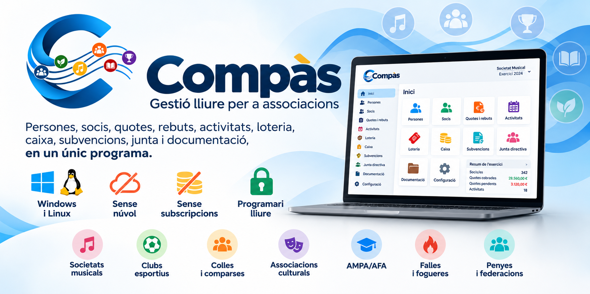
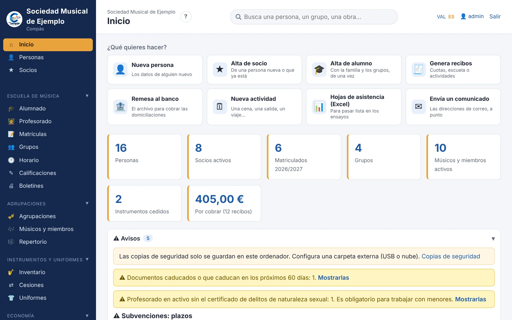
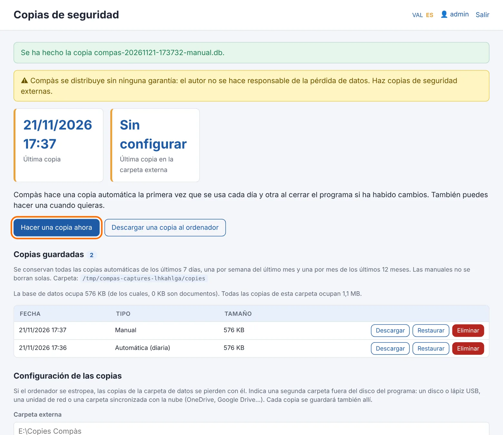
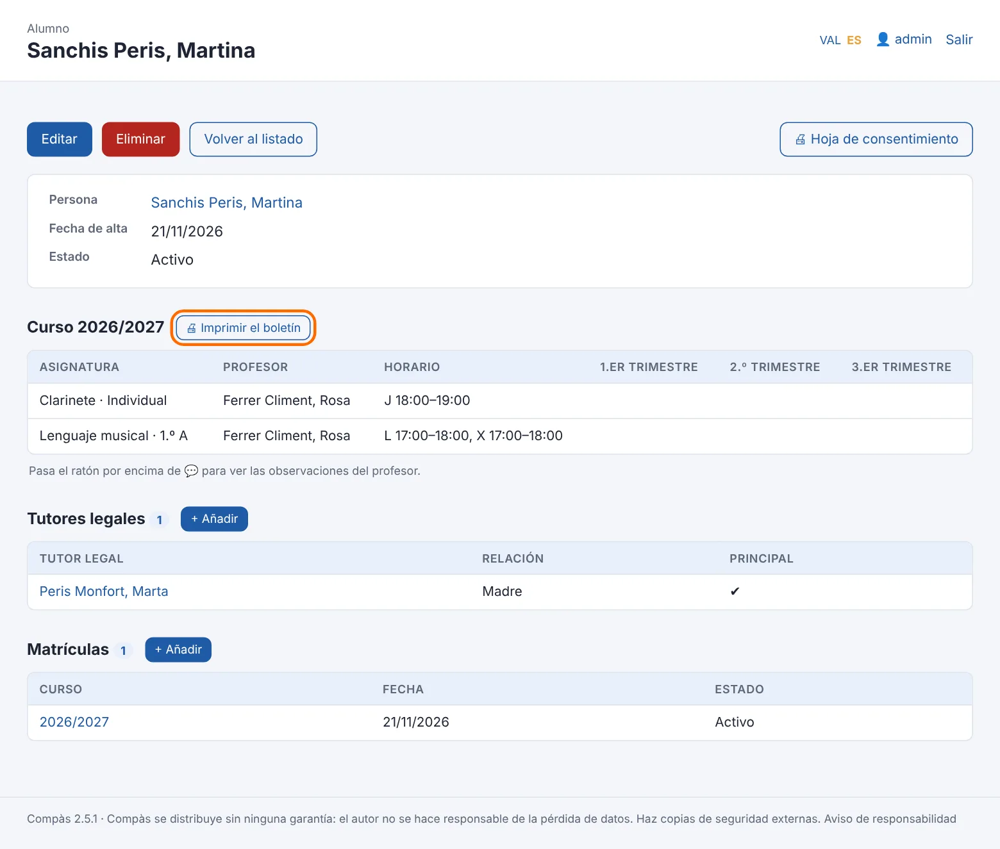
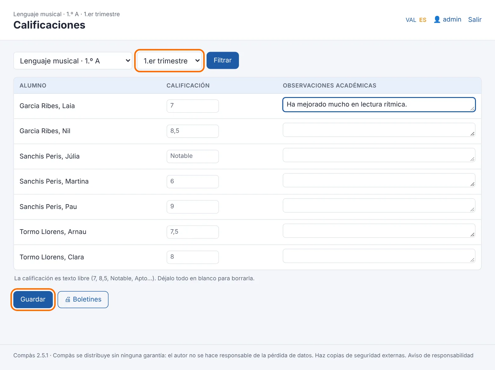

<p align="center">
  
</p>

<h1 align="center">Compàs</h1>

<p align="center"><strong>Gestión libre para asociaciones</strong></p>

<p align="center">
  Gestiona personas, socios, cuotas, recibos, actividades, economía, junta y documentación<br>
  desde un único programa, sin nube ni suscripciones.
</p>

<p align="center">
  <a href="../../releases/latest"></a>
  <a href="https://github.com/jossanmar9/compas/actions/workflows/tests.yml"></a>
  <a href="LICENSE"></a>
  
  
  
  
</p>

<p align="center"><a href="README.md">Valencià</a> · <strong>Castellano</strong></p>

<p align="center">
  <strong>🖥️ Windows y Linux · 🔒 Datos locales · 🌐 Sin Internet · 💶 Sin suscripciones · 🆓 Software libre</strong>
</p>

<p align="center">
  <a href="../../releases/latest"><strong>⬇️ Descargar Compàs</strong></a>
  &nbsp;·&nbsp;
  <a href="https://jossanmar9.github.io/compas/es/"><strong>🌐 Web</strong></a>
  &nbsp;·&nbsp;
  <a href="https://github.com/jossanmar9/compas/releases/latest/download/manual-usuario.pdf"><strong>📖 Manual</strong></a>
  &nbsp;·&nbsp;
  <a href="PRIVACITAT.md#privacidad-de-compàs"><strong>🔒 Privacidad</strong></a>
</p>



Compàs es una aplicación de escritorio para gestionar una asociación desde un ordenador con **Windows o Linux**. Está pensada para que quien lleva la secretaría o la administración de una entidad pueda utilizarla sin conocimientos informáticos especiales.

Sirve para **sociedades musicales, clubes deportivos, collas, muixerangues, collas castelleras, asociaciones culturales, AMPA/AFA, fallas, gaiatas, hogueras, comparsas, peñas y federaciones**. Al instalarlo, Compàs adapta el vocabulario, los apartados y el ejercicio al tipo de entidad.

> 🔒 **Los datos son de la asociación.** Compàs no necesita ningún servidor externo, no obliga a crear una cuenta, no tiene telemetría ni publicidad y no envía datos fuera del ordenador. La entidad controla sus datos y sus copias de seguridad.

### ⭐ ¿Te gusta Compàs?

Si Compàs te parece útil, puedes ayudar al proyecto dándole una **estrella en GitHub**. Le da visibilidad y ayuda a que más asociaciones lo descubran.

Un proyecto de **José Vicente Sanjuan**.

## Contenido

- [Para qué entidades](#para-qué-entidades)
- [Qué puedes gestionar](#qué-puedes-gestionar)
- [Por qué sin nube](#por-qué-sin-nube)
- [Capturas](#capturas)
- [Instalación](#instalación)
- [Primeros pasos](#primeros-pasos)
- [Usuarios y permisos](#usuarios-y-permisos)
- [Datos y copias de seguridad](#datos-y-copias-de-seguridad)
- [Documentación](#documentación)
- [Para desarrollar](#para-desarrollar)
- [Publicar una versión](#publicar-una-versión)
- [Colaborar](#colaborar)
- [Autoría y uso de inteligencia artificial](#autoría-y-uso-de-inteligencia-artificial)
- [Aviso de responsabilidad](#aviso-de-responsabilidad)
- [Licencia](#licencia)

## Para qué entidades

| Tipo | Cómo se llama | Apartados que se activan | Ejercicio |
|---|---|---|---|
| **Sociedad musical** | Socios, alumnado, agrupaciones, músicos | Escuela de música con notas y boletines, agrupaciones, repertorio, instrumentos, uniformes, lotería | Enero |
| **Club deportivo** | Socios, deportistas, entrenadores, equipos, jugadores | Escuela deportiva, equipos, licencias y revisiones médicas, categorías (prebenjamín… veterano), material y equipaciones | Septiembre (temporada) |
| **Muixeranga** | Miembros, secciones | Ensayos, actuaciones, actividades, material y ropa | Enero |
| **Colla castellera** | Miembros, secciones | Ensayos, actuaciones, actividades, material y ropa | Enero |
| **Colla** | Miembros de la colla, secciones | Secciones (dulzaina y tabal, gigantes…), escuela de la colla, material, ropa | Enero |
| **Asociación cultural** | Socios, participantes, talleres, grupos | Talleres y cursos, grupos (teatro, danza, coro…), material | Enero |
| **AMPA / AFA** | Familias asociadas, alumnado, monitores, comisiones | Actividades extraescolares, comisiones, ropa | Septiembre (curso) |
| **Falla** | Falleros y falleras | Cargos festeros (Fallera Mayor…), categorías infantil y mayor, lotería, ropa | Abril |
| **Gaiata** | Miembros de la comisión | Cargos festeros (Madrina…), lotería, ropa | Abril |
| **Hoguera** | Fogueres y fogueras | Cargos festeros (Belleza…), lotería, ropa | Julio |
| **Comparsa** | Comparsistas, escuadras | Escuadras, cargos festeros (capitanía…), trajes | Enero |
| **Peña** | Socios | Cuotas, lotería, actividades y salidas | Enero |
| **Federación** | Entidades federadas | Censo de entidades con representante y cuota anual | Enero |

Todos los tipos tienen personas, socios, cuotas y recibos, remesas, actividades con inscripciones, caja, junta y actas, documentos, comunicados y listados. Cada entidad puede activar o desactivar cualquier apartado, cambiar el mes en que empieza el ejercicio y cambiar de tipo cuando quiera (Administración → Configuración): los datos no se tocan.

## Qué puedes gestionar

Compàs reúne en un único programa las áreas habituales de gestión de una asociación:

| | |
|---|---|
| 👥 **Personas y socios** | Fichas, altas y bajas, tipos de socio, categorías y derechos de imagen. |
| 💳 **Cuotas y recibos** | Tarifas, cobros, devoluciones, domiciliaciones y remesas SEPA. |
| 💰 **Economía** | Libro de caja, ingresos, gastos, lotería y subvenciones. |
| 📅 **Actividades** | Actos, salidas, competiciones, talleres e inscripciones. |
| 🏛️ **Junta y actas** | Cargos, historial de juntas, convocatorias, actas y certificados. |
| 📁 **Documentos** | Estatutos, contratos, pólizas y otros documentos de la entidad. |
| 🎓 **Escuela y cursos** | Escuela de música, deportiva, talleres o extraescolares, según la entidad. |
| 👕 **Material** | Instrumentos, material, equipaciones, uniformes, trajes y préstamos. |
| 📊 **Listados y certificados** | Impresión, PDF, CSV y documentación para la gestión diaria. |
| 💾 **Copias de seguridad** | Automáticas, externas y, si se quiere, cifradas. |

Además, el tipo de entidad activa funciones específicas como **repertorio musical, licencias deportivas, cargos festeros, escuadras, comisiones o entidades federadas**.

<details>
<summary><strong>Ver todas las funciones de Compàs</strong></summary>

<br>

| Módulo | Qué hace |
|---|---|
| **Fácil de usar** | En el inicio, «¿Qué quieres hacer?» con las tareas de cada día. Buscador arriba del todo (nombre, DNI, teléfono, número de socio o NIA). Alta de alumno con la familia y los grupos en una sola pantalla. Botón **?** en cada pantalla, que abre el apartado del manual. Menú corto y plegable, fichas en pestañas y formularios con «Más datos» plegado. Se puede usar con el teclado y con lectores de pantalla (NVDA, Narrador, Orca), con contraste suficiente en modo claro y oscuro. |
| **Personas** | Registro único: cada persona se introduce una sola vez y puede ser socia, miembro de un grupo, alumna, monitora y tutora a la vez sin duplicar datos. Nombre, apellidos y fecha de nacimiento son obligatorios; DNI y teléfono, solo para los mayores de edad. Cuando un menor cumple 18 años sin esos datos, su fila se marca en amarillo. |
| **Derechos de imagen** | Si cada persona autoriza fotos y vídeos, con la fecha de la firma. Hojas de consentimiento para imprimir con los datos del alumno y del tutor/a, y listado de quién puede salir en las fotos. |
| **Socios** | Número único, que se pone solo y no se vuelve a dar cuando alguien se da de baja; tipos de socio (los define cada entidad según sus estatutos), altas y bajas. Listado por número, etiquetas para las circulares y antigüedad para las insignias de 25 y 50 años. |
| **Categorías de edad** | Prebenjamín, alevín, cadete…, o infantil y mayor: cada entidad define las suyas. La categoría de cada persona se calcula sola con la edad que cumple en el ejercicio, y hay un listado por categorías. |
| **Actividades** | Cenas, salidas, viajes, actos, competiciones o talleres con fecha, lugar, precio y plazas. Inscripciones (con las plazas de cada una), aviso cuando se llenan, lista de inscritos para imprimir y un recibo por inscripción. |
| **Licencias** | Licencias federativas de cada temporada por equipo, con el número, la caducidad y la revisión médica. Aviso en el inicio un mes antes de que caduquen. |
| **Cargos festeros** | Fallera Mayor, Belleza, Madrina, capitanía… de cada ejercicio, con el historial y el certificado. |
| **Entidades federadas** | Para federaciones: cada entidad con el CIF, el representante y la cuota anual, que se cobra con recibos. |
| **Escuela** | De música, deportiva, de talleres o de extraescolares: cursos o temporadas y evaluaciones, asignaturas, aulas, profesorado, grupos con horario, matrículas, NIA de cada alumno y tutores legales. Historial de cada alumno curso a curso. Asistente para pasar al curso siguiente sin empezar de cero. |
| **Calificaciones** | La administración introduce las notas que pasa el profesorado, por grupo y evaluación, con observaciones académicas. |
| **Boletines** | (Sociedades musicales y collas.) Boletines de notas en A4 con el logotipo y los datos de la entidad: de todo el alumnado, de un grupo o de un alumno. Se imprimen o se guardan en PDF. |
| **Horario** | El horario de toda la escuela por días, filtrable por profesor o por aula. |
| **Agrupaciones, equipos o secciones** | Banda y coral, equipos, secciones de la colla, escuadras de la comparsa o comisiones del AMPA, con los miembros, el instrumento, la posición o la tarea, y quién tiene la dirección. Hojas de asistencia en Excel por agrupación, con una fila para las fechas y casillas para marcar X. |
| **Repertorio** | (Sociedades musicales.) Catálogo del archivo musical: título, tipo de obra (los de cada sociedad), compositor, arreglista, agrupaciones que la pueden interpretar, número de archivo, ubicación física, material, estado y si está digitalizada. Búsqueda, filtros, orden, impresión, CSV e importación desde una hoja de cálculo. No guarda partituras: solo el catálogo. |
| **Instrumentos y material** | Inventario, mantenimientos y cesiones (préstamos) con aviso de devoluciones vencidas. Contrato de cesión para imprimir, con los datos del padre, la madre o el tutor/a si quien recibe el instrumento es menor. |
| **Uniformes, equipaciones o trajes** | Polos, equipaciones, trajes de la escuadra, sudaderas, mochilas… por talla: compras, ventas, préstamos y lo que queda de cada talla. |
| **Cuotas y recibos** | Tarifas de las cuotas de socio (por tipo y periodicidad), de la matrícula y de las clases. Recibos generados por periodo (según el ejercicio de la entidad): uno por socio, uno por familia en la escuela, uno por inscripción a una actividad y uno por entidad federada, con descuentos de socio, de hermanos y propios. Cobro en efectivo, transferencia o domiciliación, recibos devueltos y quién debe dinero. Recibos con el logotipo para imprimir. |
| **Remesas bancarias** | Domiciliaciones (mandatos SEPA) con el IBAN validado y la orden de domiciliación para firmar. Fichero XML de adeudos directos SEPA (pain.008) para subir a la banca electrónica. |
| **Lotería** | Sorteos con los talonarios que se han hecho y las papeletas que se lleva cada persona (o que se venden en la caja), participaciones para imprimir y liquidación con forma de pago (efectivo, Bizum, transferencia o las que se añadan). Resumen claro: papeletas en la caja, dinero que deberíamos tener y lo que hay que pagar a la administración. |
| **Libro de caja** | Ingresos y gastos con saldo, separados por banco y caja. Los recibos cobrados, las remesas, la lotería y los cobros de subvenciones entran solos; el resto se apunta a mano, con el proveedor, el NIF y la factura. Categorías propias de cada entidad, resumen por categorías para la asamblea y exportación a CSV. |
| **Subvenciones** | Cada subvención con el organismo, el estado, los plazos y los importes. Cómo se justifica cada una, con casillas que se marcan a medida que se hace: los organismos y los requisitos los edita cada entidad, y al elegir el organismo se marcan los que pide normalmente. Cobros, gastos del libro de caja imputados (sin pasarse del importe de cada factura), relación de gastos para la justificación en PDF o CSV, avisos de plazos y copia para el año siguiente. |
| **Junta directiva y actas** | Cargos con fecha de inicio y de fin y el historial de todas las juntas. Aviso cuando se acerca la renovación según los años de mandato de los estatutos (y recordatorio del Registro de Asociaciones). Libro de actas de juntas y asambleas: convocatoria, acta y certificado de un acuerdo para imprimir. Los certificados cogen solos quién firma y el visto bueno. |
| **Documentos de la entidad** | Estatutos, reglamento de régimen interno, actas firmadas, inscripción en el registro, CIF, pólizas, contratos… guardados dentro de Compàs y, por tanto, en las copias de seguridad. Fecha de caducidad con aviso antes de que venzan. Modelo de registro de actividades de tratamiento (RGPD) generado con los datos reales. |
| **Profesorado y monitores** | Certificado de delitos de naturaleza sexual de cada profesor/a o monitor/a, con aviso si falta alguno. |
| **Comunicados** | Listas de correo (socios, junta, profesorado, familias, un grupo o una agrupación) para copiar en CCO en el correo de la entidad, y registro de qué se ha enviado, cuándo y a quién. Compàs no envía nada. |
| **Hoja de alta de socio** | Modelo estándar para imprimir, con los tipos de socio, las cuotas y la orden de domiciliación, y textos personalizables. |
| **Listados y certificados** | Alumnos de un grupo con los teléfonos de los tutores, socios por número, miembros por instrumento o posición, personas por categoría, licencias por equipo, cargos festeros, censo de entidades federadas, datos para la memoria anual y las subvenciones. Certificados de socio, de matrícula, de agrupación y de cargo festero con el logotipo. Todo se imprime, se guarda en PDF o se exporta a CSV. |
| **Importación** | Trae desde Excel, LibreOffice (.ods) o CSV las personas, los socios (con el número o, si no tienen, el siguiente libre), el alumnado (con el NIA y los tutores) y el repertorio, con revisión previa y sin duplicar a quien ya está. |
| **A medida** | El tipo de entidad pone los nombres y los apartados; después, cada entidad activa o desactiva los módulos que no usa (escuela, lotería, caja…) y los avisos del inicio que no quiere ver. Los datos no se borran. |
| **Administración** | Cuentas individuales con roles de administrador/a, usuario/a de gestión y consultor/a, configuración y logotipo, registro de actividad y copias de seguridad (las externas, cifradas con contraseña si se quiere). |

Todo el programa está en **valenciano y castellano**, y cada usuario puede elegir su idioma.

Compàs hace **recibos**, no facturas: las facturas deben cumplir el reglamento de los sistemas de facturación (Verifactu) y se tienen que hacer con un programa preparado para ello.

</details>

## Por qué sin nube

| | Compàs | Plataformas en línea |
|---|---|---|
| Dónde están los datos | En el ordenador de la entidad | En el servidor de la empresa |
| Quién los puede ver | Solo quien usa el ordenador | La empresa y sus proveedores |
| Recogida de datos y analítica | Ninguna | Habitual (uso, dispositivos, cookies) |
| Funciona sin Internet | Sí | No |
| Coste | Gratuito y libre (AGPL) | Suscripción anual |
| Si el proyecto desaparece | El programa y los datos siguen | Depende de que el servicio continúe |

Las plataformas en línea tienen ventajas reales (una app para el móvil de los socios, acceso desde cualquier sitio), pero los datos de socios, familias y menores pasan a manos de un tercero. Compàs elige el otro camino: menos comodidad y ningún dato fuera.

## Capturas

| | |
|---|---|
|  |  |
| **Inicio:** «¿Qué quieres hacer?» con las tareas de cada día, el buscador arriba y los avisos. | **Copias de seguridad:** automáticas, manuales y externas. |
|  |  |
| Ejemplo de una ficha con información relacionada. | Ejemplo de un módulo específico de escuela. |

> Las capturas de escuela son solo un ejemplo de los módulos específicos. Compàs adapta los apartados a sociedades musicales, clubes deportivos, asociaciones culturales, AMPA/AFA, entidades festeras, peñas y federaciones.

Hay más de 60 capturas, paso a paso, en el [manual de usuario](docs/manual-usuario.md).

## Instalación

**Requisitos:** Windows 10 u 11 de 64 bits, o Linux con PHP 8.1 o posterior, y unos 100 MB de disco. No hace falta Internet ni servidor. En Windows tampoco hace falta instalar PHP ni bases de datos: todo va dentro.

1. Descarga la [última versión](../../releases/latest):
   - **`Compas-X.Y.Z-installador.exe`**: el instalador recomendado para Windows. No pide permisos de administrador; se instala en `%LOCALAPPDATA%\Programs\Compas` y crea el acceso en el menú Inicio y en el escritorio.
   - **`Compas-X.Y.Z-portable.zip`**: la misma versión sin instalar. Descomprímela donde quieras (también en un lápiz USB) y abre `Compas.exe`.
   - **`compas_X.Y.Z_all.deb`**: para Debian, Ubuntu, Linux Mint y similares. Se instala con `sudo apt install ./compas_X.Y.Z_all.deb`, que trae también PHP.
   - **`Compas-X.Y.Z-linux.tar.gz`**: para otros Linux. Descomprímelo y ejecuta `./installa.sh` (hace falta PHP 8.1 o posterior con `pdo_sqlite` y `mbstring`).
2. Compàs **todavía no tiene un certificado de firma de código**, por lo que Windows SmartScreen puede mostrar un aviso al abrir el instalador: pulsa **Más información → Ejecutar de todas formas**. El código fuente es público y los paquetes se construyen automáticamente con GitHub Actions. En ordenadores con el **Control inteligente de aplicaciones** de Windows 11 activado, Windows también puede bloquear la versión portable; consulta la [guía de instalación](docs/guia-instalacion.md#si-windows-no-te-deja-abrirlo).
3. Abre **Compàs**. Se abre en su propia ventana, sin ningún navegador. Al cerrarla, hace una copia de seguridad y se detiene.

**Actualizar:** ejecuta el instalador de la versión nueva con Compàs cerrado. Los datos y la configuración se conservan. Al desinstalar, la carpeta de datos no se borra.

Más detalles y solución de problemas en la [guía de instalación](docs/guia-instalacion.md).

## Primeros pasos

La primera vez, Compàs pide el nombre y el **tipo de entidad** y crea la cuenta de administrador (y, si quieres, la de usuario/a). También puede cargar **datos de ejemplo** para probarlo: unas pocas personas o una **entidad grande** del tipo elegido, con cientos de personas y miles de recibos.

Orden recomendado para empezar:

1. **Configuración**: datos de la entidad y logotipo (sale en los recibos, certificados y boletines); comprueba el mes en que empieza el ejercicio.
2. **Módulos y avisos** (desde Configuración): activa o desactiva los apartados que vayas a usar.
3. **Copias de seguridad**: elige una carpeta externa (USB o nube).
4. **Tipos de socio**, **tarifas** (desde Resumen económico) y, si las usáis, **categorías** de edad.
5. **Personas** (o impórtalas desde una hoja de cálculo) y, desde la ficha de cada una, sus funciones con los botones de arriba: hacerla socia, añadirla a un equipo o sección, darla de alta como alumno… El alumnado nuevo, con la familia y los grupos, se da de alta de una vez con **Alta de alumno**.
6. Si hay escuela: en **Grupos**, el curso o la temporada, las asignaturas o actividades y las aulas; después, los grupos con el horario y las matrículas o inscripciones.

El [manual de usuario](docs/manual-usuario.md) explica cada proceso paso a paso con capturas: alta de socios, alumnos, miembros y profesorado, matrículas, actividades e inscripciones, licencias, cargos festeros, recibos, bajas, notas, boletines, préstamos y copias.

## Usuarios y permisos

Compàs funciona en un solo ordenador, pero puede haber una cuenta por persona. Hay tres roles: **administrador/a**, **usuario/a de gestión** y **consultor/a**. El consultor tiene consulta limitada de personas, socios, escuela, agrupaciones e instrumentos, sin economía, importes ni IBAN, exportaciones, documentos descargables ni copias. Puede cambiar su propia contraseña y el idioma.

Los nombres de cuenta son únicos sin distinguir mayúsculas: de 3 a 40 caracteres ASCII (a–z, números, punto, guion y guion bajo), sin tildes ni diéresis. Al actualizar, los nombres antiguos incompatibles se adaptan y el administrador ve los cambios en Usuarios. Las contraseñas se conservan.

| Qué se puede hacer | Administrador/a | Usuario/a | Consultor/a |
|---|:---:|:---:|:---:|
| Personas, socios y tipos de socio | ✔ | ✔ | Consulta parcial |
| Escuela: cursos, grupos, matrículas, notas y boletines | ✔ | ✔ | Consulta parcial |
| Agrupaciones o equipos, repertorio, instrumentos y uniformes | ✔ | ✔ | Consulta parcial |
| Actividades, licencias, cargos festeros y entidades federadas | ✔ | ✔ | — |
| Cuotas, recibos, domiciliaciones, remesas, lotería y subvenciones | ✔ | ✔ | — |
| Libro de caja | ✔ | ✔ | — |
| Junta, actas, documentos y comunicados | ✔ | ✔ | — |
| Listados, certificados e importación de hojas de cálculo | ✔ | ✔ | — |
| Hacer y descargar copias de seguridad | ✔ | ✔ | — |
| Cambiar la propia contraseña | ✔ | ✔ | ✔ |
| Configuración de la entidad, tipo, logotipo, módulos y avisos | ✔ | — | — |
| Datos bancarios y descuentos de la escuela | ✔ | — | — |
| Crear y gestionar las cuentas | ✔ | — | — |
| Registro de actividad | ✔ | — | — |
| Restaurar y eliminar copias, carpeta externa y cifrado | ✔ | — | — |
| Recuperar el acceso con el código de recuperación | ✔ | — | — |

Las contraseñas se guardan con hash, hay un bloqueo temporal después de cinco intentos fallidos y el **registro de actividad** anota quién ha creado, modificado o eliminado cada cosa.

Si el administrador/a olvida la contraseña, puede cambiarla desde la pantalla de entrada con el **código de recuperación** que se muestra en la configuración inicial (y que se puede volver a generar en **Usuarios**). Si se ha perdido el código, hay una alternativa con un fichero en la carpeta de datos, que solo puede hacer quien tiene acceso al ordenador.

## Datos y copias de seguridad

- Todos los datos están en un solo fichero: `data\compas.db`, dentro de la carpeta del programa.
- Compàs **solo escucha en el mismo ordenador** (`127.0.0.1`): no es accesible desde la red ni desde Internet, y no envía ningún dato fuera: ni estadísticas, ni informes de errores, ni comprobaciones de actualizaciones. Consulta la [declaración de privacidad](PRIVACITAT.md#privacidad-de-compàs).
- **Copias automáticas:** la primera vez que se usa cada día y al cerrar el programa si ha habido cambios. Se guardan todas las de los últimos 7 días, una por semana del último mes y una por mes del último año (configurable): unas veinte copias que llegan a un año atrás.
- **Carpeta externa:** cada copia se guarda también en un USB o en una carpeta sincronizada con la nube. El inicio avisa si no está configurada o si hace más de 7 días que no se guarda nada en ella.
- **Copias cifradas:** las de la carpeta externa se pueden cifrar con contraseña, para que un USB perdido no exponga datos de menores.
- **Restaurar** una copia se hace con un clic. Antes, Compàs guarda una copia de los datos actuales, de manera que siempre se puede volver atrás.
- Los **documentos** de la entidad (PDF, imágenes, hojas de cálculo…) se guardan dentro de `compas.db`, de manera que entran en todas las copias (y, si se quiere, cifrados). Las copias crecen tanto como los documentos que se ponen.
- Nada se elimina si tiene historial: las bajas se marcan con estado y fecha de baja.

> Los datos contienen información personal, también de menores. La entidad es la responsable de tratarlos de acuerdo con la normativa de protección de datos.

## Documentación

| Documento | Valencià | Castellano |
|---|---|---|
| Manual de usuario, paso a paso con capturas | [MD](docs/manual-usuari.md) · [PDF](https://github.com/jossanmar9/compas/releases/latest/download/manual-usuari.pdf) | [MD](docs/manual-usuario.md) · [PDF](https://github.com/jossanmar9/compas/releases/latest/download/manual-usuario.pdf) |
| Manual de administración: configuración, cuentas, copias y actualizaciones | [MD](docs/manual-administracio.md) · [PDF](https://github.com/jossanmar9/compas/releases/latest/download/manual-administracio.pdf) | [MD](docs/manual-administracion.md) · [PDF](https://github.com/jossanmar9/compas/releases/latest/download/manual-administracion.pdf) |
| Guía de instalación | [MD](docs/guia-installacio.md) · [PDF](https://github.com/jossanmar9/compas/releases/latest/download/guia-installacio.pdf) | [MD](docs/guia-instalacion.md) · [PDF](https://github.com/jossanmar9/compas/releases/latest/download/guia-instalacion.pdf) |
| Declaración de privacidad | [PRIVACITAT](PRIVACITAT.md) | [PRIVACIDAD](PRIVACITAT.md#privacidad-de-compàs) |
| Arquitectura y detalles técnicos | [MD](docs/arquitectura.md) | [MD](docs/arquitectura.es.md) |
| Pruebas automáticas | [MD](tests/README.md) | [MD](tests/README.es.md) |
| Registro de cambios de cada versión | [CHANGELOG](CHANGELOG.md) | Resumen en castellano en cada versión |

Los manuales también se pueden consultar dentro del programa, en el menú **Ayuda** (el de administración, solo el administrador/a).

## Para desarrollar

### Tecnología

- **PHP 8** sin dependencias ni frameworks, servido por el servidor integrado de PHP.
- **SQLite** a través de PDO, con consultas preparadas (preparado para pasar a MariaDB/MySQL si hiciera falta).
- **HTML, CSS y JavaScript** propios, sin bibliotecas externas.
- **Tipos de entidad** en `src/tipus.php` (apartados, ejercicio, categorías y cargos de cada tipo) y vocabulario de cada tipo en `src/lang/vocabulari.php`.
- **Lanzador para Windows** en C# (.NET Framework 4, incluido en Windows), con la ventana de Compàs hecha con el componente **WebView2** de Windows (`launcher/Visor.cs`).
- **Lanzador para Linux** en Bash, con la ventana de Compàs hecha con **WebKitGTK** (`launcher/linux/compas-visor.py`).
- **Instalador** con Inno Setup; **PHP portable** descargado de windows.php.net en cada construcción.

### Estructura

```
app/          punto de entrada (index.php) y recursos web (CSS, JS, iconos)
src/          lógica: base de datos, permisos, entidades, pantallas y traducciones
  lang/       textos en valenciano (ca.php) y castellano (es.php)
  pages/      pantallas específicas (inicio, buscador, escuela, boletines, actividades, copias…)
  exemple/    datos de ejemplo de la entidad grande de cada tipo
launcher/     lanzador de Windows (Compas.cs), php.ini, script del instalador y, en linux/, el lanzador y el instalador para Linux
docs/         manuales, guías y capturas (imatges/); los PDF se hacen al publicar cada versión
eines/        generación de capturas, PDF, web y entidad grande de prueba
tests/        pruebas automáticas, de integración y de rendimiento
.github/      construcción del instalador (publica.yml) y de la web (web.yml)
```

La mayoría de pantallas se generan a partir de la definición declarativa de `src/entitats.php` (campos, relaciones y validaciones). Para añadir una entidad sencilla: crea la tabla en `src/schema.sql`, defínela en `src/entitats.php`, añádela al menú (`src/disseny.php`) y pon sus textos en `src/lang/`. Más detalles en la [arquitectura](docs/arquitectura.es.md).

### Ejecutarlo sin Windows

Con PHP 8.1 o posterior (extensiones `pdo_sqlite` y `mbstring`):

```
php -S 127.0.0.1:8740 -t app app/index.php
```

y abre `http://127.0.0.1:8740`. Los datos se guardan en `data/` o en la carpeta que indique la variable de entorno `COMPAS_DADES`.

### Herramientas

| Orden | Qué hace |
|---|---|
| `python3 eines/captures.py [números]` | Vuelve a hacer las capturas de los manuales (`docs/imatges/ca` y `es`, en WebP) recorriendo cada proceso con datos de ejemplo. Con números (`78 81-82`, `web`) solo hace esas. Una captura solo se vuelve a guardar si la pantalla ha cambiado de verdad (no por la fecha del día), para que el repositorio no crezca en cada versión; `--totes` las guarda igualmente (hay que hacerlo cuando cambian los datos de ejemplo o un texto pequeño, que no llegan a la proporción de píxeles que se considera un cambio). Requiere Pillow y Playwright. |
| `bash eines/pdf.sh` | Hace los manuales y las guías en PDF (`docs/pdf/`) con Chrome o Chromium. No se guardan en el repositorio: los hace GitHub Actions al publicar cada versión y la web. |
| `COMPAS_DADES=carpeta php eines/entitat-gran.php [fecha]` | Llena una instalación nueva (configurada sin datos de ejemplo) con una entidad grande inventada del tipo elegido, con nombre y dirección inventados (una sociedad musical tiene 341 socios, 278 alumnos, 5 agrupaciones, 653 obras y unos 5.000 recibos). Con una fecha, los datos se hacen como si hoy fuera ese día; las capturas de la web usan el 22-10-2026. Desde el programa se hace lo mismo eligiendo «Una entidad grande» en la configuración inicial. |
| `php eines/web.php _site` | Genera la web de presentación en valenciano y castellano. |
| `php tests/run.php` | Pruebas automáticas (IBAN, SEPA, copias cifradas, rotación de copias, nombres de cuenta y apóstrofos). Consulta [tests/README.es.md](tests/README.es.md). |
| `python3 tests/integracio.py` | Pruebas de integración: arrancan Compàs con datos de ejemplo y recorren todas las funciones, en valenciano y castellano; la batería `tipus` instala cada tipo de entidad y recorre todas sus pantallas, `entitat_gran` hace lo mismo con la entidad grande de cada tipo y mira que ninguna pantalla tarde demasiado, e `interficie` prueba el menú, el buscador, el inicio, las fichas y el alta de alumno. |
| `php tests/performance.php` | Prueba de rendimiento de SQLite con 100.000 recibos. |

## Publicar una versión

1. Actualiza `COMPAS_VERSIO` en `src/bootstrap.php`.
2. En el [CHANGELOG](CHANGELOG.md), apunta los cambios en un apartado nuevo arriba con el número y la fecha de la versión, por ejemplo `## [1.2.2] - 2026-11-05`. Mientras trabajas, puedes titularlo `## [Pendent de publicar]` y cambiarle el nombre justo antes de publicar.
3. Sube los cambios y, **después** del commit que cambia el número, crea una etiqueta en minúscula (si la etiqueta se hace antes, la versión publicada dice el número antiguo):
   ```
   git pull
   git tag v1.2.2
   git push origin v1.2.2
   ```
4. GitHub Actions (`publica.yml`) comprueba el código, descarga PHP portable, compila el lanzador, genera los manuales en PDF, construye el instalador y el zip portable para Windows y los paquetes .deb y .tar.gz para Linux, los prueba, y lo publica todo en una *release*. Las notas de la *release* se toman del apartado de esa versión en el CHANGELOG.

La web se vuelve a publicar sola con cada cambio en `main` (`web.yml`).

Las versiones siguen el formato `MAYOR.MENOR.CORRECCIÓN`: `v1.0.1` para correcciones y `v1.1.0` para funciones nuevas.

## Colaborar

Consulta la [guía de contribución](CONTRIBUTING.md#castellano) para probar Compàs, ejecutar las pruebas y enviar una PR. Si has encontrado una posible vulnerabilidad, comunícala **en privado** siguiendo la [política de seguridad](SECURITY.md#seguridad-de-compàs).

### ⭐ Da visibilidad al proyecto

Si usas Compàs, te interesa la idea o quieres apoyar el software libre para asociaciones, una **estrella en el repositorio** ayuda a que otras personas lo descubran.

### 🐛 Errores y propuestas

¿Has encontrado un error o tienes una propuesta? Abre una [incidencia](../../issues/new/choose) y elige **He encontrado un error**, **Tengo una propuesta** o **Nuevo tipo de entidad**: un formulario te guía paso a paso. Puedes escribir en castellano. No pongas datos reales de personas en el texto ni en las capturas. Las propuestas de mejora para la gestión real de cada tipo de entidad son especialmente bienvenidas.

### 🧪 Calidad y rendimiento

Compàs tiene pruebas automáticas y de integración que recorren las funciones principales en valenciano y castellano y comprueban los distintos tipos de entidad. También incluye una prueba específica de rendimiento de SQLite con **100.000 recibos**.

## Autoría y uso de inteligencia artificial

Compàs es un proyecto de **José Vicente Sanjuan**, que ha definido sus funciones, ha revisado su funcionamiento y lo mantiene.

Este proyecto se ha desarrollado con la ayuda de una inteligencia artificial (Claude, de Anthropic), que ha generado buena parte del código y de la documentación a partir de las especificaciones y las revisiones del proyecto.

## Aviso de responsabilidad

Compàs es software libre y se distribuye tal cual, sin ninguna garantía (licencia AGPL-3.0). El autor no se hace responsable de la pérdida de datos ni de ningún otro daño, directo o indirecto, que pueda derivarse del uso del programa, de un error, de una actualización o de una configuración incorrecta. Cada entidad es responsable de sus datos y de hacer copias de seguridad periódicas en un lugar externo (USB o nube).

En la configuración inicial, Compàs pide aceptar este aviso; las instalaciones anteriores a la versión 1.13.1 lo muestran una vez en el inicio.

## Licencia

Copyright © 2026 José Vicente Sanjuan.

Compàs es software libre distribuido bajo la licencia **GNU Affero General Public License v3 o posterior (AGPL-3.0-or-later)**. Lo puedes usar, estudiar, modificar y redistribuir de acuerdo con los términos de la licencia.

El texto válido de la licencia es el original en inglés ([LICENSE](LICENSE)). En [LLICENCIA.md](LLICENCIA.md#licencia-de-compàs-resumen) hay un resumen orientativo en valenciano y castellano.

Si se modifica Compàs y se ofrece a los usuarios a través de una red, la licencia AGPL exige que esos usuarios tengan acceso al código fuente de la versión modificada.

Las versiones para Windows incluyen [PHP](https://www.php.net/license/), distribuido bajo la PHP License, [SQLite](https://www.sqlite.org/copyright.html), de dominio público, y las bibliotecas del [SDK de Microsoft WebView2](https://www.nuget.org/packages/Microsoft.Web.WebView2), distribuidas bajo la licencia BSD (`WebView2-LICENSE.txt`).
