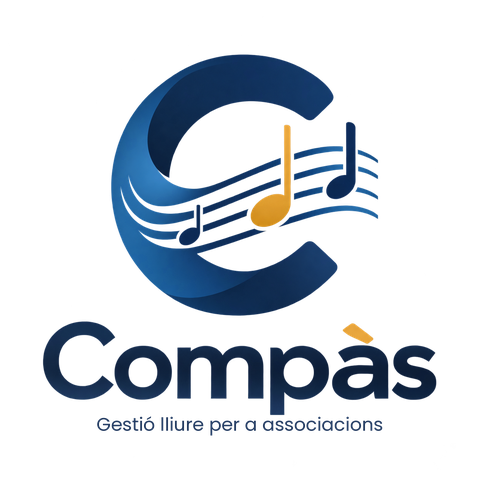
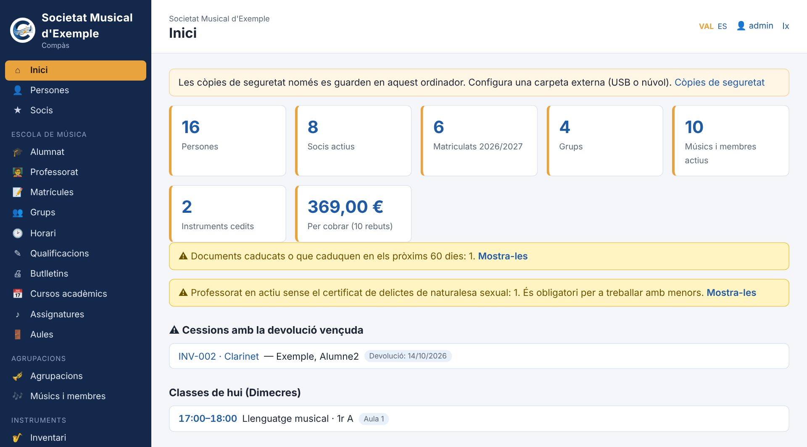
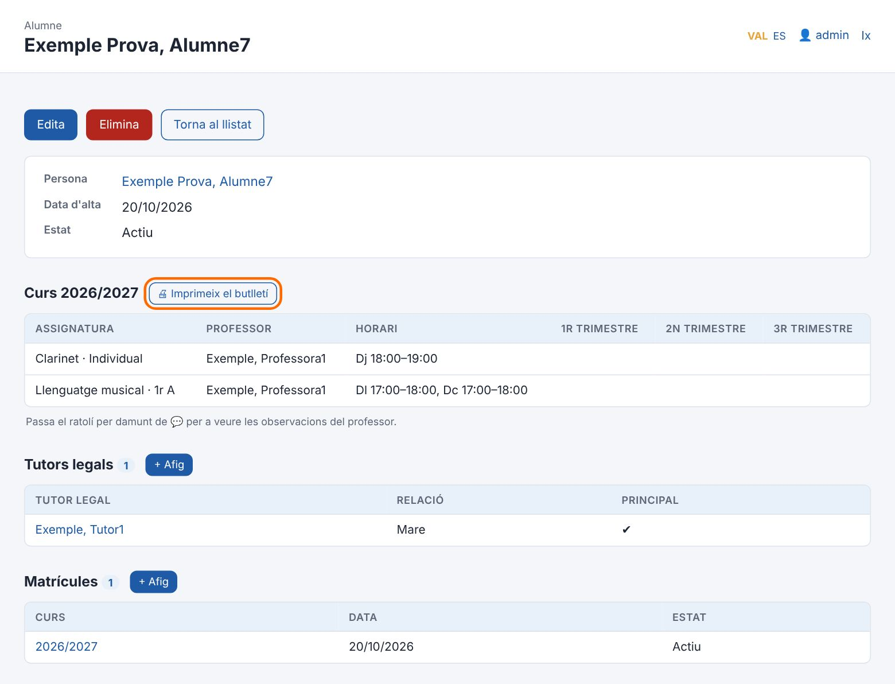
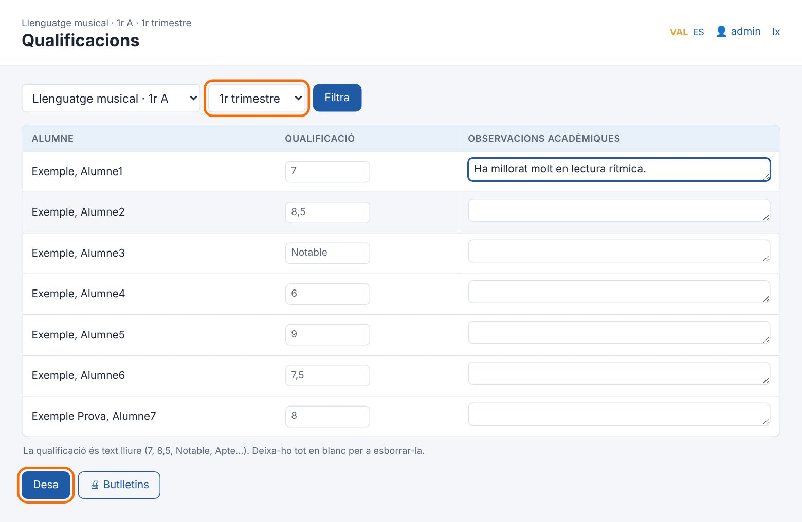
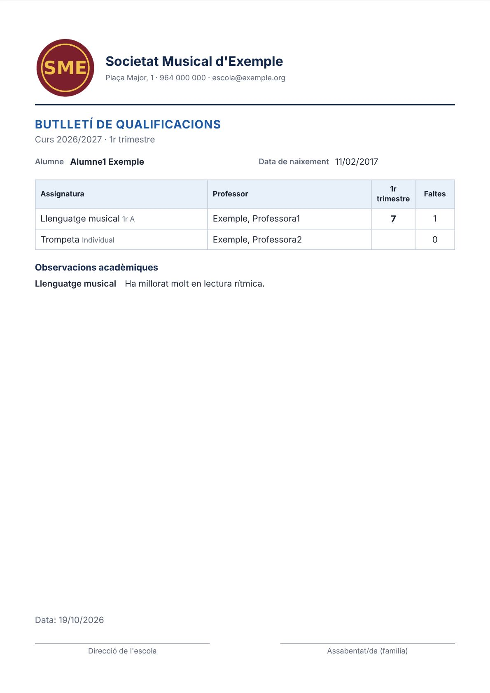
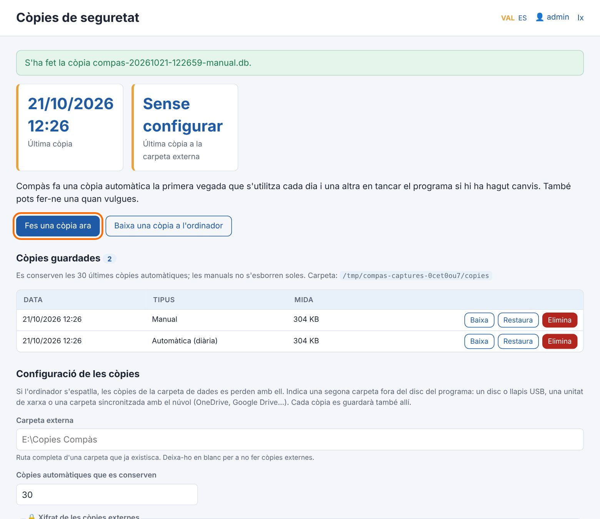

<p align="center"></p>

<p align="center">
  <a href="../../releases/latest"></a>
  <a href="LICENSE"></a>
  
  
</p>

# Compàs

**Gestió lliure per a societats musicals.** Compàs és un programa per a un ordinador amb Windows o Linux que porta en un sol lloc les persones, els socis, l'escola de música, les notes, els butlletins, les agrupacions, els instruments, les quotes, els rebuts, la loteria, la caixa, la junta directiva i la documentació d'una societat musical.

Està pensat per a qui porta la secretaria i l'escola de música d'una banda, encara que no siga informàtic: s'instal·la com qualsevol altre programa, funciona sense Internet i les dades es queden a l'ordinador de la societat.

> 🔒 **La privacitat és el centre del projecte.** A diferència de les plataformes en línia per a societats musicals, Compàs **no té servidor, no demana registrar-se ni pagar una subscripció i no recull cap dada**: ni de la societat, ni dels socis, ni de l'alumnat menor d'edat. Tot es queda en un fitxer de l'ordinador de la societat, que en controla les còpies. No hi ha telemetria, ni publicitat, ni comptes en el núvol de ningú.

*Compàs es un programa libre para gestionar una sociedad musical desde un ordenador con Windows o Linux: personas, socios, escuela de música, notas, boletines, agrupaciones, instrumentos, cuotas, recibos, lotería, caja, junta directiva y documentación. Funciona en valenciano y castellano, sin Internet, sin servidores y sin recoger ningún dato. [Manual de usuario en castellano](docs/pdf/manual-usuario.pdf).*

Un projecte de **José Vicente Sanjuan**.

🌐 **Web:** [jossanmar9.github.io/compas](https://jossanmar9.github.io/compas/) · ⬇️ **Descàrrega:** [última versió](../../releases/latest) · 📖 **Manual:** [PDF](docs/pdf/manual-usuari.pdf) · 🔒 [Privacitat](PRIVACITAT.md)



## Contingut

- [Què fa](#què-fa)
- [Per què sense núvol](#per-què-sense-núvol)
- [Captures](#captures)
- [Instal·lació](#installació)
- [Primers passos](#primers-passos)
- [Usuaris i permisos](#usuaris-i-permisos)
- [Dades i còpies de seguretat](#dades-i-còpies-de-seguretat)
- [Documentació](#documentació)
- [Per a desenvolupar](#per-a-desenvolupar)
- [Publicar una versió](#publicar-una-versió)
- [Pròximes versions](#pròximes-versions)
- [Col·laborar](#col·laborar)
- [Autoria i ús d'intel·ligència artificial](#autoria-i-ús-dintel·ligència-artificial)
- [Llicència](#llicència)

## Què fa

| Mòdul | Què fa |
|---|---|
| **Persones** | Registre únic: cada persona s'introdueix una sola vegada i pot ser sòcia, música, alumna, professora i tutora alhora sense duplicar dades. Nom, cognoms i data de naixement són obligatoris; DNI i telèfon, només per als majors d'edat. Quan un menor fa 18 anys sense eixes dades, la seua fila es marca en groc. |
| **Drets d'imatge** | Si cada persona autoritza fotos i vídeos, amb la data de la signatura. Fulls de consentiment per a imprimir amb les dades de l'alumne i del tutor/a, i llistat de qui pot eixir en les fotos. |
| **Socis** | Número, tipus (ordinari, protector, d'honor, juvenil), altes i baixes. Llistat per número, etiquetes per a les circulars i antiguitat per a les insígnies de 25 i 50 anys. |
| **Escola de música** | Cursos acadèmics i avaluacions, assignatures, aules, professorat, grups amb horari, matrícules i tutors legals. Historial de cada alumne curs a curs. Assistent per a passar al curs següent sense començar de zero. |
| **Qualificacions** | Administració introdueix les notes que passa el professorat, per grup i avaluació, amb observacions acadèmiques. |
| **Butlletins** | Butlletins de notes en A4 amb el logotip i les dades de la societat: de tot l'alumnat, d'un grup o d'un alumne. S'imprimeixen o es guarden en PDF. |
| **Horari** | L'horari de tota l'escola per dies, filtrable per professor o per aula. |
| **Agrupacions** | Banda, banda juvenil, coral, orquestra, cambra… amb els membres, l'instrument o veu i la funció (direcció titular, assistent…). |
| **Instruments** | Inventari, manteniments i cessions (préstecs) amb avís de devolucions vençudes. |
| **Quotes i rebuts** | Tarifes de les quotes de soci (per tipus i periodicitat), de la matrícula i de les classes. Rebuts generats per període: un per soci i un per família a l'escola, amb descomptes de soci, de germans i propis. Cobrament en efectiu, transferència o domiciliació, rebuts retornats i qui deu diners. Rebuts amb el logotip per a imprimir. |
| **Remeses bancàries** | Domiciliacions (mandats SEPA) amb l'IBAN validat i l'ordre de domiciliació per a signar. Fitxer XML d'adeutaments directes SEPA (pain.008) per a pujar a la banca electrònica. |
| **Loteria** | Sorteigs, talonaris repartits a cada persona, participacions per a imprimir i liquidació: venudes, tornades, diners lliurats i el que queda per a la societat. |
| **Llibre de caixa** | Ingressos i despeses amb saldo, separats per banc i caixa. Els rebuts cobrats, les remeses i la loteria hi entren sols; la resta s'apunta a mà. Resum per categories per a l'assemblea i exportació a CSV. |
| **Junta directiva i actes** | Càrrecs amb data d'inici i de fi i l'historial de totes les juntes. Avís quan s'acosta la renovació segons els anys de mandat dels estatuts (i recordatori del Registre d'Associacions). Llibre d'actes de juntes i assemblees: convocatòria, acta i certificat d'un acord per a imprimir. Els certificats agafen sols qui signa i el vistiplau. |
| **Documents de la societat** | Estatuts, reglament de règim intern, actes signades, inscripció al registre, CIF, pòlisses, contractes… guardats dins de Compàs i, per tant, en les còpies de seguretat. Data de caducitat amb avís abans que vencen. Model de registre d'activitats de tractament (RGPD) generat amb les dades reals. |
| **Professorat** | Certificat de delictes de naturalesa sexual de cada professor/a, amb avís si en falta algun. |
| **Comunicats** | Llistes de correu (socis, junta, professorat, famílies, un grup o una agrupació) per a copiar en CCO al correu de la societat, i registre de què s'ha enviat, quan i a qui. Compàs no envia res. |
| **Full d'alta de soci** | Model estàndard per a imprimir, amb els tipus de soci, les quotes i l'ordre de domiciliació, i textos personalitzables. |
| **Llistats i certificats** | Alumnes d'un grup amb els telèfons dels tutors, socis per número, músics per instrument, dades per a la memòria anual i les subvencions. Certificats de soci, de matrícula i d'agrupació amb el logotip. Tot s'imprimeix, es guarda en PDF o s'exporta a CSV. |
| **Importació** | Porta des d'Excel o CSV les persones, els socis i l'alumnat (amb els tutors), amb revisió prèvia i sense duplicar qui ja hi és. |
| **Administració** | Dos comptes (administrador/a i administratiu/va), configuració i logotip, registre d'activitat i còpies de seguretat (les externes, xifrades amb contrasenya si es vol). |

Tot el programa està en **valencià i castellà**, i cada usuari pot triar el seu idioma.

Compàs fa **rebuts**, no factures: les factures han de complir el reglament dels sistemes de facturació (Verifactu) i s'han de fer amb un programa preparat per a això.

## Per què sense núvol

| | Compàs | Plataformes en línia |
|---|---|---|
| On són les dades | A l'ordinador de la societat | Al servidor de l'empresa |
| Qui les pot veure | Només qui fa servir l'ordinador | L'empresa i els seus proveïdors |
| Recollida de dades i analítica | Cap | Habitual (ús, dispositius, cookies) |
| Funciona sense Internet | Sí | No |
| Cost | Gratuït i lliure (AGPL) | Subscripció anual |
| Si el projecte desapareix | El programa i les dades continuen | Depens que el servei continue |

Les plataformes en línia tenen avantatges reals (una app per al mòbil dels músics, accés des de qualsevol lloc), però les dades de socis, famílies i menors passen a mans d'un tercer. Compàs tria l'altre camí: menys comoditat i cap dada fora.

## Captures

| | |
|---|---|
|  |  |
| La fitxa d'un alumne: grups, horari, notes i tutors legals. | Les notes d'un grup, amb les observacions del professor. |
|  |  |
| Un butlletí de notes preparat per a imprimir. | Les còpies de seguretat: automàtiques, manuals i externes. |

Hi ha més de 60 captures, pas a pas, al [manual d'usuari](docs/manual-usuari.md).

## Instal·lació

**Requisits:** Windows 10 o 11 de 64 bits, o Linux amb PHP 8.1 o posterior, i uns 100 MB de disc. No cal Internet ni servidor. A Windows tampoc no cal instal·lar PHP ni bases de dades: tot va dins.

1. Baixa l'[última versió](../../releases/latest):
   - **`Compas-X.Y.Z-installador.exe`**: l'instal·lador recomanat per a Windows. No demana permisos d'administrador; s'instal·la a `%LOCALAPPDATA%\Programs\Compas` i crea l'accés al menú Inici i a l'escriptori.
   - **`Compas-X.Y.Z-portable.zip`**: la mateixa versió sense instal·lar. Descomprimeix-la on vulgues (també en un llapis USB) i obri `Compas.exe`.
   - **`compas_X.Y.Z_all.deb`**: per a Debian, Ubuntu, Linux Mint i semblants. S'instal·la amb `sudo apt install ./compas_X.Y.Z_all.deb`, que porta també PHP.
   - **`Compas-X.Y.Z-linux.tar.gz`**: per a altres Linux. Descomprimeix-lo i executa `./installa.sh` (cal PHP 8.1 o posterior amb `pdo_sqlite` i `mbstring`).
2. El programa **encara no està signat digitalment**. Windows SmartScreen pot avisar: prem **Més informació → Executa igualment**. En ordinadors amb el **Control intel·ligent d'aplicacions** de Windows 11 activat, Windows el bloqueja (també la versió portable) i cal desactivar-lo: vegeu la [guia d'instal·lació](docs/guia-installacio.md#si-windows-no-et-deixa-obrir-lo).
3. Obri **Compàs**. S'obri en la seua pròpia finestra, sense cap navegador. En tancar-la, fa una còpia de seguretat i s'atura.

**Actualitzar:** executa l'instal·lador de la versió nova amb Compàs tancat. Les dades i la configuració es conserven. En desinstal·lar, la carpeta de dades no s'esborra.

Més detalls i solució de problemes a la [guia d'instal·lació](docs/guia-installacio.md).

## Primers passos

La primera vegada, Compàs demana el nom de la societat i crea el compte d'administrador (i, si vols, el d'administratiu). També pot carregar **dades d'exemple** per a provar-lo.

Ordre recomanat per a començar:

1. **Configuració**: dades de la societat i logotip (ix als butlletins).
2. **Còpies de seguretat**: tria una carpeta externa (USB o núvol).
3. **Cursos acadèmics**: crea el curs, marca'l com a actual i afig-hi les avaluacions.
4. **Assignatures**, **aules**, **professorat** i **grups** amb el seu horari.
5. **Persones** i, des de la fitxa de cadascuna, les seues funcions: soci, alumne, músic…
6. **Matrícules**: inscriu cada alumne en el curs i en els seus grups.

El [manual d'usuari](docs/manual-usuari.md) explica cada procés pas a pas amb captures: alta d'alumnes, socis, músics i professorat, matrícules, baixes, notes, butlletins, préstecs d'instruments i còpies.

## Usuaris i permisos

| Compte | Pot fer |
|---|---|
| **Administrador/a** | Tot, incloent-hi usuaris, configuració, registre d'activitat i restauració de còpies. |
| **Administratiu/va** | Tota la gestió diària (persones, socis, escola, notes, butlletins, agrupacions, instruments, economia, junta, documents i comunicats) i fer còpies. |

Les contrasenyes es guarden xifrades, hi ha un bloqueig temporal després de cinc intents fallits i el **registre d'activitat** anota qui ha creat, modificat o eliminat cada cosa.

Si l'administrador/a oblida la contrasenya, la pot canviar des de la pantalla d'entrada amb el **codi de recuperació** que es mostra en la configuració inicial (i que es pot tornar a generar a **Usuaris**). Si s'ha perdut el codi, hi ha una alternativa amb un fitxer a la carpeta de dades, que només pot fer qui té accés a l'ordinador.

## Dades i còpies de seguretat

- Totes les dades estan en un sol fitxer: `data\compas.db`, dins de la carpeta del programa.
- Compàs **només escolta en el mateix ordinador** (`127.0.0.1`): no és accessible des de la xarxa ni des d'Internet, i no envia cap dada fora: ni estadístiques, ni informes d'errors, ni comprovacions d'actualitzacions. Vegeu la [declaració de privacitat](PRIVACITAT.md).
- **Còpies automàtiques:** la primera vegada que s'utilitza cada dia i en tancar el programa si hi ha hagut canvis. Es conserven les 30 últimes (configurable).
- **Carpeta externa:** cada còpia es guarda també en un USB o en una carpeta sincronitzada amb el núvol. L'inici avisa si no està configurada o si fa més de 7 dies que no s'hi guarda res.
- **Còpies xifrades:** les de la carpeta externa es poden xifrar amb contrasenya, perquè un USB perdut no expose dades de menors.
- **Restaurar** una còpia es fa amb un clic. Abans, Compàs guarda una còpia de les dades actuals, de manera que sempre es pot tornar arrere.
- Els **documents** de la societat (PDF, imatges, fulls de càlcul…) es guarden dins de `compas.db`, de manera que entren en totes les còpies (i, si es vol, xifrats). Les còpies creixen tant com els documents que s'hi posen.
- Res no s'elimina si té historial: les baixes es marquen amb estat i data de baixa.

> Les dades contenen informació personal, també de menors. La societat és la responsable de tractar-les d'acord amb la normativa de protecció de dades.

## Documentació

| Document | Valencià | Castellano |
|---|---|---|
| Manual d'usuari, pas a pas amb captures | [MD](docs/manual-usuari.md) · [PDF](docs/pdf/manual-usuari.pdf) | [MD](docs/manual-usuario.md) · [PDF](docs/pdf/manual-usuario.pdf) |
| Guia d'instal·lació | [MD](docs/guia-installacio.md) · [PDF](docs/pdf/guia-installacio.pdf) | [MD](docs/guia-instalacion.md) · [PDF](docs/pdf/guia-instalacion.pdf) |
| Declaració de privacitat | [PRIVACITAT](PRIVACITAT.md) | [PRIVACITAT](PRIVACITAT.md#privacidad-de-compàs) |
| Arquitectura i detalls tècnics | [MD](docs/arquitectura.md) | |
| Registre de canvis de cada versió | [CHANGELOG](CHANGELOG.md) | |

El manual també es pot consultar dins del programa, al menú **Ajuda**.

## Per a desenvolupar

### Tecnologia

- **PHP 8** sense dependències ni frameworks, servit pel servidor integrat de PHP.
- **SQLite** a través de PDO, amb consultes preparades (preparat per a passar a MariaDB/MySQL si calguera).
- **HTML, CSS i JavaScript** propis, sense biblioteques externes.
- **Llançador per a Windows** en C# (.NET Framework 4, inclòs en Windows), amb la finestra de Compàs feta amb el component **WebView2** de Windows (`launcher/Visor.cs`).
- **Llançador per a Linux** en Bash, amb la finestra de Compàs feta amb **WebKitGTK** (`launcher/linux/compas-visor.py`).
- **Instal·lador** amb Inno Setup; **PHP portable** baixat de windows.php.net en cada construcció.

### Estructura

```
app/          punt d'entrada (index.php) i recursos web (CSS, JS, icones)
src/          lògica: base de dades, permisos, entitats, pantalles i traduccions
  lang/       textos en valencià (ca.php) i castellà (es.php)
  pages/      pantalles específiques (inici, escola, butlletins, còpies…)
launcher/     llançador de Windows (Compas.cs), php.ini, script de l'instal·lador i, a linux/, el llançador i l'instal·lador per a Linux
docs/         manuals, guies, captures (imatges/) i PDF (pdf/)
eines/        generació de captures, PDF i web
.github/      construcció de l'instal·lador (publica.yml) i de la web (web.yml)
```

La majoria de pantalles es generen a partir de la definició declarativa de `src/entitats.php` (camps, relacions i validacions). Per a afegir una entitat senzilla: crea la taula a `src/schema.sql`, defineix-la a `src/entitats.php`, afig-la al menú (`src/disseny.php`) i posa'n els textos a `src/lang/`. Més detalls a [arquitectura](docs/arquitectura.md).

### Executar-lo sense Windows

Amb PHP 8.1 o posterior (extensions `pdo_sqlite` i `mbstring`):

```
php -S 127.0.0.1:8740 -t app app/index.php
```

i obri `http://127.0.0.1:8740`. Les dades es guarden a `data/` o a la carpeta que indique la variable d'entorn `COMPAS_DADES`.

### Eines

| Ordre | Què fa |
|---|---|
| `python3 eines/captures.py` | Torna a fer totes les captures dels manuals (`docs/imatges/ca` i `es`) recorrent cada procés amb dades d'exemple. Requereix Pillow i Playwright. |
| `php eines/document-html.php docs/manual-usuari.md eixida.html` | Prepara un manual com a pàgina A4 amb portada; després s'imprimeix en PDF amb Chrome o Edge. |
| `php eines/web.php _site` | Genera la web de presentació en valencià i castellà. |

## Publicar una versió

1. Actualitza `COMPAS_VERSIO` a `src/bootstrap.php`.
2. Al [CHANGELOG](CHANGELOG.md), apunta els canvis en un apartat nou a dalt amb el número i la data de la versió, per exemple `## [1.2.2] - 2026-11-05`. Mentre treballes, el pots titular `## [Pendent de publicar]` i canviar-li el nom just abans de publicar.
3. Puja els canvis i crea una etiqueta en minúscula:
   ```
   git tag v1.2.2
   git push origin v1.2.2
   ```
4. GitHub Actions (`publica.yml`) comprova el codi, baixa PHP portable, compila el llançador, genera els manuals en PDF, construeix l'instal·lador i el zip portable per a Windows i els paquets .deb i .tar.gz per a Linux, els prova, i ho publica tot en una *release*. Les notes de la *release* es prenen de l'apartat d'eixa versió al CHANGELOG.

La web es torna a publicar sola amb cada canvi a `main` (`web.yml`).

Les versions segueixen el format `MAJOR.MENOR.CORRECCIÓ`: `v1.0.1` per a correccions i `v1.1.0` per a funcionalitats noves.

## Pròximes versions

- Calendari d'assajos, concerts i activitats, amb els espais que cal demanar a l'ajuntament; convocatòries i repertori de les agrupacions.
- Arxiu musical (partitures) i repertori per a la declaració a la SGAE.
- Subvencions: sol·licituds, terminis i justificacions.
- Uniformes: inventari i préstecs.
- Cobrament per Bizum o TPV en el registre dels rebuts.

## Col·laborar

Has trobat una errada o tens una proposta? Obri una [incidència](../../issues/new/choose) i tria **He trobat una errada** o **Tinc una proposta**: un formulari et guia pas a pas. No poses dades reals de persones en el text ni en les captures. Les propostes de millora per a la gestió real de les societats musicals són especialment benvingudes.

## Autoria i ús d'intel·ligència artificial

Compàs és un projecte de **José Vicente Sanjuan**, que n'ha definit les funcions, n'ha revisat el funcionament i el manté.

Aquest projecte s'ha desenvolupat amb l'ajuda d'una intel·ligència artificial (Claude, d'Anthropic), que ha generat bona part del codi i de la documentació a partir de les especificacions i les revisions del projecte.

## Llicència

Copyright © 2026 José Vicente Sanjuan.

Compàs és programari lliure distribuït sota la llicència **GNU Affero General Public License v3 o posterior (AGPL-3.0-or-later)**. El pots utilitzar, estudiar, modificar i redistribuir d'acord amb els termes de la llicència.

Si es modifica Compàs i s'ofereix als usuaris a través d'una xarxa, la llicència AGPL exigeix que estos usuaris tinguen accés al codi font de la versió modificada.

Consulta [LICENSE](LICENSE).

Les versions per a Windows inclouen [PHP](https://www.php.net/license/), distribuït sota la PHP License, [SQLite](https://www.sqlite.org/copyright.html), de domini públic, i les biblioteques del [SDK de Microsoft WebView2](https://www.nuget.org/packages/Microsoft.Web.WebView2), distribuïdes sota la llicència BSD (`WebView2-LICENSE.txt`).
