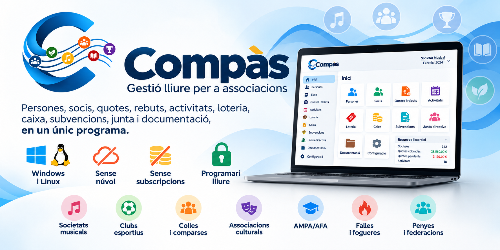
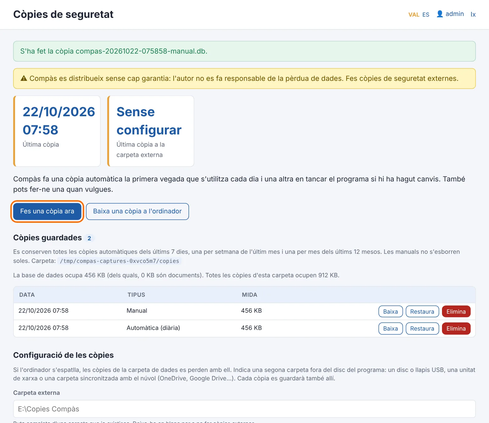
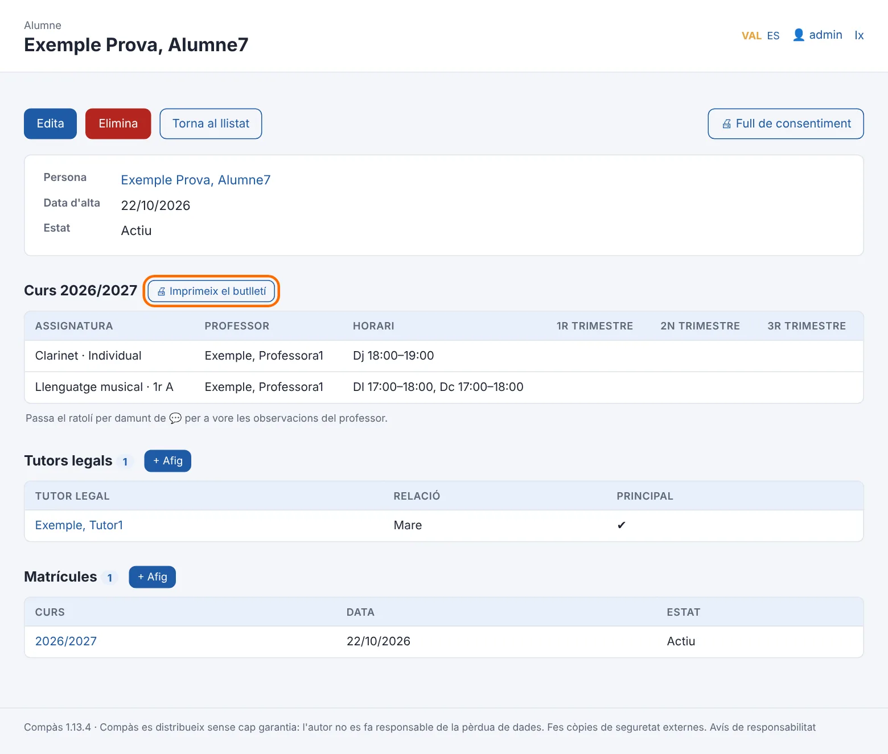
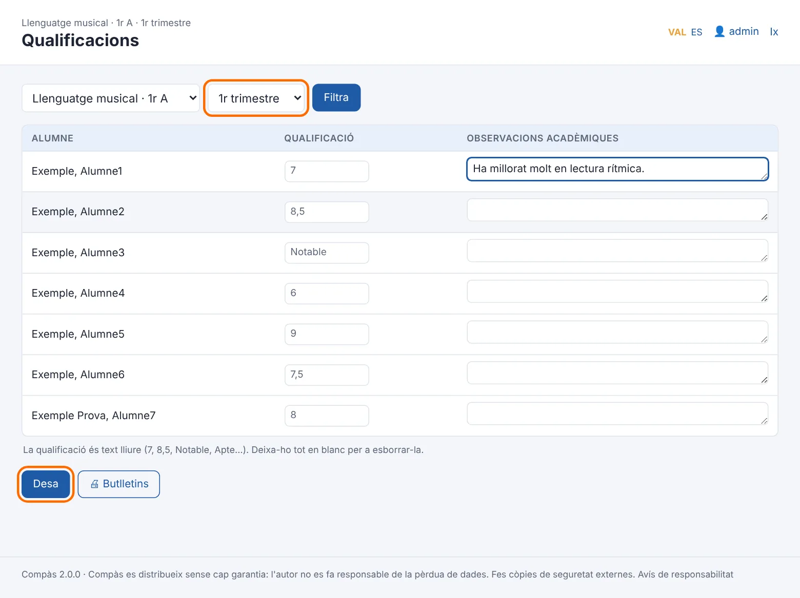

<p align="center">
  
</p>

<h1 align="center">Compàs</h1>

<p align="center"><strong>Gestió lliure per a associacions</strong></p>

<p align="center">
  Gestiona persones, socis, quotes, rebuts, activitats, economia, junta i documentació<br>
  des d'un únic programa, sense núvol ni subscripcions.
</p>

<p align="center">
  <a href="../../releases/latest"></a>
  <a href="https://github.com/jossanmar9/compas/actions/workflows/tests.yml"></a>
  <a href="LICENSE"></a>
  
  
  
  
</p>

<p align="center">
  <strong>🖥️ Windows i Linux · 🔒 Dades locals · 🌐 Sense Internet · 💶 Sense subscripcions · 🆓 Programari lliure</strong>
</p>

<p align="center">
  <a href="../../releases/latest"><strong>⬇️ Descarregar Compàs</strong></a>
  &nbsp;·&nbsp;
  <a href="https://jossanmar9.github.io/compas/"><strong>🌐 Web</strong></a>
  &nbsp;·&nbsp;
  <a href="https://github.com/jossanmar9/compas/releases/latest/download/manual-usuari.pdf"><strong>📖 Manual</strong></a>
  &nbsp;·&nbsp;
  <a href="PRIVACITAT.md"><strong>🔒 Privacitat</strong></a>
</p>



Compàs és una aplicació d'escriptori per a gestionar una associació des d'un ordinador amb **Windows o Linux**. Està pensada perquè qui porta la secretaria o l'administració d'una entitat puga utilitzar-la sense coneixements informàtics especials.

Serveix per a **societats musicals, clubs esportius, colles, associacions culturals, AMPA/AFA, falles, gaiates, fogueres, comparses, penyes i federacions**. En instal·lar-lo, Compàs adapta el vocabulari, els apartats i l'exercici al tipus d'entitat.

> 🔒 **Les dades són de l'associació.** Compàs no necessita cap servidor extern, no obliga a crear un compte, no té telemetria ni publicitat i no envia dades fora de l'ordinador. L'entitat controla les seues dades i les seues còpies de seguretat.

### ⭐ T'agrada Compàs?

Si Compàs et sembla útil, pots ajudar el projecte donant-li una **estrela a GitHub**. Ajuda a donar-li visibilitat i a fer que més associacions el descobrisquen.

*Compàs también está disponible en castellano. El programa, los manuales y la documentación de uso están en valenciano y castellano.*

Un projecte de **José Vicente Sanjuan**.

## Contingut

- [Per a quines entitats](#per-a-quines-entitats)
- [Què pots gestionar](#què-pots-gestionar)
- [Per què sense núvol](#per-què-sense-núvol)
- [Captures](#captures)
- [Instal·lació](#installació)
- [Primers passos](#primers-passos)
- [Usuaris i permisos](#usuaris-i-permisos)
- [Dades i còpies de seguretat](#dades-i-còpies-de-seguretat)
- [Documentació](#documentació)
- [Per a desenvolupar](#per-a-desenvolupar)
- [Publicar una versió](#publicar-una-versió)
- [Pròximes versions](#pròximes-versions)
- [Col·laborar](#col·laborar)
- [Autoria i ús d'intel·ligència artificial](#autoria-i-ús-dintel·ligència-artificial)
- [Avís de responsabilitat](#avís-de-responsabilitat)
- [Llicència](#llicència)

## Per a quines entitats

| Tipus | Com s'hi diu | Apartats que s'activen | Exercici |
|---|---|---|---|
| **Societat musical** | Socis, alumnat, agrupacions, músics | Escola de música amb notes i butlletins, agrupacions, repertori, instruments, uniformes, loteria | Gener |
| **Club esportiu** | Socis, esportistes, entrenadors, equips, jugadors | Escola esportiva, equips, llicències i revisions mèdiques, categories (prebenjamí… veterà), material i equipacions | Setembre (temporada) |
| **Colla** | Membres de la colla, seccions | Seccions (dolçaina i tabal, gegants…), escola de la colla, material, roba | Gener |
| **Associació cultural** | Socis, participants, tallers, grups | Tallers i cursos, grups (teatre, dansa, cor…), material | Gener |
| **AMPA / AFA** | Famílies associades, alumnat, monitors, comissions | Activitats extraescolars, comissions, roba | Setembre (curs) |
| **Falla** | Fallers i falleres | Càrrecs de festa (Fallera Major…), categories infantil i major, loteria, roba | Abril |
| **Gaiata** | Membres de la comissió | Càrrecs de festa (Madrina…), loteria, roba | Abril |
| **Foguera** | Foguerers i foguereres | Càrrecs de festa (Bellesa…), loteria, roba | Juliol |
| **Comparsa** | Comparsistes, esquadres | Esquadres, càrrecs de festa (capitania…), vestits | Gener |
| **Penya** | Socis | Quotes, loteria, activitats i eixides | Gener |
| **Federació** | Entitats federades | Cens d'entitats amb representant i quota anual | Gener |

Tots els tipus tenen persones, socis, quotes i rebuts, remeses, activitats amb inscripcions, caixa, junta i actes, documents, comunicats i llistats. Cada entitat pot activar o desactivar qualsevol apartat, canviar el mes en què comença l'exercici i canviar de tipus quan vulga (Administració → Configuració): les dades no es toquen.

## Què pots gestionar

Compàs concentra en un únic programa les àrees habituals de gestió d'una associació:

| | |
|---|---|
| 👥 **Persones i socis** | Fitxes, altes i baixes, tipus de soci, categories i drets d'imatge. |
| 💳 **Quotes i rebuts** | Tarifes, cobraments, devolucions, domiciliacions i remeses SEPA. |
| 💰 **Economia** | Llibre de caixa, ingressos, despeses, loteria i subvencions. |
| 📅 **Activitats** | Actes, eixides, competicions, tallers i inscripcions. |
| 🏛️ **Junta i actes** | Càrrecs, historial de juntes, convocatòries, actes i certificats. |
| 📁 **Documents** | Estatuts, contractes, pòlisses i altres documents de l'entitat. |
| 🎓 **Escola i cursos** | Escola de música, esportiva, tallers o extraescolars, segons l'entitat. |
| 👕 **Material** | Instruments, material, equipacions, uniformes, vestits i préstecs. |
| 📊 **Llistats i certificats** | Impressió, PDF, CSV i documentació per a la gestió diària. |
| 💾 **Còpies de seguretat** | Automàtiques, externes i opcionalment xifrades. |

A més, el tipus d'entitat activa funcionalitats específiques com **repertori musical, llicències esportives, càrrecs de festa, esquadres, comissions o entitats federades**.

<details>
<summary><strong>Veure totes les funcionalitats de Compàs</strong></summary>

<br>

| Mòdul | Què fa |
|---|---|
| **Persones** | Registre únic: cada persona s'introdueix una sola vegada i pot ser sòcia, membre d'un grup, alumna, monitora i tutora alhora sense duplicar dades. Nom, cognoms i data de naixement són obligatoris; DNI i telèfon, només per als majors d'edat. Quan un menor fa 18 anys sense eixes dades, la seua fila es marca en groc. |
| **Drets d'imatge** | Si cada persona autoritza fotos i vídeos, amb la data de la signatura. Fulls de consentiment per a imprimir amb les dades de l'alumne i del tutor/a, i llistat de qui pot eixir en les fotos. |
| **Socis** | Número, tipus de soci (els defineix cada entitat segons els seus estatuts), altes i baixes. Llistat per número, etiquetes per a les circulars i antiguitat per a les insígnies de 25 i 50 anys. |
| **Categories d'edat** | Prebenjamí, aleví, cadet…, o infantil i major: cada entitat defineix les seues. La categoria de cada persona es calcula sola amb l'edat que fa en l'exercici, i hi ha un llistat per categories. |
| **Activitats** | Sopars, eixides, viatges, actes, competicions o tallers amb data, lloc, preu i places. Inscripcions (amb les places de cada una), avís quan s'omplin, llista d'inscrits per a imprimir i un rebut per inscripció. |
| **Llicències** | Llicències federatives de cada temporada per equip, amb el número, la caducitat i la revisió mèdica. Avís a l'inici un mes abans que caduquen. |
| **Càrrecs de festa** | Fallera Major, Bellesa, Madrina, capitania… de cada exercici, amb l'historial i el certificat. |
| **Entitats federades** | Per a federacions: cada entitat amb el CIF, el representant i la quota anual, que es cobra amb rebuts. |
| **Escola** | De música, esportiva, de tallers o d'extraescolars: cursos o temporades i avaluacions, assignatures, aules, professorat, grups amb horari, matrícules i tutors legals. Historial de cada alumne curs a curs. Assistent per a passar al curs següent sense començar de zero. |
| **Qualificacions** | Administració introdueix les notes que passa el professorat, per grup i avaluació, amb observacions acadèmiques. |
| **Butlletins** | (Societats musicals i colles.) Butlletins de notes en A4 amb el logotip i les dades de l'entitat: de tot l'alumnat, d'un grup o d'un alumne. S'imprimeixen o es guarden en PDF. |
| **Horari** | L'horari de tota l'escola per dies, filtrable per professor o per aula. |
| **Agrupacions, equips o seccions** | Banda i coral, equips, seccions de la colla, esquadres de la comparsa o comissions de l'AMPA, amb els membres, l'instrument, la posició o la tasca, i qui en té la direcció. |
| **Repertori** | (Societats musicals.) Catàleg de l'arxiu musical: títol, tipus d'obra (els de cada societat), compositor, arranjador, agrupacions que la poden interpretar, número d'arxiu, ubicació física, material, estat i si està digitalitzada. Cerca, filtres, ordenació, impressió, CSV i importació des d'Excel. No guarda partitures: només el catàleg. |
| **Instruments i material** | Inventari, manteniments i cessions (préstecs) amb avís de devolucions vençudes. |
| **Uniformes, equipacions o vestits** | Polos, equipacions, vestits de l'esquadra, dessuadores, motxilles… per talla: compres, vendes, préstecs i el que queda de cada talla. |
| **Quotes i rebuts** | Tarifes de les quotes de soci (per tipus i periodicitat), de la matrícula i de les classes. Rebuts generats per període (segons l'exercici de l'entitat): un per soci, un per família a l'escola, un per inscripció a una activitat i un per entitat federada, amb descomptes de soci, de germans i propis. Cobrament en efectiu, transferència o domiciliació, rebuts retornats i qui deu diners. Rebuts amb el logotip per a imprimir. |
| **Remeses bancàries** | Domiciliacions (mandats SEPA) amb l'IBAN validat i l'ordre de domiciliació per a signar. Fitxer XML d'adeutaments directes SEPA (pain.008) per a pujar a la banca electrònica. |
| **Loteria** | Sorteigs, talonaris repartits a cada persona, participacions per a imprimir i liquidació: venudes, tornades, diners lliurats i el que queda per a l'entitat. |
| **Llibre de caixa** | Ingressos i despeses amb saldo, separats per banc i caixa. Els rebuts cobrats, les remeses, la loteria i els cobraments de subvencions hi entren sols; la resta s'apunta a mà, amb el proveïdor, el NIF i la factura. Resum per categories per a l'assemblea i exportació a CSV. |
| **Subvencions** | Cada subvenció amb l'organisme, l'estat, els terminis i els imports. Com es justifica cada una, amb caselles que es marquen a mesura que es fa: els organismes i els requisits els edita cada entitat, i en triar l'organisme es marquen els que demana normalment. Cobraments, despeses del llibre de caixa imputades (sense passar-se de l'import de cada factura), relació de despeses per a la justificació en PDF o CSV, avisos de terminis i còpia per a l'any següent. |
| **Junta directiva i actes** | Càrrecs amb data d'inici i de fi i l'historial de totes les juntes. Avís quan s'acosta la renovació segons els anys de mandat dels estatuts (i recordatori del Registre d'Associacions). Llibre d'actes de juntes i assemblees: convocatòria, acta i certificat d'un acord per a imprimir. Els certificats agafen sols qui signa i el vistiplau. |
| **Documents de l'entitat** | Estatuts, reglament de règim intern, actes signades, inscripció al registre, CIF, pòlisses, contractes… guardats dins de Compàs i, per tant, en les còpies de seguretat. Data de caducitat amb avís abans que vencen. Model de registre d'activitats de tractament (RGPD) generat amb les dades reals. |
| **Professorat i monitors** | Certificat de delictes de naturalesa sexual de cada professor/a o monitor/a, amb avís si en falta algun. |
| **Comunicats** | Llistes de correu (socis, junta, professorat, famílies, un grup o una agrupació) per a copiar en CCO al correu de l'entitat, i registre de què s'ha enviat, quan i a qui. Compàs no envia res. |
| **Full d'alta de soci** | Model estàndard per a imprimir, amb els tipus de soci, les quotes i l'ordre de domiciliació, i textos personalitzables. |
| **Llistats i certificats** | Alumnes d'un grup amb els telèfons dels tutors, socis per número, membres per instrument o posició, persones per categoria, llicències per equip, càrrecs de festa, cens d'entitats federades, dades per a la memòria anual i les subvencions. Certificats de soci, de matrícula, d'agrupació i de càrrec de festa amb el logotip. Tot s'imprimeix, es guarda en PDF o s'exporta a CSV. |
| **Importació** | Porta des d'Excel o CSV les persones, els socis i l'alumnat (amb els tutors), amb revisió prèvia i sense duplicar qui ja hi és. |
| **A la mida** | El tipus d'entitat posa els noms i els apartats; després, cada entitat activa o desactiva els mòduls que no fa servir (escola, loteria, caixa…) i els avisos de l'inici que no vol vore. Les dades no s'esborren. |
| **Administració** | Comptes individuals amb rols d’administrador/a, usuari/ària de gestió i consultor/a, configuració i logotip, registre d'activitat i còpies de seguretat (les externes, xifrades amb contrasenya si es vol). |

Tot el programa està en **valencià i castellà**, i cada usuari pot triar el seu idioma.

Compàs fa **rebuts**, no factures: les factures han de complir el reglament dels sistemes de facturació (Verifactu) i s'han de fer amb un programa preparat per a això.

</details>

## Per què sense núvol

| | Compàs | Plataformes en línia |
|---|---|---|
| On són les dades | A l'ordinador de l'entitat | Al servidor de l'empresa |
| Qui les pot vore | Només qui fa servir l'ordinador | L'empresa i els seus proveïdors |
| Recollida de dades i analítica | Cap | Habitual (ús, dispositius, cookies) |
| Funciona sense Internet | Sí | No |
| Cost | Gratuït i lliure (AGPL) | Subscripció anual |
| Si el projecte desapareix | El programa i les dades continuen | Depens que el servei continue |

Les plataformes en línia tenen avantatges reals (una app per al mòbil dels socis, accés des de qualsevol lloc), però les dades de socis, famílies i menors passen a mans d'un tercer. Compàs tria l'altre camí: menys comoditat i cap dada fora.

## Captures

| | |
|---|---|
|  |  |
| **Inici:** visió general i accés als mòduls de l'entitat. | **Còpies de seguretat:** automàtiques, manuals i externes. |
|  |  |
| Exemple d'una fitxa amb informació relacionada. | Exemple d'un mòdul específic d'escola. |

> Les captures d'escola són només un exemple dels mòduls específics. Compàs adapta els apartats a societats musicals, clubs esportius, associacions culturals, AMPA/AFA, entitats festives, penyes i federacions.

Hi ha més de 60 captures, pas a pas, al [manual d'usuari](docs/manual-usuari.md).

## Instal·lació

**Requisits:** Windows 10 o 11 de 64 bits, o Linux amb PHP 8.1 o posterior, i uns 100 MB de disc. No cal Internet ni servidor. A Windows tampoc no cal instal·lar PHP ni bases de dades: tot va dins.

1. Baixa l'[última versió](../../releases/latest):
   - **`Compas-X.Y.Z-installador.exe`**: l'instal·lador recomanat per a Windows. No demana permisos d'administrador; s'instal·la a `%LOCALAPPDATA%\Programs\Compas` i crea l'accés al menú Inici i a l'escriptori.
   - **`Compas-X.Y.Z-portable.zip`**: la mateixa versió sense instal·lar. Descomprimeix-la on vulgues (també en un llapis USB) i obri `Compas.exe`.
   - **`compas_X.Y.Z_all.deb`**: per a Debian, Ubuntu, Linux Mint i semblants. S'instal·la amb `sudo apt install ./compas_X.Y.Z_all.deb`, que porta també PHP.
   - **`Compas-X.Y.Z-linux.tar.gz`**: per a altres Linux. Descomprimeix-lo i executa `./installa.sh` (cal PHP 8.1 o posterior amb `pdo_sqlite` i `mbstring`).
2. Compàs **encara no disposa d'un certificat de signatura de codi**, per la qual cosa Windows SmartScreen pot mostrar un avís en obrir l'instal·lador: prem **Més informació → Executa igualment**. El codi font és públic i els paquets es construeixen automàticament amb GitHub Actions. En ordinadors amb el **Control intel·ligent d'aplicacions** de Windows 11 activat, Windows pot bloquejar també la versió portable; consulta la [guia d'instal·lació](docs/guia-installacio.md#si-windows-no-et-deixa-obrir-lo).
3. Obri **Compàs**. S'obri en la seua pròpia finestra, sense cap navegador. En tancar-la, fa una còpia de seguretat i s'atura.

**Actualitzar:** executa l'instal·lador de la versió nova amb Compàs tancat. Les dades i la configuració es conserven. En desinstal·lar, la carpeta de dades no s'esborra.

Més detalls i solució de problemes a la [guia d'instal·lació](docs/guia-installacio.md).

## Primers passos

La primera vegada, Compàs demana el nom i el **tipus d'entitat** i crea el compte d'administrador (i, si vols, el d'usuari/ària). També pot carregar **dades d'exemple** per a provar-lo.

Ordre recomanat per a començar:

1. **Configuració**: dades de l'entitat i logotip (ix als rebuts, certificats i butlletins); comprova el mes en què comença l'exercici.
2. **Mòduls i avisos**: activa o desactiva els apartats que faràs servir.
3. **Còpies de seguretat**: tria una carpeta externa (USB o núvol).
4. **Tipus de soci**, **tarifes** i, si en feu servir, **categories** d'edat.
5. **Persones** (o importa-les des d'Excel) i, des de la fitxa de cadascuna, les seues funcions: soci, membre d'un equip o secció, alumne…
6. Si hi ha escola: el curs o la temporada, les assignatures o activitats, els grups amb l'horari i les matrícules o inscripcions.

El [manual d'usuari](docs/manual-usuari.md) explica cada procés pas a pas amb captures: alta de socis, alumnes, membres i professorat, matrícules, activitats i inscripcions, llicències, càrrecs de festa, rebuts, baixes, notes, butlletins, préstecs i còpies.

## Usuaris i permisos

Hi ha tres rols: **administrador/a**, **usuari/ària de gestió** i **consultor/a**. El consultor té consulta limitada de persones, socis, escola, agrupacions i instruments, sense economia, imports ni IBAN, exportacions, documents descarregables ni còpies. Pot canviar la pròpia contrasenya i l'idioma.

Els noms de compte són únics sense distingir majúscules: de 3 a 40 caràcters ASCII (a–z, números, punt, guió i guió baix), sense accents ni dièresi. En actualitzar, els noms antics incompatibles s'adapten i l'administrador veu els canvis a Usuaris. Les contrasenyes es conserven.

| Què es pot fer | Administrador/a | Usuari/ària | Consultor/a |
|---|:---:|:---:|:---:|
| Persones, socis i tipus de soci | ✔ | ✔ | Consulta parcial |
| Escola: cursos, grups, matrícules, notes i butlletins | ✔ | ✔ | Consulta parcial |
| Agrupacions o equips, repertori, instruments i uniformes | ✔ | ✔ | Consulta parcial |
| Activitats, llicències, càrrecs de festa i entitats federades | ✔ | ✔ | — |
| Quotes, rebuts, domiciliacions, remeses, loteria i subvencions | ✔ | ✔ | — |
| Llibre de caixa | ✔ | ✔ | — |
| Junta, actes, documents i comunicats | ✔ | ✔ | — |
| Llistats, certificats i importació des d'Excel | ✔ | ✔ | — |
| Fer i baixar còpies de seguretat | ✔ | ✔ | — |
| Canviar la pròpia contrasenya | ✔ | ✔ | ✔ |
| Configuració de l'entitat, tipus, logotip, mòduls i avisos | ✔ | — | — |
| Dades bancàries i descomptes de l'escola | ✔ | — | — |
| Crear i gestionar els comptes | ✔ | — | — |
| Registre d'activitat | ✔ | — | — |
| Restaurar i eliminar còpies, carpeta externa i xifrat | ✔ | — | — |
| Recuperar l'accés amb el codi de recuperació | ✔ | — | — |

Les contrasenyes es guarden amb hash; en LAN hi ha un bloqueig temporal per compte després de cinc intents fallits i un límit addicional per IP i el **registre d'activitat** anota qui ha creat, modificat o eliminat cada cosa.

Si l'administrador/a oblida la contrasenya, la pot canviar des de la pantalla d'entrada amb el **codi de recuperació** que es mostra en la configuració inicial (i que es pot tornar a generar a **Usuaris**). Si s'ha perdut el codi, hi ha una alternativa amb un fitxer a la carpeta de dades, que només pot fer qui té accés a l'ordinador.

## Xarxa local opcional (2.2)

Un sol servidor guarda el programa i SQLite; els altres equips obrin la seua adreça al navegador, amb un compte per persona. A `compas.ini`: `lan = 1` i `adreca_lan = 192.168.1.20` (la IP privada fixa del servidor). Per defecte, `lan = 0`. Tancar el navegador no atura el servidor; tancar el panell o terminal del servidor desconnecta tots els clients.

Consulta la [guia LAN en valencià i castellà](docs/xarxa-local.md) abans d'activar-lo: tallafoc restringit, HTTP sense xifrar en una xarxa de confiança, còpies i restauració fora del mode LAN. No compartisques `compas.db` per carpetes de xarxa. El servidor integrat està pensat per a grups menuts i processa les peticions en sèrie a Windows.

## Dades i còpies de seguretat

- Totes les dades estan en un sol fitxer: `data\compas.db`, dins de la carpeta del programa.
- Per defecte, Compàs només escolta en el mateix ordinador (`127.0.0.1`). El **mode LAN opcional** permet clients amb navegador en una xarxa privada de confiança; les dades queden al servidor de l’entitat. No envia telemetria ni estadístiques a serveis externs. Vegeu la [guia de xarxa local](docs/xarxa-local.md) i la [declaració de privacitat](PRIVACITAT.md).
- **Còpies automàtiques:** la primera vegada que s'utilitza cada dia i en tancar el programa si hi ha hagut canvis. Es guarden totes les dels últims 7 dies, una per setmana de l'últim mes i una per mes de l'últim any (configurable): unes vint còpies que arriben a un any arrere.
- **Carpeta externa:** cada còpia es guarda també en un USB o en una carpeta sincronitzada amb el núvol. L'inici avisa si no està configurada o si fa més de 7 dies que no s'hi guarda res.
- **Còpies xifrades:** les de la carpeta externa es poden xifrar amb contrasenya, perquè un USB perdut no expose dades de menors.
- **Restaurar** una còpia es fa amb un clic. Abans, Compàs guarda una còpia de les dades actuals, de manera que sempre es pot tornar arrere.
- Els **documents** de l'entitat (PDF, imatges, fulls de càlcul…) es guarden dins de `compas.db`, de manera que entren en totes les còpies (i, si es vol, xifrats). Les còpies creixen tant com els documents que s'hi posen.
- Res no s'elimina si té historial: les baixes es marquen amb estat i data de baixa.

> Les dades contenen informació personal, també de menors. L'entitat és la responsable de tractar-les d'acord amb la normativa de protecció de dades.

## Documentació

| Document | Valencià | Castellano |
|---|---|---|
| Manual d'usuari, pas a pas amb captures | [MD](docs/manual-usuari.md) · [PDF](https://github.com/jossanmar9/compas/releases/latest/download/manual-usuari.pdf) | [MD](docs/manual-usuario.md) · [PDF](https://github.com/jossanmar9/compas/releases/latest/download/manual-usuario.pdf) |
| Manual d'administració: configuració, comptes, còpies i actualitzacions | [MD](docs/manual-administracio.md) · [PDF](https://github.com/jossanmar9/compas/releases/latest/download/manual-administracio.pdf) | [MD](docs/manual-administracion.md) · [PDF](https://github.com/jossanmar9/compas/releases/latest/download/manual-administracion.pdf) |
| Guia d'instal·lació | [MD](docs/guia-installacio.md) · [PDF](https://github.com/jossanmar9/compas/releases/latest/download/guia-installacio.pdf) | [MD](docs/guia-instalacion.md) · [PDF](https://github.com/jossanmar9/compas/releases/latest/download/guia-instalacion.pdf) |
| Declaració de privacitat | [PRIVACITAT](PRIVACITAT.md) | [PRIVACITAT](PRIVACITAT.md#privacidad-de-compàs) |
| Arquitectura i detalls tècnics | [MD](docs/arquitectura.md) | |
| Registre de canvis de cada versió | [CHANGELOG](CHANGELOG.md) | |

Els manuals també es poden consultar dins del programa, al menú **Ajuda** (el d'administració, només l'administrador/a).

## Per a desenvolupar

### Tecnologia

- **PHP 8** sense dependències ni frameworks, servit pel servidor integrat de PHP.
- **SQLite** a través de PDO, amb consultes preparades (preparat per a passar a MariaDB/MySQL si calguera).
- **HTML, CSS i JavaScript** propis, sense biblioteques externes.
- **Tipus d'entitat** a `src/tipus.php` (apartats, exercici, categories i càrrecs de cada tipus) i vocabulari de cada tipus a `src/lang/vocabulari.php`.
- **Llançador per a Windows** en C# (.NET Framework 4, inclòs en Windows), amb la finestra de Compàs feta amb el component **WebView2** de Windows (`launcher/Visor.cs`).
- **Llançador per a Linux** en Bash, amb la finestra de Compàs feta amb **WebKitGTK** (`launcher/linux/compas-visor.py`).
- **Instal·lador** amb Inno Setup; **PHP portable** baixat de windows.php.net en cada construcció.

### Estructura

```
app/          punt d'entrada (index.php) i recursos web (CSS, JS, icones)
src/          lògica: base de dades, permisos, entitats, pantalles i traduccions
  lang/       textos en valencià (ca.php) i castellà (es.php)
  pages/      pantalles específiques (inici, escola, butlletins, activitats, còpies…)
launcher/     llançador de Windows (Compas.cs), php.ini, script de l'instal·lador i, a linux/, el llançador i l'instal·lador per a Linux
docs/         manuals, guies, captures (imatges/) i PDF (pdf/)
eines/        generació de captures, PDF i web
.github/      construcció de l'instal·lador (publica.yml) i de la web (web.yml)
```

La majoria de pantalles es generen a partir de la definició declarativa de `src/entitats.php` (camps, relacions i validacions). Per a afegir una entitat senzilla: crea la taula a `src/schema.sql`, defineix-la a `src/entitats.php`, afig-la al menú (`src/disseny.php`) i posa'n els textos a `src/lang/`. Més detalls a [arquitectura](docs/arquitectura.md).

### Executar-lo sense Windows

Amb PHP 8.1 o posterior (extensions `pdo_sqlite` i `mbstring`):

```
php -S 127.0.0.1:8740 -t app app/index.php
```

i obri `http://127.0.0.1:8740`. Les dades es guarden a `data/` o a la carpeta que indique la variable d'entorn `COMPAS_DADES`.

### Eines

| Ordre | Què fa |
|---|---|
| `python3 eines/captures.py [números]` | Torna a fer les captures dels manuals (`docs/imatges/ca` i `es`, en WebP) recorrent cada procés amb dades d'exemple. Amb números (`78 81-82`, `web`) només desa estes: en una versió nova només es refan les pantalles que han canviat, perquè el repositori no cresca. Requereix Pillow i Playwright. |
| `bash eines/pdf.sh` | Fa els manuals i les guies en PDF (`docs/pdf/`) amb Chrome o Chromium. No es guarden al repositori: els fa GitHub Actions en publicar cada versió i la web. |
| `COMPAS_DADES=carpeta php eines/societat-gran.php` | Omple una instal·lació nova (configurada sense dades d'exemple) amb una societat gran inventada: 341 socis, 278 alumnes, 5 agrupacions, 653 obres i uns 5.000 rebuts. Per a provar el programa amb moltes dades; també la fan servir les captures de la web. |
| `php eines/web.php _site` | Genera la web de presentació en valencià i castellà. |
| `php tests/run.php` | Proves automàtiques (IBAN, SEPA, còpies xifrades, rotació de còpies). Vegeu [tests/README.md](tests/README.md). |
| `python3 tests/integracio.py` | Proves d'integració: arranquen Compàs amb dades d'exemple i recorren totes les funcions, en valencià i castellà; la bateria `tipus` instal·la cada tipus d'entitat i en recorre totes les pantalles. |
| `php tests/performance.php` | Prova de rendiment de SQLite amb 100.000 rebuts. |

## Publicar una versió

1. Actualitza `COMPAS_VERSIO` a `src/bootstrap.php`.
2. Al [CHANGELOG](CHANGELOG.md), apunta els canvis en un apartat nou a dalt amb el número i la data de la versió, per exemple `## [1.2.2] - 2026-11-05`. Mentre treballes, el pots titular `## [Pendent de publicar]` i canviar-li el nom just abans de publicar.
3. Puja els canvis i crea una etiqueta en minúscula:
   ```
   git tag v1.2.2
   git push origin v1.2.2
   ```
4. GitHub Actions (`publica.yml`) comprova el codi, baixa PHP portable, compila el llançador, genera els manuals en PDF, construeix l'instal·lador i el zip portable per a Windows i els paquets .deb i .tar.gz per a Linux, els prova, i ho publica tot en una *release*. Les notes de la *release* es prenen de l'apartat d'eixa versió al CHANGELOG.

La web es torna a publicar sola amb cada canvi a `main` (`web.yml`).

Les versions segueixen el format `MAJOR.MENOR.CORRECCIÓ`: `v1.0.1` per a correccions i `v1.1.0` per a funcionalitats noves.

## Pròximes versions

- Calendari d'assajos, entrenaments, partits i actes, amb els espais que cal demanar a l'ajuntament.
- Assistència als assajos, entrenaments i activitats.
- Repertori interpretat en cada concert, per a la declaració a la SGAE.
- Cobrament per Bizum o TPV en el registre dels rebuts.

## Col·laborar

Consulta la [guia de contribució](CONTRIBUTING.md) per a provar Compàs, executar les proves i enviar una PR. Si has trobat una possible vulnerabilitat, comunica-la **en privat** seguint la [política de seguretat](SECURITY.md).

### ⭐ Dona visibilitat al projecte

Si utilitzes Compàs, t'interessa la idea o vols donar suport al programari lliure per a associacions, una **estrela al repositori** ajuda altres persones a descobrir-lo.

### 🐛 Errors i propostes

Has trobat una errada o tens una proposta? Obri una [incidència](../../issues/new/choose) i tria **He trobat una errada**, **Tinc una proposta** o **Nou tipus d’entitat**: un formulari et guia pas a pas. No poses dades reals de persones en el text ni en les captures. Les propostes de millora per a la gestió real de cada tipus d'entitat són especialment benvingudes.

### 🧪 Qualitat i rendiment

Compàs disposa de proves automàtiques i d'integració que recorren les funcions principals en valencià i castellà i comproven els diferents tipus d'entitat. També inclou una prova específica de rendiment de SQLite amb **100.000 rebuts**.

## Autoria i ús d'intel·ligència artificial

Compàs és un projecte de **José Vicente Sanjuan**, que n'ha definit les funcions, n'ha revisat el funcionament i el manté.

Este projecte s'ha desenvolupat amb l'ajuda d'una intel·ligència artificial (Claude, d'Anthropic), que ha generat bona part del codi i de la documentació a partir de les especificacions i les revisions del projecte.

## Avís de responsabilitat

Compàs és programari lliure i es distribueix tal com és, sense cap garantia (llicència AGPL-3.0). L'autor no es fa responsable de la pèrdua de dades ni de cap altre dany, directe o indirecte, que puga derivar-se de l'ús del programa, d'una errada, d'una actualització o d'una configuració incorrecta. Cada entitat és responsable de les seues dades i de fer-ne còpies de seguretat periòdiques en un lloc extern (USB o núvol).

En la configuració inicial, Compàs demana acceptar este avís; les instal·lacions d'abans de la versió 1.13.1 el mostren una vegada a l'inici.

## Llicència

Copyright © 2026 José Vicente Sanjuan.

Compàs és programari lliure distribuït sota la llicència **GNU Affero General Public License v3 o posterior (AGPL-3.0-or-later)**. El pots utilitzar, estudiar, modificar i redistribuir d'acord amb els termes de la llicència.

El text vàlid de la llicència és l'original en anglés ([LICENSE](LICENSE)). En [LLICENCIA.md](LLICENCIA.md) n'hi ha un resum orientatiu en valencià i castellà.

Si es modifica Compàs i s'ofereix als usuaris a través d'una xarxa, la llicència AGPL exigeix que estos usuaris tinguen accés al codi font de la versió modificada.

Consulta [LICENSE](LICENSE).

Les versions per a Windows inclouen [PHP](https://www.php.net/license/), distribuït sota la PHP License, [SQLite](https://www.sqlite.org/copyright.html), de domini públic, i les biblioteques del [SDK de Microsoft WebView2](https://www.nuget.org/packages/Microsoft.Web.WebView2), distribuïdes sota la llicència BSD (`WebView2-LICENSE.txt`).
