# Manual d'usuari de Compàs

## 1. Abans de començar

Compàs és el programa de gestió de la societat musical: persones, socis, escola de música, agrupacions, repertori, instruments, uniformes, quotes i rebuts, loteria, llibre de caixa, junta directiva i actes, documents, comunicats i còpies de seguretat. Funciona en **un sol ordinador amb Windows o Linux**, sense Internet, i té dos comptes:

| Compte | Què pot fer |
|---|---|
| **Administrador/a** | Tot. També gestionar usuaris, la configuració (també les dades bancàries), el registre d'activitat i restaurar còpies. |
| **Administratiu/va** | La gestió diària: persones, socis, escola, notes, butlletins, agrupacions, instruments, uniformes, rebuts, remeses, loteria, caixa, junta, actes, documents, comunicats i fer còpies. |

> En este manual, el botó o el camp que cal utilitzar en cada pas apareix **marcat en taronja** a les captures.

### Obrir i tancar Compàs

1. Fes doble clic a la icona **Compàs** de l'escriptori o del menú Inici.
2. Al cap d'uns segons, s'obri **la finestra de Compàs**. És una finestra del programa, com la de qualsevol altre: no cal cap navegador.
3. Per a acabar, **tanca la finestra** (la ✕ de dalt a la dreta). Compàs farà una còpia de seguretat si hi ha hagut canvis i s'aturarà.

Si tornes a obrir Compàs mentre ja està obert, es mostra la finestra que ja tenies. Els documents per a imprimir (butlletins, certificats, llistats…) s'obrin en una altra finestra de Compàs, i els fitxers que es descarreguen (CSV, còpies) van a la carpeta **Baixades**. Per a obrir la **carpeta de dades**, fes clic a la icona de dalt a l'esquerra de la finestra (o prem Alt+Espai) i tria **Carpeta de dades de Compàs**.

La finestra utilitza el component WebView2, que porten Windows 10 i 11. En l'ordinador estrany que no el tinga, Compàs s'obri amb Microsoft Edge o Google Chrome o, si tampoc, al navegador habitual amb una finestra menuda que **no has de tancar** mentre treballes.

> **A Linux**, la finestra utilitza WebKitGTK, que el paquet .deb instal·la si cal. Si no hi és, Compàs prova Chromium, Google Chrome, Microsoft Edge o Brave i, si tampoc, s'obri el navegador habitual amb una finestra de terminal: no la tanques mentre treballes, i per a acabar prem **Ctrl+C** o tanca-la.

### Entrar

Escriu el teu usuari i la contrasenya i prem **Entra**. A baix pots triar l'idioma.

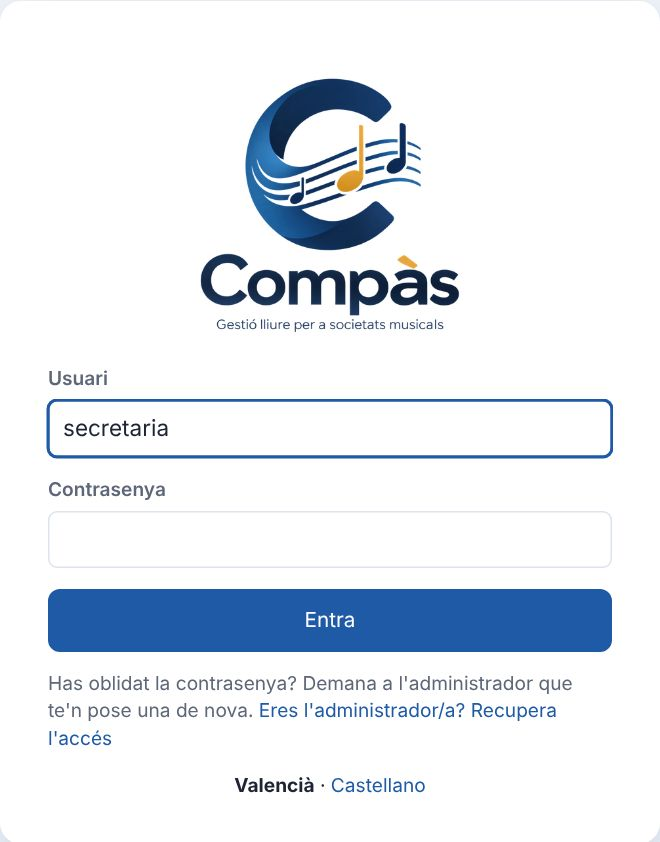

Si oblides la contrasenya, l'administrador te'n pot posar una de nova. Si qui l'ha oblidada és l'administrador/a, prem **Recupera l'accés** (vegeu l'apartat 21).

### La primera vegada: configuració inicial

La primera vegada que s'obri Compàs apareix la **Configuració inicial**:

1. Escriu el **nom de la societat musical**.
2. Tria l'**idioma** per defecte.
3. Crea l'**usuari administrador** i la seua contrasenya (almenys 8 caràcters). Apunta-la en un lloc segur.
4. Si vols, crea també el compte d'**administratiu/va** (es pot fer després).
5. Marca **Carrega dades d'exemple** només si vols provar el programa amb dades inventades.
6. Prem **Comença**.

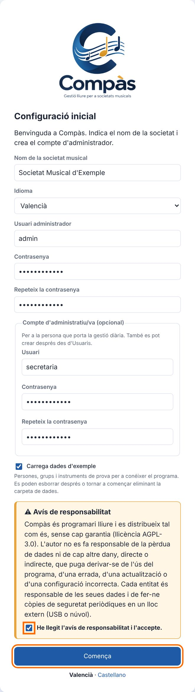

Tot seguit, Compàs mostra el **codi de recuperació**. Serveix per a posar una contrasenya nova si l'administrador/a l'oblida, i **només es mostra esta vegada**. Prem **Imprimeix** (o apunta'l) i guarda'l amb els papers de la societat, no a l'ordinador. Després prem **Ja l'he guardat, continua**.

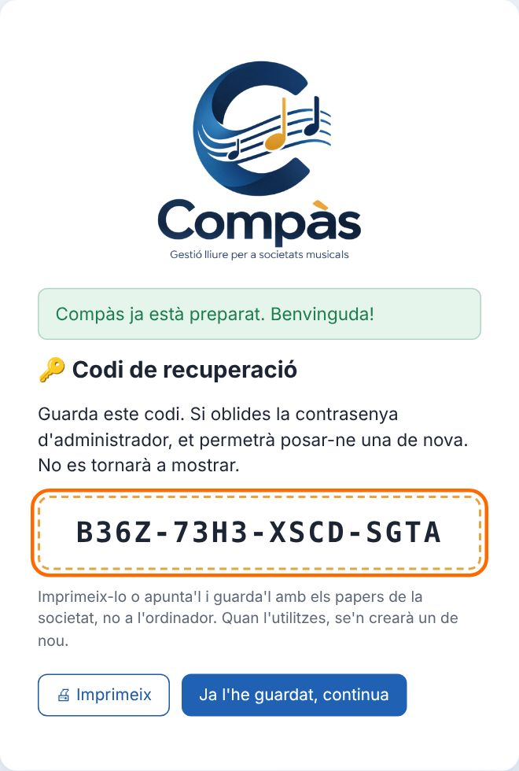

> Per a començar a treballar de veres sense les dades d'exemple, tanca Compàs, esborra la carpeta `data` del programa i torna a obrir-lo.

## 2. La pantalla principal

- **Menú lateral** (esquerra): totes les seccions, agrupades per Escola de música, Agrupacions, Instruments, Documents i dades (llistats, informes i importació) i Administració.
- **Dalt a la dreta**: canvi d'idioma (`VAL` / `ES`), el teu nom d'usuari (per a canviar la contrasenya) i **Ix** per a eixir.
- **Inici**: un resum amb el nombre de persones, socis, matriculats, grups, músics i instruments cedits. Fes clic en qualsevol xifra per a anar a la llista.
- **Avisos**: les cessions d'instruments amb la devolució vençuda, les classes de hui i els avisos de còpies de seguretat.

## 3. Com es treballa amb Compàs

Totes les seccions funcionen igual. Si n'aprens una, les saps totes.

### Llistats

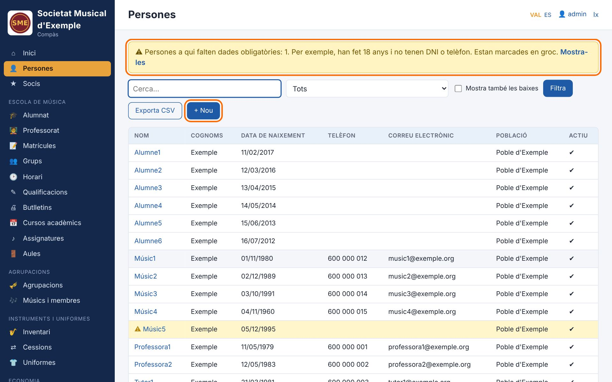

- **Cerca**: escriu un nom, cognom, telèfon… i prem **Filtra**.
- **Mostra també les baixes**: per defecte s'amaguen les persones inactives i les baixes.
- **Exporta CSV**: descarrega la llista per a obrir-la amb Excel o LibreOffice Calc.
- **+ Nou**: crea un element nou.
- Fes clic en qualsevol fila per a obrir-ne la **fitxa**.

### Fitxes

La fitxa mostra totes les dades d'un element i tot el que hi està relacionat. Per exemple, la fitxa d'una persona mostra si és sòcia, alumna, professora, música…

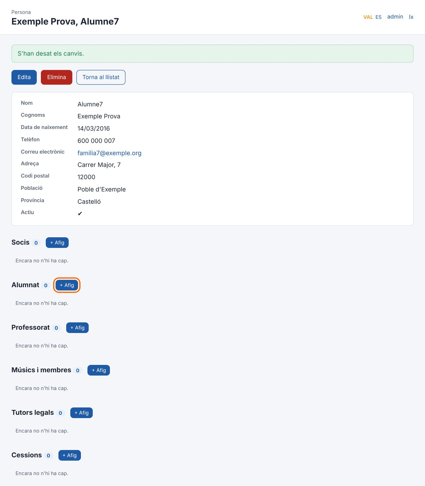

- **Edita**: canvia les dades.
- **Elimina**: només es pot si no té res relacionat (vegeu «Baixes» més avall).
- **+ Afig** de cada apartat: crea un element **ja vinculat** a esta fitxa. És la manera més ràpida de treballar.

### Formularis

- Els camps amb asterisc (*) són obligatoris.
- En els desplegables llargs (persones, grups…) hi ha una **lupa** damunt: escriu-hi per a filtrar les opcions.
- Prem **Desa** per a guardar o **Cancel·la** per a tornar sense guardar.

### Baixes: per què no s'elimina res

Compàs no deixa eliminar res que tinga historial (matrícules, notes, cessions…), perquè no es perda informació. En lloc d'eliminar:

- una **persona** que ja no té relació amb la societat: edita-la i desmarca **Actiu**;
- un **soci, alumne, professor o músic**: edita'l, posa l'**estat «Baixa»** i la **data de baixa**.

Les baixes desapareixen dels llistats, però es poden tornar a vore marcant **Mostra també les baixes**.

## 4. Configuració de la societat i logotip

Menú **Administració → Configuració** (només l'administrador/a).

1. Omple les dades de la societat: nom, CIF, adreça, telèfon, correu i web. Ixen als butlletins.
2. A **Logotip de la societat**, prem el botó de triar fitxer i selecciona la imatge del logotip (PNG, JPG o WEBP, fins a 3 MB).
3. Prem **Desa**. El logotip apareix al menú i als butlletins.

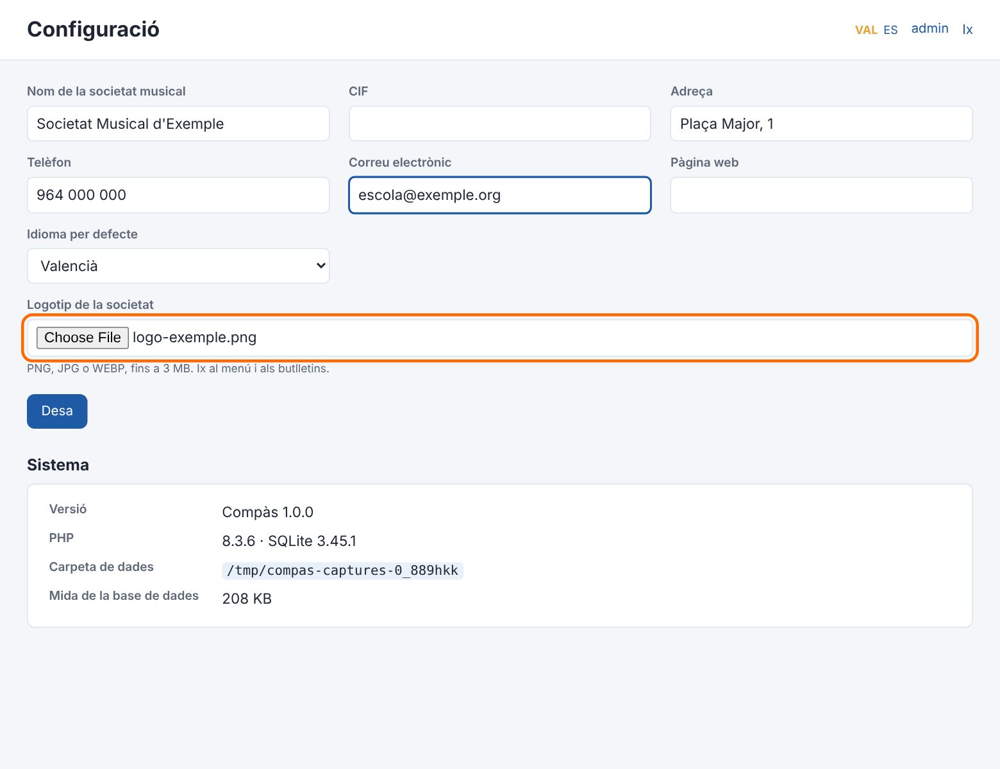

### Mòduls i avisos

No totes les societats fan servir tot: n'hi ha que no tenen escola, que no venen loteria o que porten la comptabilitat en un altre lloc. Al menú **Administració → Mòduls i avisos** es pot desactivar cada apartat: escola de música, agrupacions, repertori, instruments, uniformes, quotes i rebuts, loteria, llibre de caixa, junta i actes, documents i comunicats.

Un mòdul desactivat desapareix del menú, de l'inici, dels llistats i de les fitxes de les persones, però **no s'esborra cap dada**: si es torna a activar, tot està com estava. Persones, socis, llistats, importació i administració sempre estan actius.

A la mateixa pantalla es poden amagar els **avisos de l'inici** que la societat no vol vore: la carpeta externa de les còpies, la renovació de la junta, els documents que caduquen, el certificat de delictes del professorat, els instruments per tornar i el curs actual.

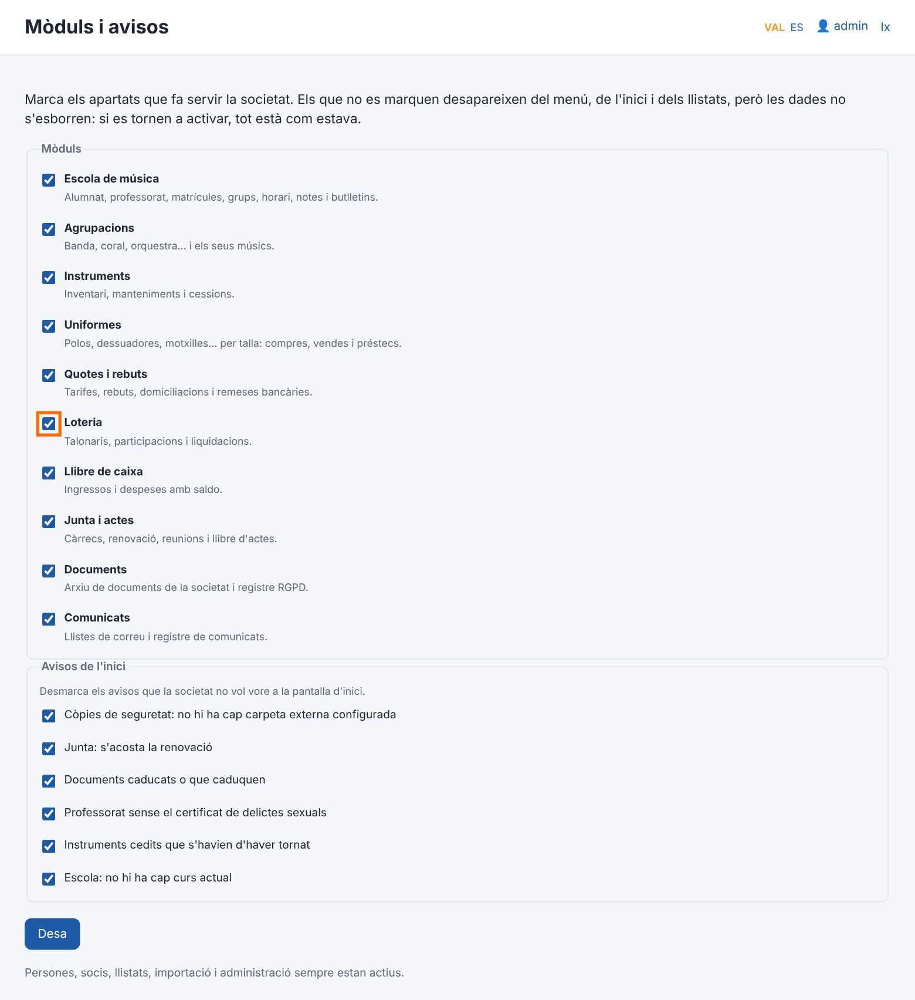

## 5. Preparar el curs acadèmic

Abans de matricular cal tindre el curs preparat. Ordre recomanat: **curs → períodes → assignatures i aules → professorat → grups → horaris**.

### 5.1 Curs i períodes d'avaluació

1. Menú **Cursos acadèmics → + Nou**.
2. Nom (per exemple `2026/2027`), data d'inici i de finalització.
3. Marca **Curs actual**. Només n'hi pot haver un; és el que s'utilitza en les notes i els butlletins.
4. Prem **Desa**. S'obri la fitxa del curs.
5. A l'apartat **Períodes d'avaluació**, prem **+ Afig** i crea'n un per a cada avaluació (`1r trimestre`, `2n trimestre`, `3r trimestre`), amb l'ordre 1, 2, 3.

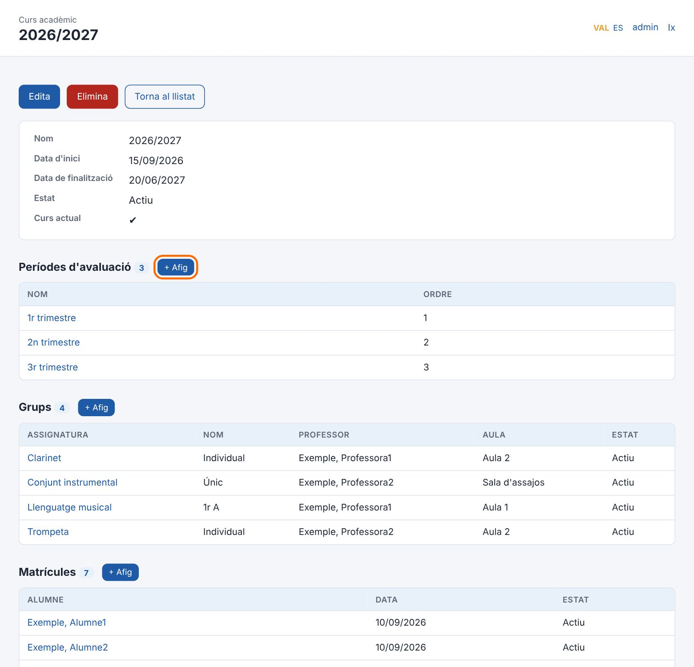

### 5.2 Assignatures i aules

- Menú **Assignatures → + Nou**: nom (Llenguatge musical, Trompeta, Clarinet…) i tipus.
- Menú **Aules → + Nou**: nom i capacitat.

Només cal crear-les una vegada: es reutilitzen cada curs.

### 5.3 Professorat

Un professor és una **persona** amb fitxa de professor:

1. Dona d'alta la persona (apartat 6) o busca-la si ja existeix.
2. A la seua fitxa, en l'apartat **Professorat**, prem **+ Afig**.
3. Comprova la data d'alta i prem **Desa**.

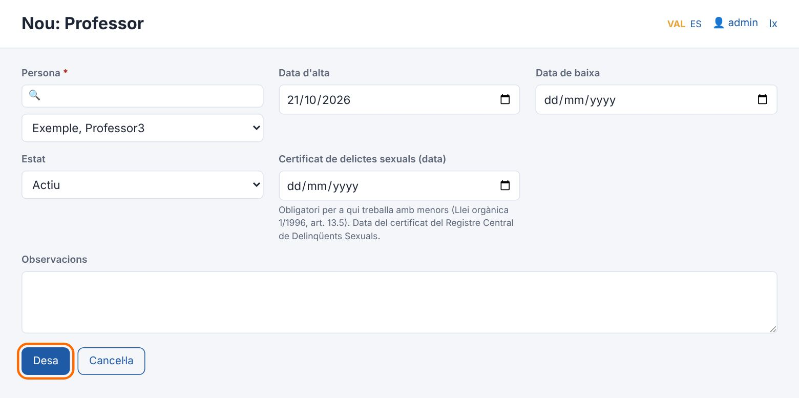

**Certificat de delictes de naturalesa sexual.** És obligatori per a tothom que treballa amb menors. A la fitxa de professor, posa'n la **data**. Si falta el d'algun professor en actiu, Compàs ho avisa a l'inici i el llistat de professorat té el filtre **Sense certificat de delictes sexuals**.

### 5.4 Grups i horaris

Un **grup** és una assignatura impartida en un curs per un professor: per exemple *Llenguatge musical · 1r A* o *Trompeta · Individual*.

1. Menú **Grups → + Nou**.
2. Tria el **curs**, l'**assignatura**, escriu el **nom** del grup i tria el **professor** i l'**aula**.
3. Prem **Desa**. S'obri la fitxa del grup.

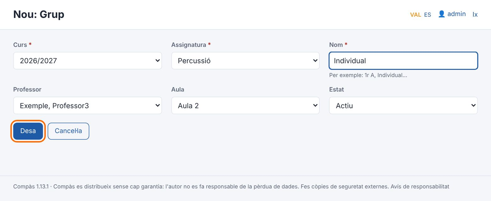

4. A l'apartat **Horari**, prem **+ Afig**, tria el **dia** i les hores d'inici i de fi, i prem **Desa**. Repeteix-ho si el grup té classe més d'un dia.

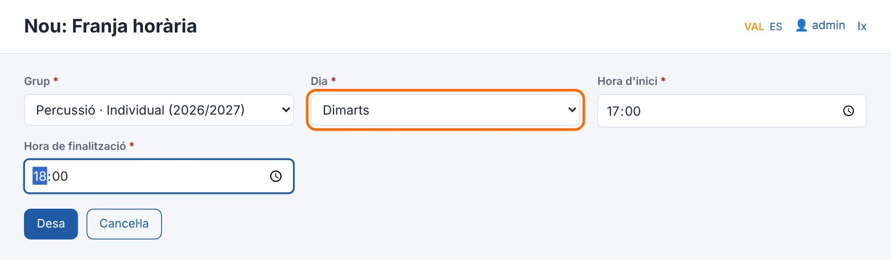

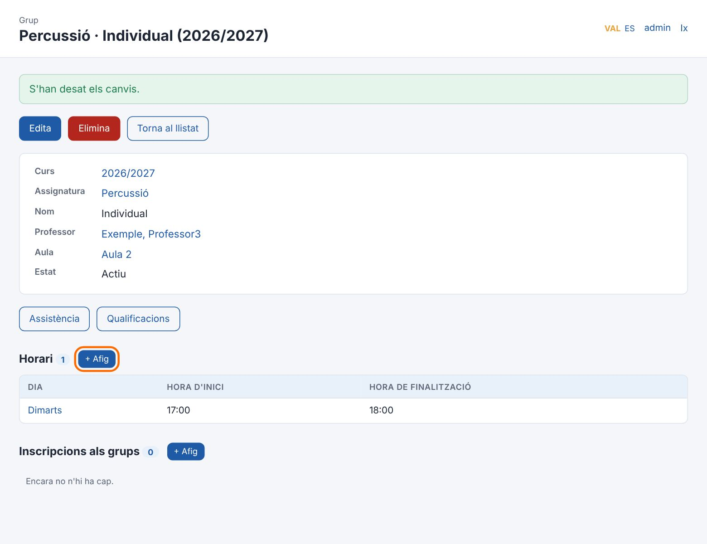

Des de la fitxa del grup també pots anar directament a les **Qualificacions** del grup.

### 5.5 Horari general

El menú **Horari** mostra totes les classes de la setmana. Pots filtrar per professor o per aula per a imprimir l'horari de cadascú.

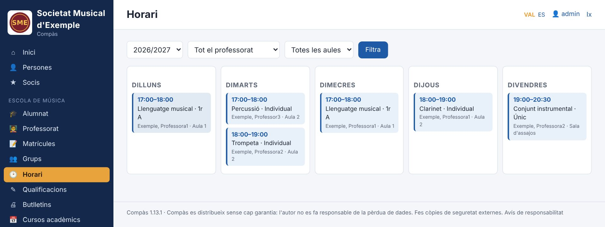

### 5.6 Passar al curs següent

Quan s'acosta el curs nou no cal crear-ho tot des de zero:

1. Menú **Cursos acadèmics**, obri el curs que acaba i prem **⏭ Passa al curs següent**.
2. Comprova el **nom** i les **dates** del curs nou (Compàs els proposa: 2027/2028, un any més).
3. Tria què es copia: els **períodes d'avaluació**, els **grups** amb el professor/a i l'aula, i l'**horari**. Si vols, també pots **matricular ja els alumnes que continuen** (sense grups).
4. Deixa marcat **Marca el curs nou com a curs actual** i, si vols, **Tanca** el curs anterior.
5. Prem **Crea el curs nou**.

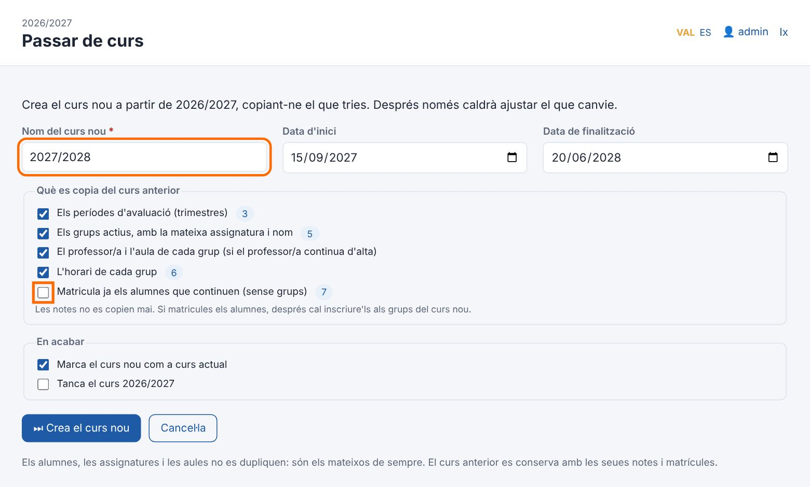

Després només cal ajustar el que canvie (un grup nou, un altre professor…) i inscriure els alumnes als grups. Les notes no es copien mai, i el curs anterior es conserva sencer.

## 6. Donar d'alta una persona

> **Una persona s'introdueix una sola vegada.** Ser alumne, soci, músic, professor o tutor legal són *funcions* que s'afigen a la seua fitxa. Abans de crear-ne una, **busca-la** al llistat per si ja existeix.

1. Menú **Persones → + Nou**.
2. Omple les dades obligatòries i la resta que tingues (correu, adreça…):

| Dada | Obligatòria |
|---|---|
| Nom, cognoms i data de naixement | Sempre |
| DNI/NIE i telèfon | Només si la persona és **major d'edat** (18 anys o més) |

3. Deixa marcat **Actiu**.
4. Prem **Desa**.

En posar una data de naixement de major d'edat, els camps DNI i telèfon passen a ser obligatoris i apareix l'asterisc al costat.

Si la persona és major d'edat i pagarà rebuts pel banc (un soci, o el pare o la mare d'un alumne), escriu el seu **IBAN**. Compàs crea la domiciliació (apartat 13.4). També s'hi pot escriure el número de compte antic de 20 xifres: Compàs el converteix en IBAN.

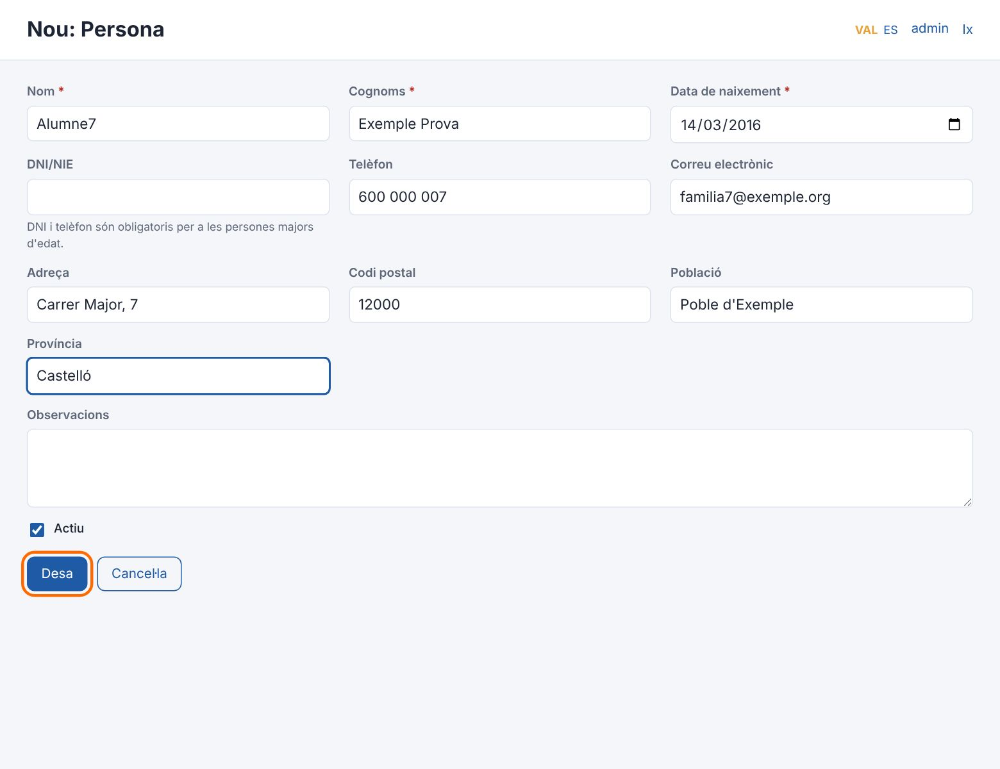

S'obri la **fitxa de la persona**, amb un apartat per a cada funció: Socis, Alumnat, Professorat, Músics i membres, Tutors legals (quan és tutor d'algú) i Cessions.

### Quan un alumne menor fa 18 anys

Dels menors no cal tindre el DNI ni el telèfon. Quan una persona fa 18 anys i no té eixes dades, Compàs ho avisa:

- Dalt del llistat de **Persones** apareix un **avís groc** amb el nombre de persones a qui falten dades.
- La seua fila es marca **en groc** amb el símbol ⚠. Si passes el ratolí per damunt, diu quines dades falten.
- A la seua fitxa també apareix l'avís, amb un enllaç per a editar-la.

Prem **Mostra-les** (o tria el filtre **Falten dades obligatòries**) per a vore només eixes persones. Obri cadascuna, prem **Edita**, completa el DNI i el telèfon i desa. L'avís desapareix quan ja no en falta cap.

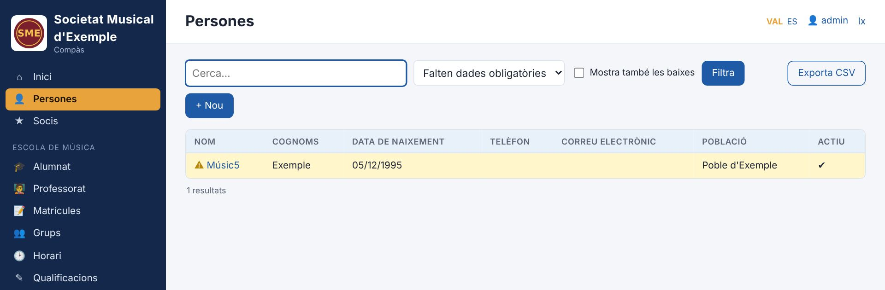

### Drets d'imatge (fotos i vídeos)

Abans de publicar fotos o vídeos en la web o les xarxes, la societat ha de tindre l'autorització de cada persona; per als menors, la del pare, la mare o el tutor/a.

1. Obri la fitxa de la persona (o de l'alumne) i prem **🖨 Full de consentiment**. Ix un full A4 amb les dades de l'alumne i del tutor/a, el text de l'autorització i l'espai per a signar.
2. Quan el tornen signat, edita la persona i, a **Drets d'imatge**, tria **Autoritza fotos i vídeos** o **No autoritza**. Si no poses la **data de la signatura**, es posa la de hui.

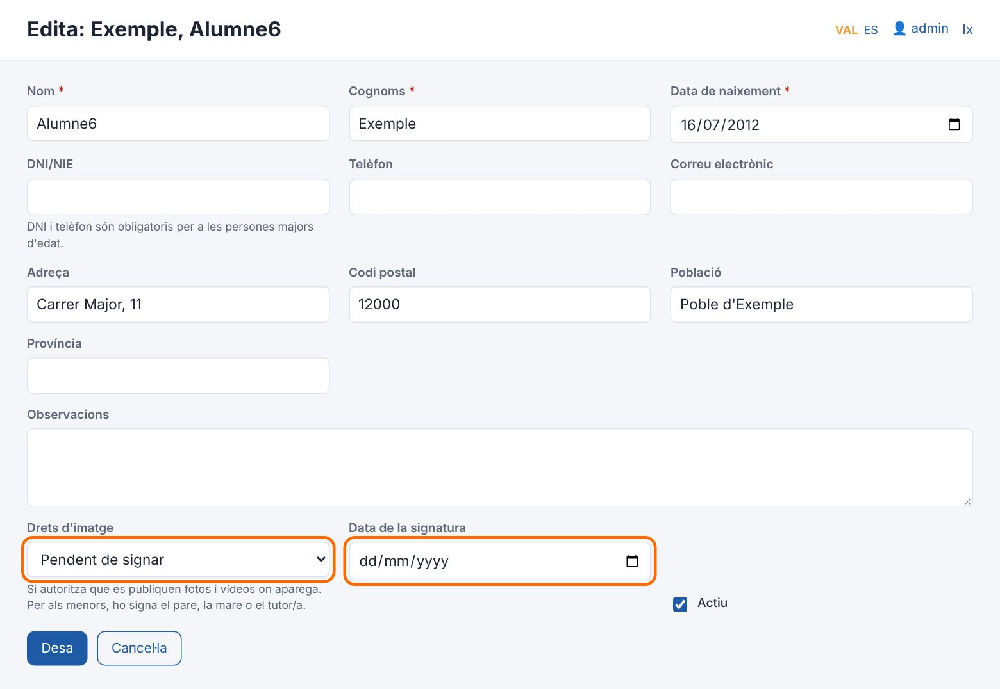

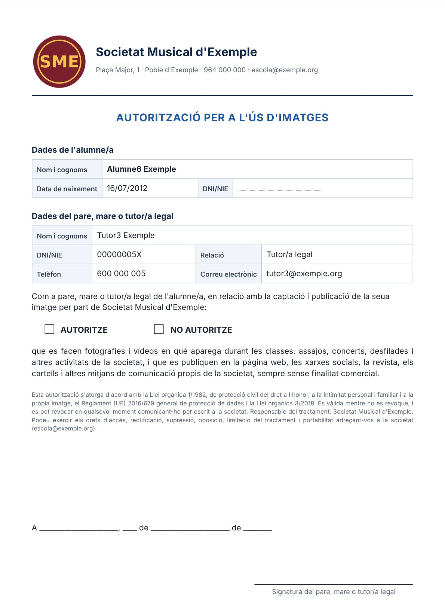

Per a repartir-los a principi de curs, a **Llistats i informes → Drets d'imatge** pots imprimir de colp els fulls de tots els pendents o els d'un grup (apartat 18). Al llistat de **Persones**, el filtre **Alumnes sense consentiment d'imatge signat** mostra qui falta.

> El text del full és un model. Revisa'l amb la junta i, si cal, afig-hi el que vulgues a **Configuració → Text addicional del full de consentiment**.

## 7. Alta d'un alumne (pas a pas)

Exemple complet: un xiquet nou que s'apunta a Llenguatge musical i Clarinet. El tutor legal (la mare o el pare) també ha d'estar donat d'alta com a persona.

### Pas 1. La persona

Dona d'alta l'alumne com a **persona** (apartat 6). Si el tutor legal encara no està donat d'alta, dona'l d'alta també.

### Pas 2. La fitxa d'alumne

1. A la fitxa de la persona, en l'apartat **Alumnat**, prem **+ Afig**.

2. La persona ja ve triada. Comprova la **data d'alta** i prem **Desa**.

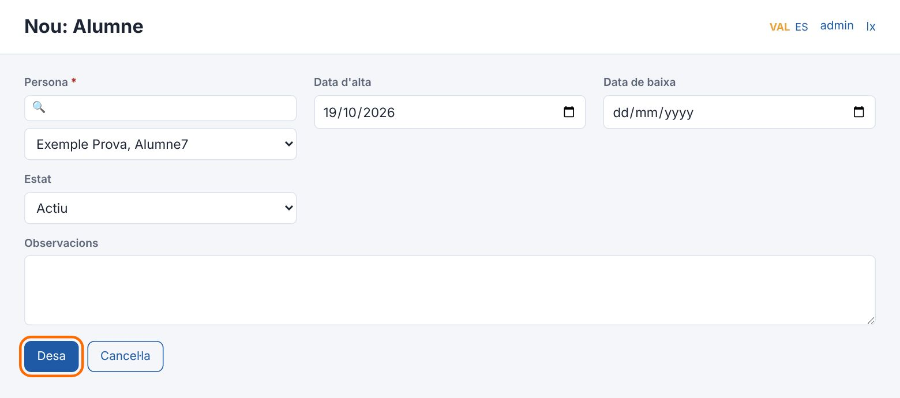

S'obri la **fitxa de l'alumne**, on es completen els passos següents.

### Pas 3. El tutor legal

1. A l'apartat **Tutors legals**, prem **+ Afig**.

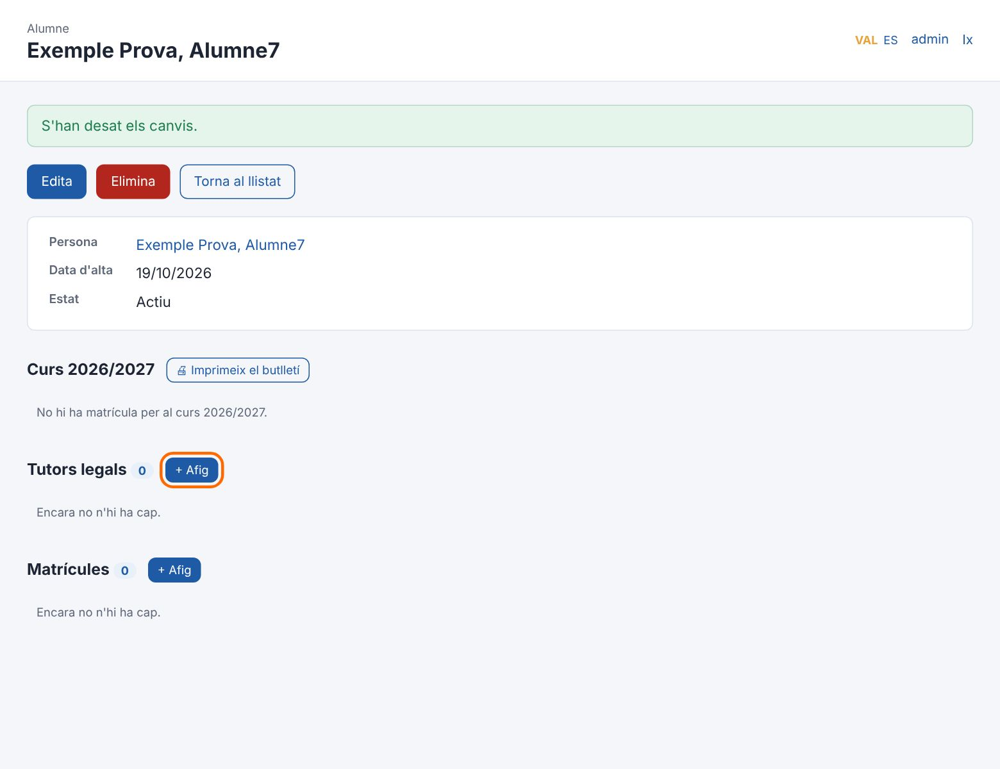

2. Al desplegable **Tutor legal**, escriu a la lupa el nom del pare, la mare o el tutor i tria'l.
3. Tria la **relació** (mare, pare, tutor/a legal…) i marca **Principal** si és el contacte principal.
4. Prem **Desa**. Repeteix-ho si hi ha més d'un tutor.

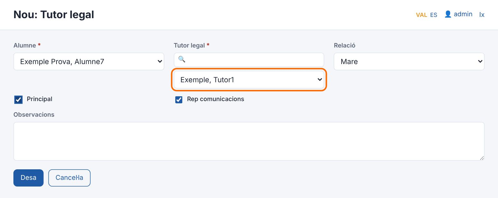

> Germans: tots dos alumnes poden tindre el mateix tutor. No cal donar-lo d'alta dues vegades.

### Pas 4. La matrícula del curs

1. A la fitxa de l'alumne, en l'apartat **Matrícules**, prem **+ Afig**.
2. Comprova que el **curs** és l'actual i prem **Desa**.

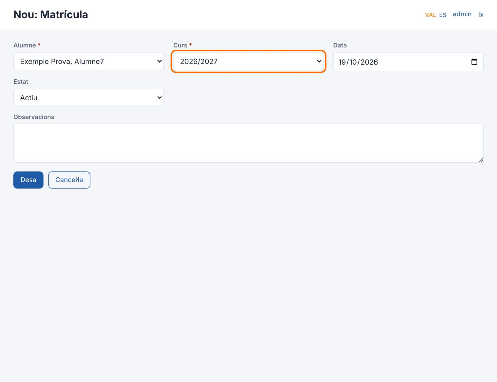

### Pas 5. Inscriure'l als grups

S'obri la fitxa de la matrícula.

1. A l'apartat **Inscripcions als grups**, prem **+ Afig**.

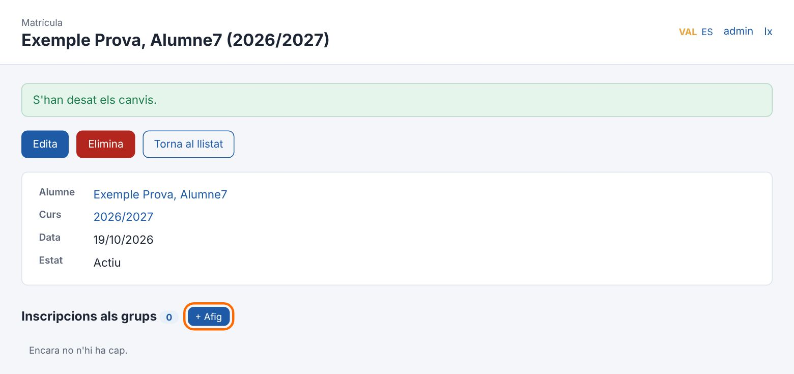

2. Tria el **grup** (per exemple *Llenguatge musical · 1r A*) i prem **Desa**.
3. Repeteix-ho per a cada assignatura (per exemple *Clarinet · Individual*).

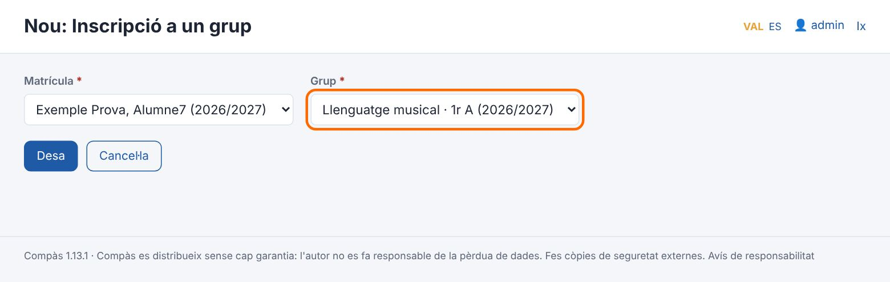

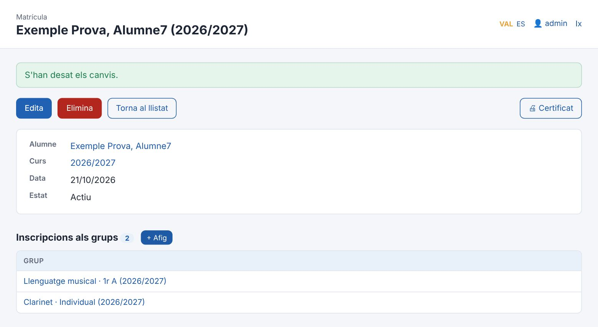

### Resultat

La fitxa de l'alumne mostra el resum del curs: grups, professors, horari i notes de cada avaluació, el botó per a **imprimir-ne el butlletí**, els tutors legals i les matrícules de tots els cursos.

### En començar un curs nou

1. Crea el curs nou amb **Passa al curs següent** (apartat 5.6): copia els períodes, els grups i l'horari, i pot matricular ja els alumnes que continuen.
2. Inscriu cada alumne als grups del curs nou des de la seua matrícula (pas 5).

Les matrícules i les notes dels cursos anteriors es conserven a la fitxa de l'alumne.

### Quan un alumne deixa l'escola

Edita la seua fitxa d'alumne i posa l'estat **Baixa** i la **data de baixa**. Si a més ja no és res de la societat, desmarca **Actiu** a la seua fitxa de persona.

## 8. Socis

### Tipus de soci

Cada societat té els tipus de soci que diuen els seus estatuts. Compàs en porta quatre per a començar (ordinari, protector, juvenil i d'honor), però es poden canviar, afegir-ne i donar-ne de baixa: al llistat de socis, prem **Tipus de soci**.

- **Nom** i, si es vol, una **descripció** (per exemple, «Majors de 65 anys»).
- **Ordre**: en quin lloc ix als llistats i al full d'alta.
- **Al full d'alta**: si qui es fa soci el pot triar. Els que nomena la societat (d'honor…) normalment no hi van.

Un tipus que ja tenen alguns socis o que té tarifa no es pot eliminar: es posa de **baixa** i deixa d'aparéixer en els socis nous.

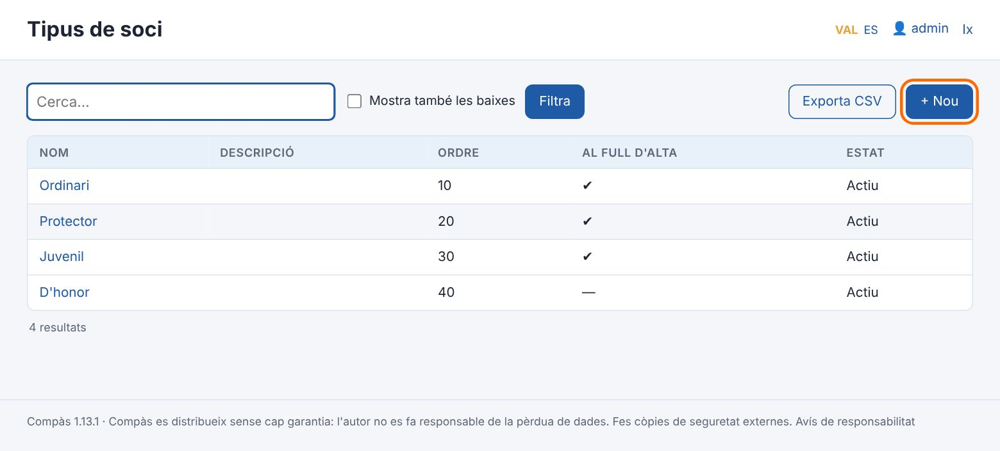

### Alta d'un soci

1. Busca o dona d'alta la **persona** (apartat 6).
2. A la seua fitxa, en l'apartat **Socis**, prem **+ Afig**.
3. Escriu el **número de soci**, tria el **tipus** (els que tinga la societat) i comprova la **data d'alta**.
4. Si les quotes es cobraran pel banc, escriu l'**IBAN** (si encara no el té a la seua fitxa de persona).
5. Prem **Desa**.

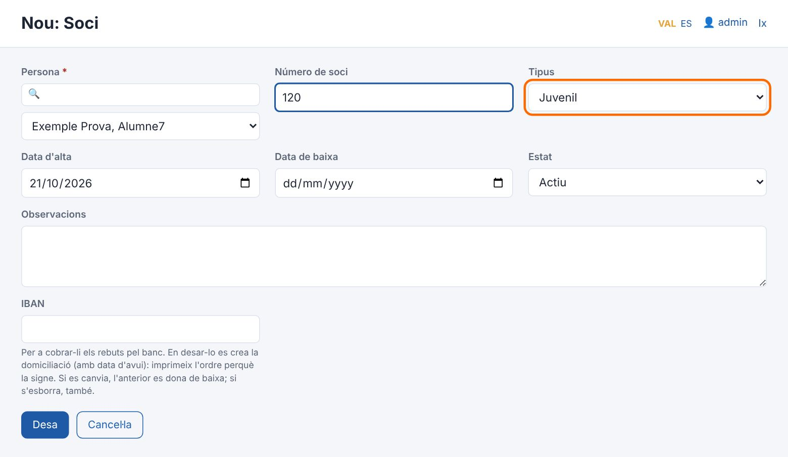

### Llistat de socis

El menú **Socis** mostra tots els socis actius. Pots buscar pel nom o pel número i exportar la llista a CSV (per exemple, per a fer etiquetes o enviar una circular).

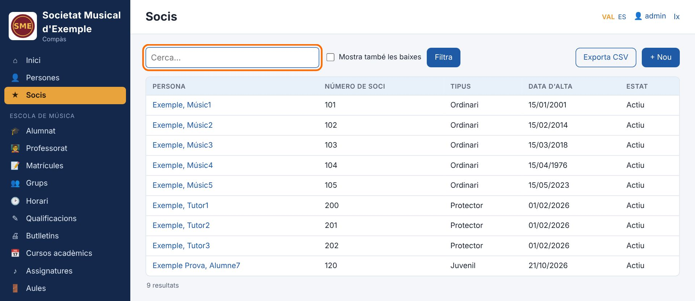

**Full d'alta de soci.** Al llistat de socis, **Full d'alta de soci** fa un full en blanc per a qui vol fer-se soci: dades personals, tipus de soci (amb la quota, si hi ha tarifes), forma de pagament, ordre de domiciliació SEPA, autorització d'imatge, signatura i la informació de protecció de dades. Els textos de dalt i del peu es poden canviar a **Configuració**.

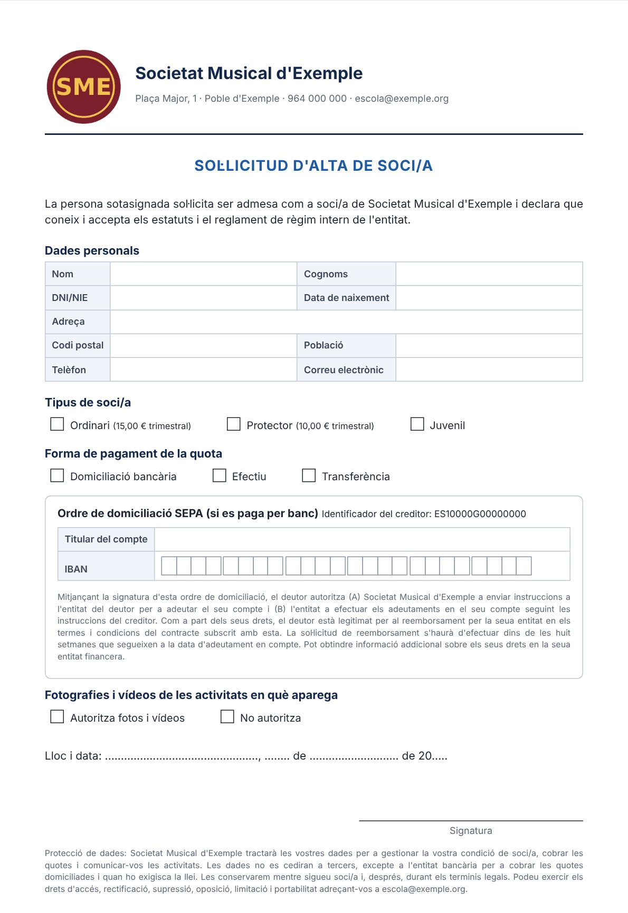

### Baixa d'un soci

1. Obri el soci i prem **Edita**.
2. Canvia l'**estat** a **Baixa** i posa la **data de baixa**.
3. Prem **Desa**.

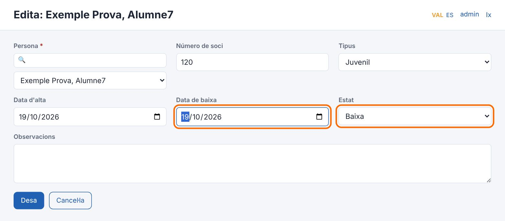

El soci desapareix del llistat, però es conserva amb el seu historial.

## 9. Músics, agrupacions i repertori

### Alta d'un músic en una agrupació

1. Busca o dona d'alta la **persona** (apartat 6).
2. A la seua fitxa, en l'apartat **Músics i membres**, prem **+ Afig**.
3. Tria l'**agrupació** (Banda, Banda juvenil, Coral…), escriu l'**instrument o veu** i tria la **funció**: membre, director/a titular, director/a assistent o responsable.
4. Prem **Desa**.

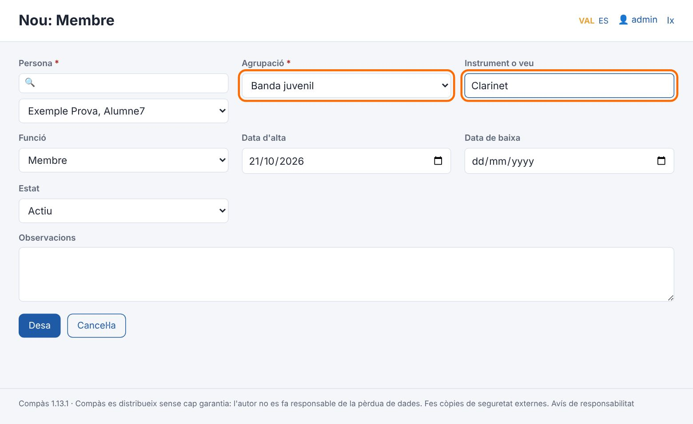

Una persona pot ser de diverses agrupacions: repeteix-ho per a cadascuna.

### Fitxa de l'agrupació

Menú **Agrupacions** → obri l'agrupació. Mostra tots els seus membres amb l'instrument i la funció. Des d'ací també pots afegir membres amb **+ Afig**.

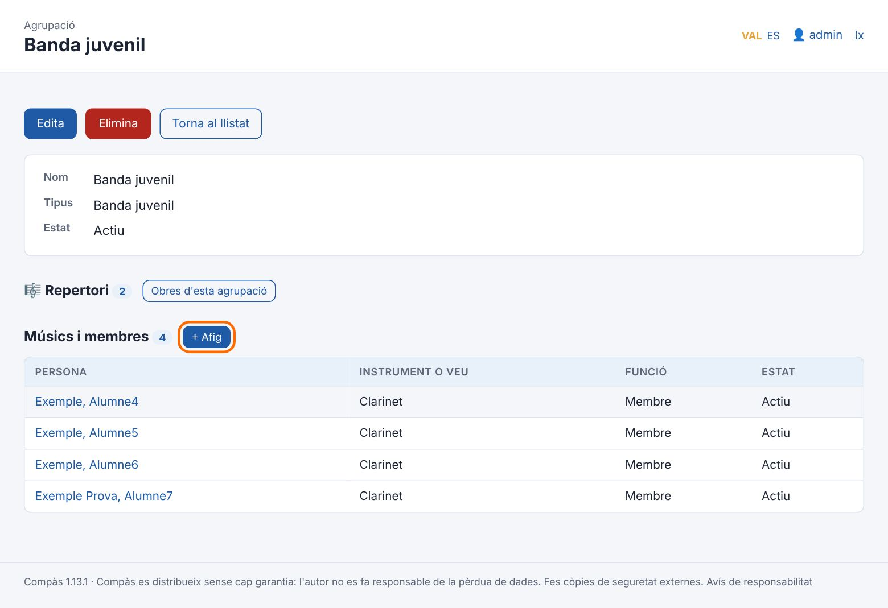

Per a crear una agrupació nova: menú **Agrupacions → + Nou**.

### Repertori: el catàleg de l'arxiu musical

Menú **Repertori**. És el catàleg de les obres que té la societat: de quin tipus són, per a quines agrupacions servixen, en quin estat estan i on és el material. Compàs no guarda partitures ni fitxers, només el catàleg.

Per a afegir una obra, prem **+ Obra**:

- **Títol**, **tipus d'obra** (pasdoble, marxa mora, marxa cristiana, marxa de processó, obertura, poema simfònic…), **compositor/a** i, si n'hi ha, **arranjador/a**.
- **Agrupacions** que la poden interpretar: es marquen les que ja hi ha a Compàs.
- **Número d'arxiu**: Compàs proposa el següent a l'última obra (si l'última era ARX-0027, proposa ARX-0028). No es pot repetir.
- **Ubicació** del material físic (Armari A · Prestatgeria 3 · Carpeta 27) i **material** que hi ha (Partitura + particel·les).
- **Estat** (complet, incomplet, en revisió o retirat), si està **digitalitzada** i **observacions**, per exemple quina particel·la falta.

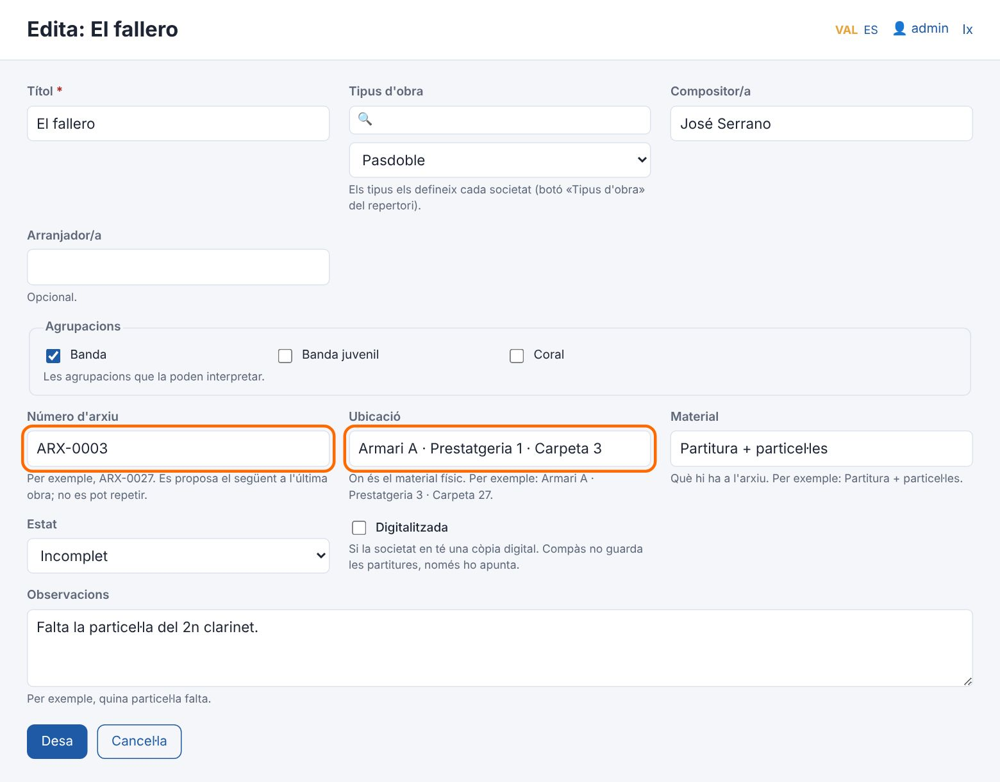

La pantalla del repertori té un **cercador** (títol, compositor, número d'arxiu, ubicació…), **filtres** per tipus, agrupació, estat i si està digitalitzada, i es pot **ordenar** per títol, compositor, número d'arxiu, tipus o ubicació. El que es veu es pot **imprimir** (o guardar en PDF) i **exportar a CSV**. Les obres incompletes o en revisió tenen un avís a la seua fitxa, i a la fitxa de cada agrupació hi ha un enllaç a les seues obres.

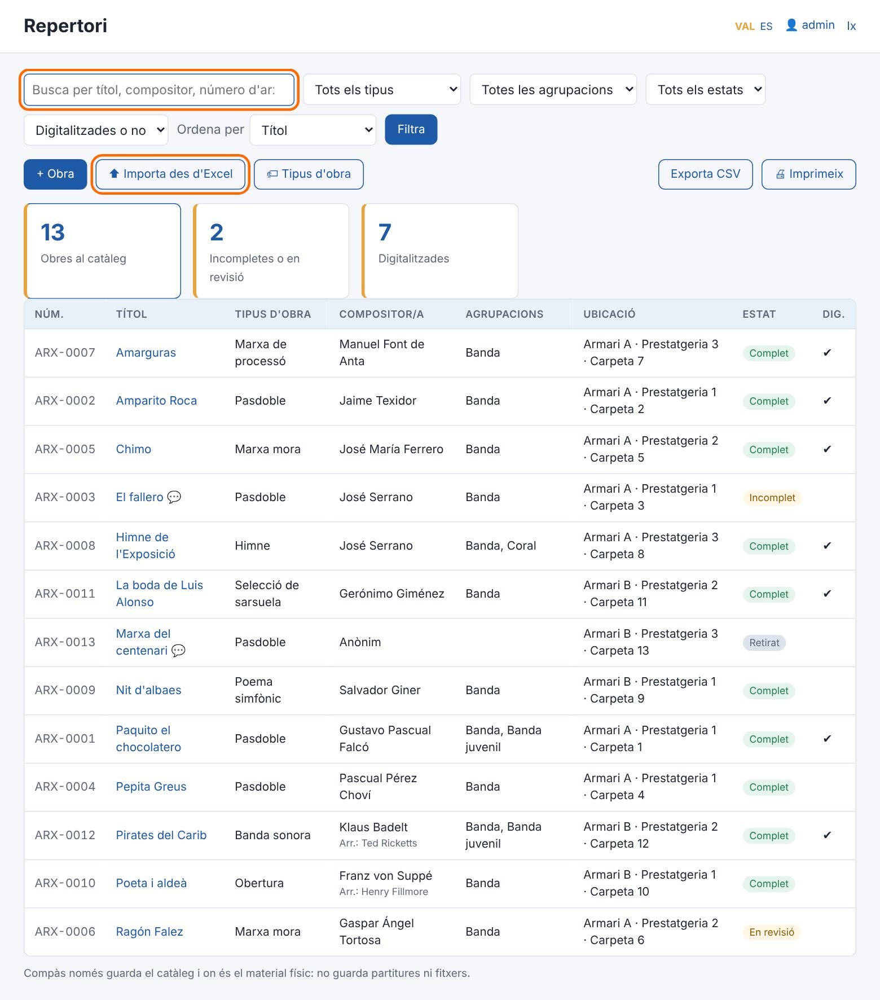

Els **tipus d'obra** els tria cada societat: al repertori, prem **Tipus d'obra** per a canviar-los, afegir-ne o ordenar-los. Un tipus que ja tenen algunes obres no es pot eliminar, però es pot donar de baixa.

Si la societat ja té el catàleg en un full de càlcul, no cal tornar-lo a escriure: es pot importar (apartat 19).

## 10. Qualificacions

El professorat passa les notes a administració i administració les introdueix.

1. Menú **Qualificacions**.
2. Tria el **grup** i l'**avaluació** (1r trimestre, 2n trimestre…).
3. Escriu la nota de cada alumne. És text lliure: `7`, `8,5`, `Notable`, `Apte`…
4. Si el professor ha passat observacions, escriu-les a **Observacions acadèmiques**. Ixen al butlletí.
5. Prem **Desa**.

Per a esborrar una nota, deixa en blanc la nota i les observacions i desa.

## 11. Butlletins de notes

1. Menú **Butlletins** (o el botó **Butlletins** de la pàgina de qualificacions, o **Imprimeix el butlletí** de la fitxa d'un alumne).
2. Tria l'**avaluació**. El butlletí mostra les notes d'esta avaluació i de les anteriors.
3. Tria **de qui**: tot l'alumnat matriculat, l'alumnat d'un grup o un sol alumne.
4. Si vols, escriu un **text al peu** (per exemple, la data de les audicions). Es recorda per a la pròxima vegada.
5. Prem **Prepara els butlletins**.

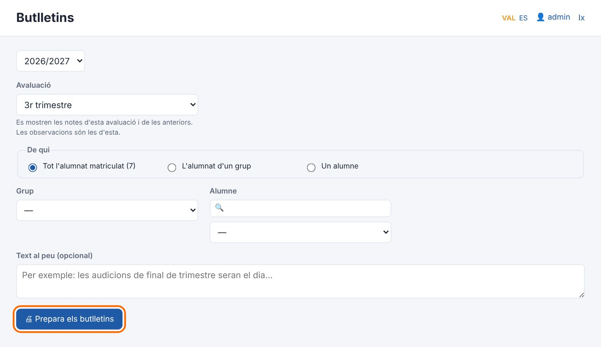

S'obri una pestanya nova amb un full A4 per alumne. Prem **Imprimeix el butlletí** (dalt de tot).

> Per a guardar-los en PDF (per a enviar-los per correu), tria **Microsoft Print to PDF** com a impressora.

## 12. Instruments i uniformes

### Alta d'un instrument

1. Menú **Inventari → + Nou**.
2. Omple el **número d'inventari** i el **tipus** (obligatoris) i la resta de dades: marca, model, número de sèrie, estat, ubicació i data d'adquisició.
3. Prem **Desa**.

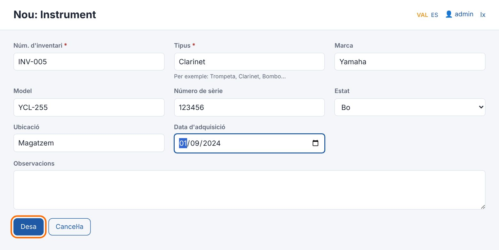

A la fitxa de l'instrument hi ha l'historial de **cessions** i de **manteniments** (reparacions, revisions…).

### Deixar un instrument (cessió)

1. A la fitxa de l'instrument, en l'apartat **Cessions**, prem **+ Afig**.
2. Tria la **persona**, comprova la **data d'entrega** i posa la **devolució prevista**, l'estat en què s'entrega i la fiança si n'hi ha.
3. Prem **Desa**.

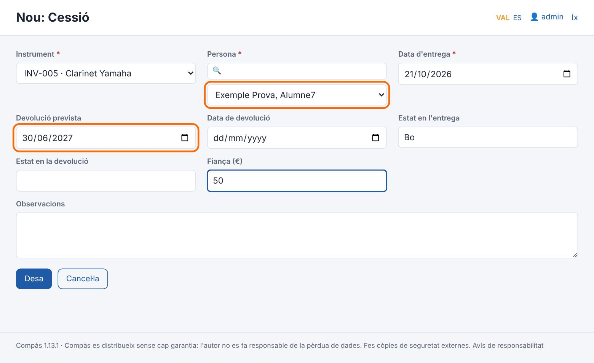

Un instrument no es pot deixar a dues persones alhora.

### Quan el tornen

1. Obri la cessió i prem **Edita**.
2. Posa la **data de devolució** i l'**estat en la devolució**.
3. Prem **Desa**. L'instrument torna a estar disponible.

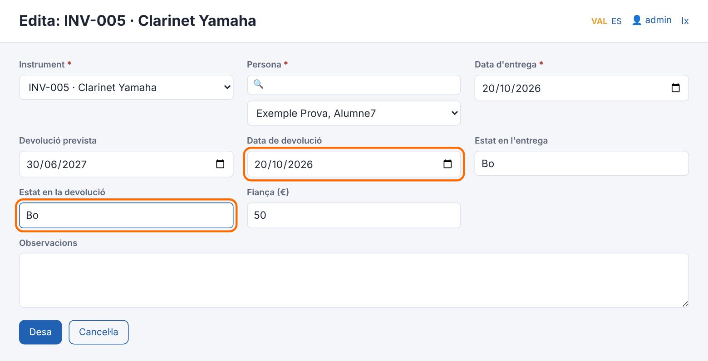

### Llistat de cessions

Menú **Cessions**. Amb el filtre pots vore les **cessions actives** o només les que tenen la **devolució vençuda**. Les vençudes també apareixen a l'inici.

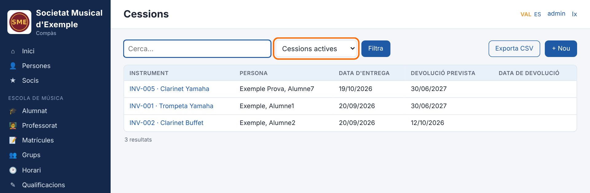

### Uniformes

Menú **Uniformes**: polos, samarretes, dessuadores, jaquetes, motxilles, gorres… amb el que s'ha comprat i el que queda de cada talla.

1. **+ Article**: el nom («Polo de la banda»), el tipus, les **talles** separades per comes en l'ordre en què s'han de mostrar (8, 10, 12, S, M, L, XL; buit si no en té, com una motxilla) i el preu de venda, si es ven.
2. **+ Compra**: quan arriben de la botiga, l'article, la talla, la quantitat, el preu i el proveïdor.
3. **+ Lliurament**: quan es dona a algú, la persona, la talla i si és una **venda** (se la queda i la paga; l'import es proposa amb el preu de l'article), un **préstec** (l'ha de tornar, com un uniforme de concert) o **gratuït**.

Quan es torna un préstec, s'edita el lliurament i es posa la **data de devolució**: la peça torna a estar disponible.

La pantalla mostra, per a cada article i talla, el **total** de peces que té la societat (les comprades, menys les venudes i les gratuïtes), les que estan **en préstec** i les **disponibles**. Si d'una talla s'han lliurat més de les que consten com a comprades, el número ix en roig: falta apuntar alguna compra. Els lliuraments de cada persona apareixen també a la seua fitxa.

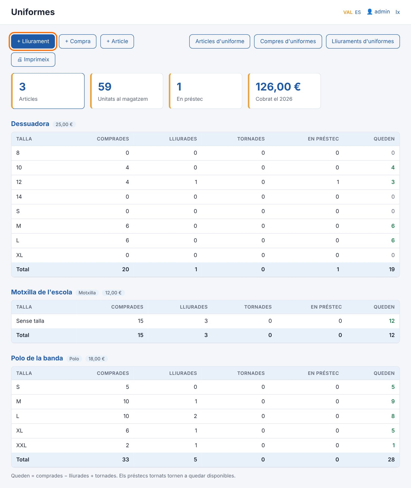

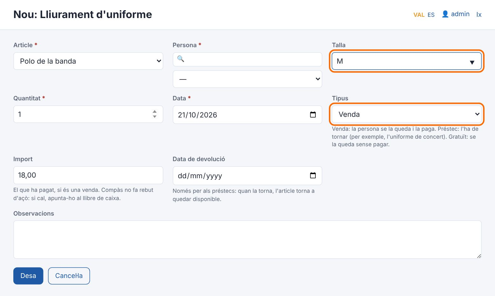

> Compàs no fa rebuts de les vendes d'uniformes. Si cal, apunta els diners al llibre de caixa (apartat 13.7).

## 13. Economia: quotes, escola i rebuts

L'apartat **Economia** del menú porta els diners de la societat: les quotes dels socis, la matrícula i les classes de l'escola, els rebuts, les remeses al banc i la loteria. **Resum econòmic** mostra el que hi ha per cobrar, el que s'ha cobrat enguany, els rebuts retornats pel banc i qui deu diners.

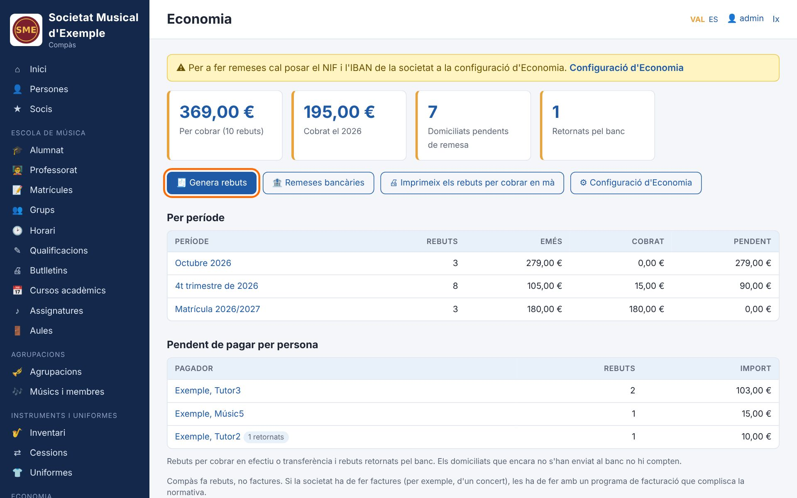

> Compàs fa **rebuts**, no factures. Si la societat ha de fer una factura (per exemple, d'un concert per a l'ajuntament), l'ha de fer amb un programa de facturació que complisca la normativa, o la gestoria.

### 13.1 Tarifes: el preu de cada cosa

Menú **Economia → Tarifes**. Cada tarifa té un nom (el que apareixerà al rebut), un tipus, una periodicitat i un import:

- **Quota de soci**: anual, semestral, trimestral o mensual. Es pot fer una per a cada **tipus de soci** (els de l'apartat 8). Si se'n deixa una sense tipus, val per als tipus que no en tinguen una de pròpia. Els socis d'un tipus sense tarifa (per exemple, els honoraris) no paguen.
- **Matrícula**: una sola vegada per curs i alumne.
- **Classes**: mensual, trimestral (per avaluacions) o anual. Si es posa una **assignatura**, es cobra a cada alumne inscrit en algun grup d'eixa assignatura. Si no, es cobra una vegada per alumne (una quota d'escola fixa).

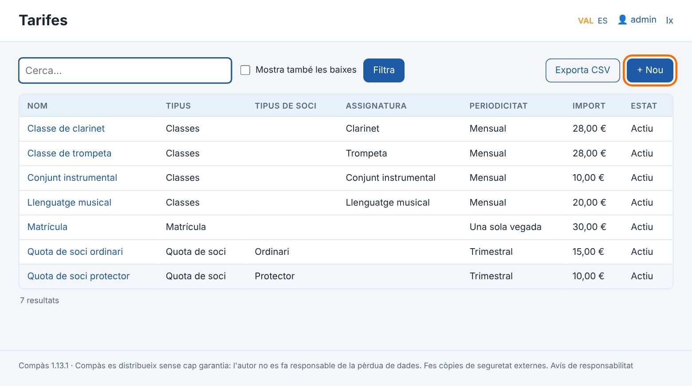

### 13.2 Dades del banc i descomptes

L'administrador/a ho configura una sola vegada a **Resum econòmic → Configuració d'Economia**:

- **Dades bancàries de la societat**: el NIF i l'IBAN on es cobren els rebuts. Les dona el banc quan es contracta el servei d'adeutaments directes SEPA («remeses» o «quadern 19»). Compàs calcula l'**identificador de creditor**: comprova que és el mateix que t'ha donat el banc.
- **Descomptes de l'escola**: un percentatge per a qui és soci (l'alumne o qui paga) i un altre per a cada germà a partir del segon. S'apliquen a les classes, no a la matrícula. A la fitxa de l'alumne es pot posar, a més, un **descompte propi** (família nombrosa, beca…) i **qui paga** les classes, si no és el tutor principal.
- **Text al peu dels rebuts**, si la societat en vol posar un.

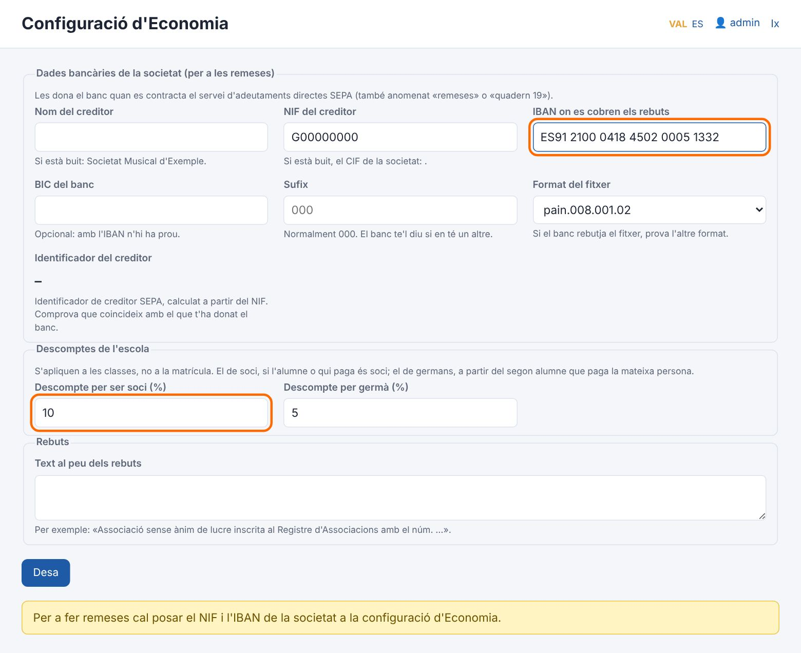

### 13.3 Generar els rebuts

Menú **Economia → Genera rebuts**. Hi ha dues opcions:

- **Quotes de soci**: tria l'any i el període (per exemple, el 1r trimestre). Es fa un rebut per a cada soci d'alta en eixe període.
- **Escola de música**: tria el curs i el període: la **matrícula**, un **mes**, una **avaluació** o el **curs complet**. Es fa **un rebut per família**: si el mateix pare o mare paga dos germans, va tot en un rebut, amb una línia per assignatura i els descomptes.

Prem **Previsualitza**: Compàs mostra qui pagarà, el detall i l'import, i avisa dels alumnes que no tenen qui pague. Si està bé, prem **Crea**. Si tornes a generar el mateix període, no es duplica res: els que ja existeixen apareixen com a «Ja generat».

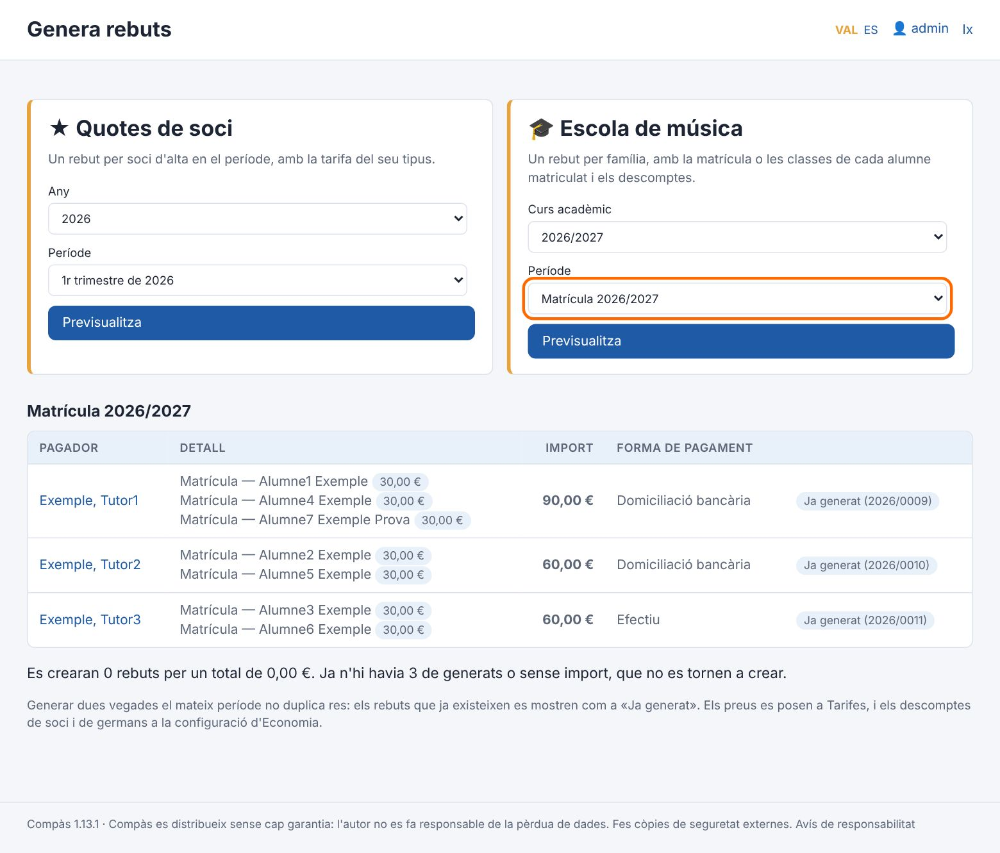

Els rebuts de qui té una **domiciliació** activa es cobraran pel banc; els altres, en **efectiu**. També es pot fer un rebut a mà amb **Rebuts → + Nou** (per exemple, un donatiu o la venda d'un uniforme).

### 13.4 Domiciliacions bancàries

Per a cobrar un rebut pel banc, qui paga ha d'haver signat l'**ordre de domiciliació** (el mandat SEPA). La manera més senzilla és escriure l'**IBAN a la fitxa de la persona o del soci**: en desar, Compàs crea la domiciliació amb la data de hui. Si després es canvia l'IBAN, l'anterior es dona de baixa i se'n crea una de nova (s'ha de tornar a signar); si s'esborra, es dona de baixa. També es pot fer des de **Economia → Domiciliacions → + Nou**, on es pot posar la data de signatura i un titular del compte diferent. Compàs comprova que l'IBAN és correcte i li posa una referència. Només es pot domiciliar a nom d'un major d'edat. Als llistats, l'IBAN només es veu en part.

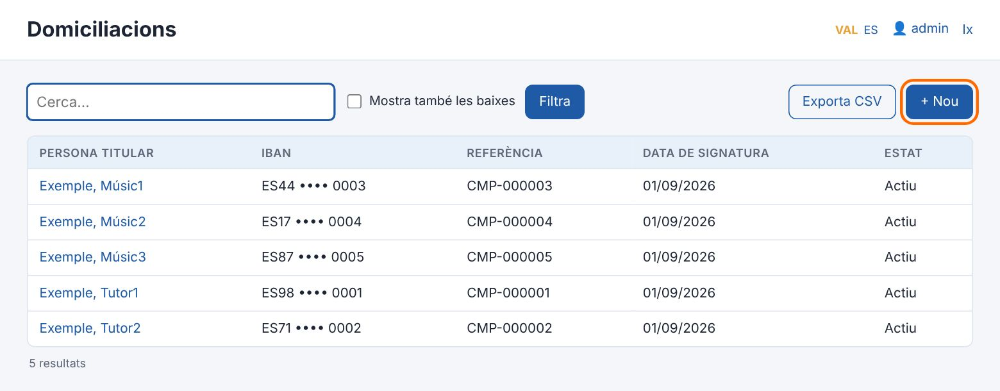

A la fitxa de la domiciliació, **Imprimeix l'ordre de domiciliació** fa el full per a signar. La societat ha de guardar-lo signat mentre es cobre i 14 mesos més.

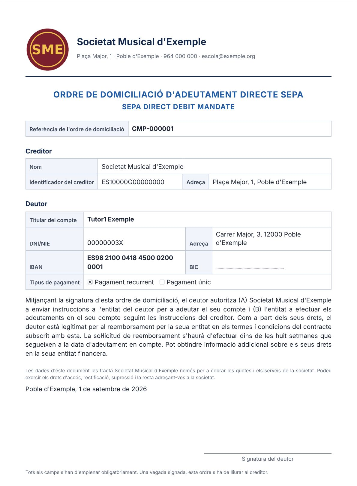

### 13.5 Remeses: cobrar pel banc

Menú **Economia → Remeses bancàries**. Apareixen els rebuts domiciliats pendents de cobrar (també els que el banc ha retornat). Tria'ls, posa la **data de cobrament** (molts bancs demanen almenys dos dies hàbils) i prem **Prepara la remesa**.

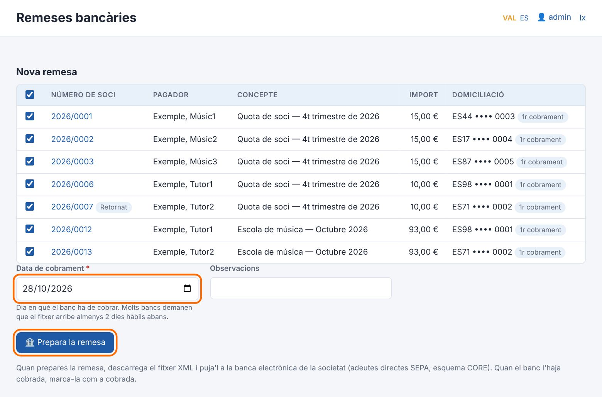

Després:

1. Prem **Descarrega el fitxer per al banc (XML)**.
2. Entra a la banca electrònica de la societat i puja'l a l'apartat d'adeutaments directes SEPA (esquema CORE). Si el banc rebutja el fitxer, canvia el **format** a la configuració d'Economia i torna a descarregar-lo.
3. Quan el banc l'haja cobrada, prem **Marca-la com a cobrada**: tots els rebuts queden pagats.

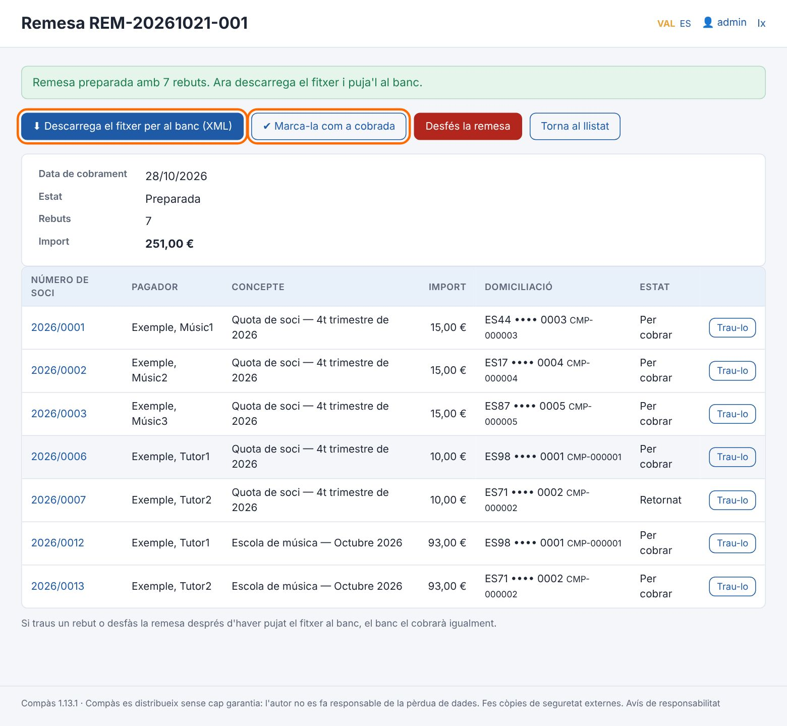

Si el banc **retorna** un rebut, obri'l i prem **Retornat pel banc**. Tornarà a estar per cobrar: el pots cobrar en mà o posar-lo en la remesa següent. Mentre una remesa no s'ha pujat al banc, se'n pot traure un rebut o desfer-la.

### 13.6 Cobrar en mà i imprimir rebuts

Obri el rebut, tria com s'ha pagat (**efectiu** o **transferència**) i la data, i prem **Pagat**. Amb **Imprimeix el rebut** es fa el rebut amb el logotip; si està pagat, porta el segell «PAGAT». Des del **Resum econòmic**, **Imprimeix els rebuts per cobrar en mà** els fa tots de colp, dos per full.

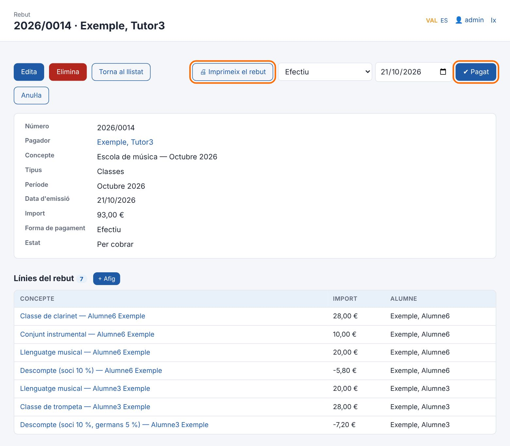

Al llistat de **Rebuts**, els filtres mostren els que estan per cobrar, els retornats, els que cal cobrar en mà o els domiciliats que encara no són en cap remesa. A baix es veu el total. A la fitxa de cada persona hi ha els seus rebuts i la seua domiciliació.

### 13.7 Llibre de caixa

Menú **Economia → Llibre de caixa**. Mostra tots els ingressos i despeses de l'any, amb el saldo després de cada moviment. Moltes coses hi entren soles:

- els rebuts cobrats en efectiu (a la caixa) o per transferència (al banc);
- les remeses cobrades, en una sola línia, com apareixen al banc;
- els diners de la loteria que lliura cada talonari.

La resta (factures, subvencions, la quota de la Federació…) s'apunta amb **+ Nou moviment**: data, ingrés o despesa, banc o caixa, categoria, concepte i import. Al final de la pàgina es posa el **saldo inicial** de l'1 de gener del banc i de la caixa, perquè els saldos siguen els reals. Es pot vore només el banc o només la caixa, imprimir-lo i exportar-lo a CSV. El resum **per categories** serveix per a presentar els comptes a l'assemblea i per a la memòria.

## 14. Loteria

Menú **Economia → Loteria → + Nou**. Escriu el nom del sorteig (per exemple, «Loteria de Nadal 2026»), la data, els **números**, el **preu** de cada participació, l'import que **juga** (la resta és el donatiu per a la societat) i quantes participacions porta cada talonari. A la fitxa, **Talonaris i liquidació** obri el resum.

### Repartir els talonaris

Tria la persona i quants talonaris s'endú, i prem **Reparteix talonaris**. Compàs els numera seguits: el talonari 1 porta les participacions 0001–0050, el 2 les 0051–0100, etc.

### Imprimir les participacions

A la fitxa de cada talonari, **Imprimeix les participacions** fa les seues 50 participacions (8 per full), amb el logotip, els números, el preu i el número de participació. Des del resum es poden imprimir totes de colp. El text legal del peu es canvia a la fitxa del sorteig.

### Liquidar

Quan algú torna el talonari, obri'l i apunta quantes participacions ha **venut**, quantes **torna** sense vendre i quants **diners lliura**. El resum mostra el que falta per lliurar (en roig), quant cal comprar a l'administració de loteria i el que queda per a la societat.

## 15. Junta directiva i actes

### 15.1 La junta

Menú **Societat → Junta directiva**. Mostra la junta actual i les anteriors. Per a posar un càrrec, prem **+ Afig un càrrec**: tria la persona, el càrrec (president/a, vicepresident/a, secretari/ària, tresorer/a, vocal…) i la data d'inici. La data de fi es deixa buida mentre el càrrec està vigent.

- **Anys de mandat:** posa els que diguen els estatuts. Compàs avisarà a l'inici quatre mesos abans que s'haja de renovar la junta.
- **Junta nova:** quan s'elegeix una junta nova, prem **Tanca els càrrecs actuals** amb la data de l'elecció i després afig els càrrecs nous. Els anteriors queden a l'historial. Recordeu que els canvis de junta s'han de comunicar al Registre d'Associacions.
- **Certificat de la composició de la junta:** per al banc, el registre o una subvenció.

Els **certificats** (de soci, de matrícula, d'agrupació i de la junta) i les **actes** els signa la secretaria amb el vistiplau de la presidència de la junta actual. Si cal que els signe una altra persona, es posa a **Configuració**.

### 15.2 Reunions i actes

Menú **Societat → Reunions i actes → + Nou**. Tria si és una reunió de la **junta** o una **assemblea** (ordinària o extraordinària), i posa la data, l'hora (en les assemblees, també la de segona convocatòria), el lloc i l'**ordre del dia**, un punt per línia.

A la fitxa de la reunió hi ha tres documents per a imprimir:

1. **Convocatòria**, amb l'ordre del dia numerat.
2. **Acta**. Després de la reunió, edita-la i completa els **assistents**, el **desenvolupament** i els **acords** (un per línia), i marca-la com a celebrada. En les reunions de junta, si no poses els assistents, l'acta posa la junta actual.
3. **Certificat d'un acord**: tria l'acord i Compàs fa el certificat que demanen sovint el banc o les administracions.

## 16. Documents de la societat

Menú **Societat → Documents**. Ací es guarden els estatuts, el reglament de règim intern, les actes signades, la inscripció al registre, el CIF, les pòlisses d'assegurança, els contractes del professorat i de la direcció, els convenis…

Per a afegir-ne un, prem **+ Nou**, escriu el títol, tria el tipus i el **fitxer** (PDF, imatge, Word, Excel, LibreOffice o text, fins a 20 MB). Si és d'una persona (un contracte, per exemple), tria-la: apareixerà també a la seua fitxa. Si el document caduca (una assegurança, una llicència, un conveni), posa la **data de caducitat**: Compàs avisarà a l'inici 60 dies abans.

El fitxer es guarda **dins de Compàs**, no en una carpeta a part. Així entra a les còpies de seguretat (i, si les xifreu, també va xifrat). A canvi, les còpies ocupen més si hi guardeu molts documents grans.

### Registre d'activitats de tractament (RGPD)

Des del llistat de documents, **Registre d'activitats de tractament (RGPD)** fa el document que el Reglament de protecció de dades demana a les entitats. Compàs el prepara amb les dades que tracta la societat i les mesures de seguretat que té configurades. És un model orientatiu: reviseu-lo, adapteu-lo i guardeu-lo signat amb la documentació de la societat.

## 17. Comunicats

Menú **Societat → Comunicats**. Compàs no envia correus ni es connecta a Internet: prepara les adreces perquè envieu el comunicat des del correu de la societat.

1. Tria **a qui**: els socis, la junta, el professorat, les famílies de l'escola o d'un grup, els membres d'una agrupació o tothom.
2. Prem **Copia les adreces** i apega-les al camp **CCO** (còpia oculta) del correu, perquè ningú no veja les adreces dels altres. Si són poques, **Obri el correu amb les adreces en CCO** ho fa directament.
3. Escriu i envia el correu des del vostre programa de correu.
4. Torna a Compàs i **registra el comunicat** amb l'assumpte: queda constància de què s'ha enviat, quan i a qui.

Les persones del grup que no tenen correu apareixen en una llista a part, per a avisar-les d'una altra manera.

## 18. Llistats, certificats i memòria

Menú **Documents i dades → Llistats i informes**. Cada llistat es pot vore a la pantalla, **imprimir** (o guardar en PDF) i **exportar a CSV** per a obrir-lo amb Excel.

### Alumnes d'un grup

Tria el curs i el grup. Ix cada alumne amb l'edat, el pare, la mare o el tutor/a i els seus telèfons i correus. És el llistat que necessita el professorat. En groc, els que no autoritzen fotos.

### Socis per número i músics per instrument

- **Socis per número**: tots els socis d'alta, ordenats pel número, amb DNI i contacte. Pots triar un tipus de soci.
- **Músics per instrument**: tria una agrupació i ix la plantilla agrupada per instrument o veu, amb el nombre de músics de cadascun.

### Drets d'imatge

Qui pot eixir en fotos i vídeos: el resum (quants autoritzen, quants no i quants falten) i la llista, amb els que no autoritzen en groc. Abans d'un concert, imprimeix-la per a qui fa les fotos. El botó **Fulls de consentiment dels pendents** imprimeix els fulls que falten.

### Etiquetes per a les circulars

1. Tria **per a qui**: socis, famílies de l'alumnat (els tutors que reben comunicacions), músics o totes les persones.
2. Tria el **format** del full d'etiquetes (ho diu la capsa: 24, 21 o 14 per full).
3. Si el full ja està començat, indica quantes etiquetes **ja s'han gastat**.
4. Prem **Prepara les etiquetes** i imprimeix amb la **mida real (100 %)** i **sense marges**.

> Fes primer una prova en paper normal amb **Mostra les vores** i posa-la damunt del full d'etiquetes a contrallum.

### Antiguitat i insígnies

Tria l'**any** i els **anys que es premien** (per defecte 25 i 50). Ix qui els complix eixe any, com a soci i com a músic. Marca **Mostra també la llista completa** per a vore tothom ordenat per antiguitat.

L'antiguitat es compta des de la data d'alta. Per als músics, des de la primera alta en qualsevol agrupació.

### Memòria anual i subvencions

Tria el curs. Ix el que solen demanar la Diputació, l'IVC o l'ajuntament: alumnes per edat (amb menors i majors), per assignatura i per població, professorat i grups, músics de cada agrupació (amb els menors), socis per tipus i les altes i baixes de l'any.

### Certificats

A la fitxa d'un **soci**, d'una **matrícula** o d'un **músic** (a **Músics i membres**) hi ha el botó **🖨 Certificat**. Ix un certificat en A4 amb el logotip, les dades de la persona i la data de hui, preparat per a signar. Serveix per a beques, el conservatori, la feina…

La primera vegada, a **Configuració → Certificats i fulls de consentiment**, posa qui signa (normalment el secretari/ària), el càrrec i, si voleu el vist i plau, el president/a. Posa també la **població** de la societat, que ix al final del certificat.

## 19. Importar dades des d'Excel

Si la societat ja té els socis o l'alumnat en un Excel, no cal tornar-los a escriure. Menú **Documents i dades → Importa dades**.

### Pas 1. El fitxer

1. Tria què vols importar: **Persones**, **Socis** (amb el número, el tipus i la data d'alta; el tipus es busca pel nom) **Alumnat** (amb el pare, la mare o el tutor/a, si el full els porta) o el **Repertori** (vegeu més avall).
2. Tria el fitxer: Excel (**.xlsx**) o **CSV**. Si és un .xls antic, obri'l amb Excel i guarda'l com a .xlsx.
3. Deixa marcat **La primera fila té els títols de les columnes** si és el cas, i prem **Següent**.

Si comences de zero, baixa una **plantilla**, omple-la i puja-la.

### Pas 2. Què és cada columna

Compàs reconeix les columnes habituals (Nom, Cognoms, DNI, Telèfon, Data de naixement…) i ja les deixa triades. Comprova-les i corregeix les que falten. Si el nom i els cognoms estan junts, tria **Nom i cognoms junts**. Les columnes que no tries no s'importen.

Si el full porta el **compte bancari** (IBAN o el número antic de 20 xifres), Compàs crea la domiciliació de cada persona major d'edat; en importar alumnat, la del pare, la mare o el tutor/a. Si hi ha una columna amb la **data de signatura** de la domiciliació, també l'agafa. A les persones que ja tenen una domiciliació amb un altre IBAN no se'ls canvia.

### Pas 3. Revisar i importar

Abans d'importar res, Compàs mostra cada fila:

| Estat | Què vol dir | Què es fa |
|---|---|---|
| **Nova** | No està a Compàs | Es crea |
| **Ja existeix** | Mateix DNI, o mateix nom i data de naixement | No es duplica: només es completen les dades que li falten |
| **Possible duplicat** | Mateix nom, però no es pot assegurar | Marca **És la mateixa persona** si ho és; si no, es crea nova |
| **Repetida al fitxer** / **Error** | Està dues vegades o no té nom | No s'importa |

A la columna **Avisos** veuràs, per exemple, dates que no s'entenen o persones a qui falten dades obligatòries (quedaran en groc, com sempre).

Prem **Importa**. Abans d'importar, Compàs fa una còpia de seguretat («Abans d'importar»): si el resultat no és el que esperaves, la pots restaurar (apartat 20).

### Importar el repertori

Tria **Repertori** en el primer pas. Compàs reconeix les columnes més habituals (número d'arxiu, títol, tipus, compositor, arranjador, agrupacions, ubicació, material, estat, digitalitzada i observacions); la del títol és l'única obligatòria.

- Els **tipus d'obra** que no existeixen es creen.
- Les **agrupacions** es busquen pel nom; si en són diverses, van separades per comes («Banda, Coral»). Les que no hi ha a Compàs s'avisen i no s'assignen.
- L'**estat** s'entén encara que estiga escrit d'una altra manera («Completa», «Falta la flauta»…), i **Digitalitzada** accepta «Sí», «X» o «1».
- Les obres que **ja són al catàleg** (pel número d'arxiu o, si no en tenen, pel títol i el compositor) no es toquen, si no marques **Actualitza-la amb el full**. Les repetides dins del mateix full s'importen una sola vegada.

El CSV que es baixa del repertori es pot tornar a importar: és una manera senzilla de corregir moltes obres alhora amb Excel.

## 20. Còpies de seguretat

Totes les dades estan en un sol fitxer. Compàs en fa còpies automàticament:

| Quan | Tipus |
|---|---|
| La primera vegada que s'utilitza cada dia | Automàtica (diària) |
| En tancar Compàs, si hi ha hagut canvis | Automàtica (en tancar) |
| Quan prems **Fes una còpia ara** | Manual |
| Just abans de restaurar | Abans de restaurar |
| Just abans d'importar dades | Abans d'importar |

Menú **Administració → Còpies de seguretat**:

### Configurar la carpeta externa (molt important)

Si l'ordinador s'espatlla o el roben, les còpies que hi ha dins es perden amb ell. Cal guardar-les també fora:

1. Connecta un **disc o llapis USB**, o tria una carpeta **sincronitzada amb el núvol** (OneDrive, Google Drive…).
2. Crea-hi una carpeta, per exemple `Copies Compàs`, i copia'n la ruta des de l'Explorador de Windows (per exemple `E:\Copies Compàs`).
3. A **Configuració de les còpies**, enganxa la ruta a **Carpeta externa**.
4. Prem **Desa**.

A partir d'ara, cada còpia es guarda també en esta carpeta. Si no està disponible (per exemple, el USB no està connectat) o fa més de 7 dies que no s'hi guarda res, l'inici ho avisa.

### Llista de còpies, restaurar i eliminar

- **Baixa**: descarrega aquella còpia.
- **Restaura** (només l'administrador/a): substitueix totes les dades actuals per les de la còpia. Abans, Compàs guarda una còpia de les dades actuals («Abans de restaurar»), de manera que sempre es pot tornar arrere. Després cal tornar a entrar.
- **Elimina** (només l'administrador/a): esborra la còpia.

Per a restaurar una còpia guardada fora (per exemple, des del USB), utilitza **Restaura des d'un fitxer**, al final de la pàgina.

> Les còpies contenen dades personals, també de menors. Guarda-les en un lloc segur.

### Còpies externes xifrades

Si la carpeta externa és un llapis USB o el núvol, convé xifrar-les: si es perd el USB, ningú podrà obrir les dades sense la contrasenya.

1. A **Configuració de les còpies**, marca **Xifra amb contrasenya les còpies de la carpeta externa**.
2. Escriu una contrasenya (almenys 8 caràcters) dues vegades i prem **Desa**.

A partir d'ara, les còpies de la carpeta externa acaben en `.xifrat`. Les de l'ordinador no es xifren. Per a restaurar-ne una, a **Restaura des d'un fitxer** tria el fitxer `.xifrat` i escriu la contrasenya.

> **Apunta la contrasenya en paper** junt amb el codi de recuperació. Si s'oblida, les còpies xifrades no es poden recuperar.

## 21. Usuaris i contrasenyes

### Canviar la teua contrasenya

Cada usuari pot canviar la seua quan vulga:

1. Al menú, a baix de tot, prem **Compte i contrasenya** (o fes clic en el teu nom d'usuari, dalt a la dreta).
2. Escriu la **contrasenya actual**.
3. Escriu la **contrasenya nova** dues vegades (almenys 8 caràcters).
4. Prem **Desa**.

Si no recordes l'actual, no la pots canviar ací: l'administratiu/va ha de demanar-ne una de nova a l'administrador/a, i l'administrador/a pot recuperar l'accés des de l'entrada (vegeu més avall).

### Gestionar els comptes (administrador/a)

Menú **Administració → Usuaris**. Obri un compte per a:

- canviar-li el **rol** (administrador/a o administratiu/va);
- posar-li una **contrasenya nova** si l'ha oblidada (deixa-la en blanc per a no canviar-la);
- desactivar-lo (desmarca **Actiu**) o eliminar-lo.

Sempre ha de quedar almenys un administrador actiu.

### Si l'administrador/a oblida la contrasenya

1. A la pantalla d'entrada, prem **Eres l'administrador/a? Recupera l'accés**.
2. Escriu el teu **usuari**, el **codi de recuperació** que vas guardar i la **contrasenya nova** dues vegades.
3. Prem **Canvia la contrasenya**. Entraràs directament al programa.
4. Compàs mostra un **codi de recuperació nou**, perquè l'anterior ja no val. Imprimeix-lo i guarda'l en lloc de l'antic.

**Si no trobes el codi**, prem **No tinc el codi de recuperació** a la mateixa pàgina i segueix els passos:

1. Obri l'Explorador de fitxers i ves a la carpeta de dades de Compàs. La pàgina mostra la ruta exacta: copia-la a la barra d'adreces de l'Explorador.
2. Crea-hi un fitxer nou (botó dret → **Nou → Document de text**) i posa-li de nom `recupera-acces`.
3. Torna a la pàgina de Compàs i recarrega-la (tecla **F5**). Ja no demanarà el codi: escriu l'usuari i la contrasenya nova.

El fitxer només val durant una hora i s'esborra sol en usar-lo. Este sistema és segur perquè només pot crear el fitxer qui ja té accés a l'ordinador i a les dades.

### Codi de recuperació

Si has perdut el codi o creus que algú l'ha vist, ves a **Administració → Usuaris** i, a baix, prem **Genera un codi nou**. L'anterior deixa de valdre. Si Compàs es va instal·lar abans de la versió 1.3, la pantalla d'inici avisa que no hi ha codi fins que el generes.

Totes les recuperacions, també les que fallen, queden al **Registre d'activitat**.

### Registre d'activitat

Menú **Administració → Registre d'activitat** (només l'administrador/a): qui ha creat, modificat o eliminat cada cosa, les entrades al programa, els butlletins impresos i les còpies.

## 22. Ajuda

El menú **Ajuda** mostra este manual dins del programa. Els botons de dalt obrin el manual i la guia d'instal·lació en PDF.

## 23. Preguntes freqüents

**He donat d'alta una persona dues vegades. Què faig?** Si la segona no té res vinculat, obri-la i prem **Elimina**. Si ja té coses vinculades, edita-les perquè apunten a la persona bona i després elimina la repetida.

**Per què una persona apareix en groc?** Li falten dades obligatòries: normalment, ha fet 18 anys i no té DNI o telèfon. Completa-les (apartat 6).

**No trobe un alumne al llistat.** Pot estar de baixa: marca **Mostra també les baixes**.

**No em deixa eliminar una cosa.** Té historial relacionat. Posa-la de baixa o com a inactiva (apartat 3).

**L'alumne no apareix en les notes del grup.** Comprova que té matrícula en el curs actual, en estat Actiu, i que està inscrit en aquell grup (apartat 7, pas 5).

**El butlletí no mostra una assignatura.** L'alumne no està inscrit en aquell grup dins de la seua matrícula.

**L'administrador/a ha oblidat la contrasenya.** Prem **Recupera l'accés** a la pantalla d'entrada i utilitza el codi de recuperació. Si no el trobes, també hi ha una manera sense codi (apartat 21).

**Hem de passar a Compàs els socis que tenim en Excel.** Utilitza **Importa dades** (apartat 19): no cal escriure'ls a mà, i les persones que ja hi ha no es dupliquen.

**Qui pot eixir en les fotos del concert?** **Llistats i informes → Drets d'imatge** (apartat 18).

**Com cobrem les quotes pel banc?** Posa les dades bancàries de la societat, crea la domiciliació de cada pagador, genera els rebuts i prepara una remesa: Compàs fa el fitxer que es puja a la banca electrònica (apartat 13).

**Compàs fa factures?** No, fa rebuts. Les factures s'han de fer amb un programa de facturació que complisca la normativa (Verifactu).

**Compàs envia les nostres dades a algun lloc?** No. Tot es queda a l'ordinador i, si la configureu, a la carpeta externa de còpies. Ho explica la declaració de privacitat: menú **Ajuda → Privacitat**.

**He d'estar connectat a Internet?** No.

**On estan les dades?** A la carpeta `data` del programa (`data\compas.db`). La ruta exacta es veu a **Configuració**.

**Com passe Compàs a un altre ordinador?** Instal·la Compàs a l'ordinador nou i, a **Còpies de seguretat → Restaura des d'un fitxer**, carrega l'última còpia.
