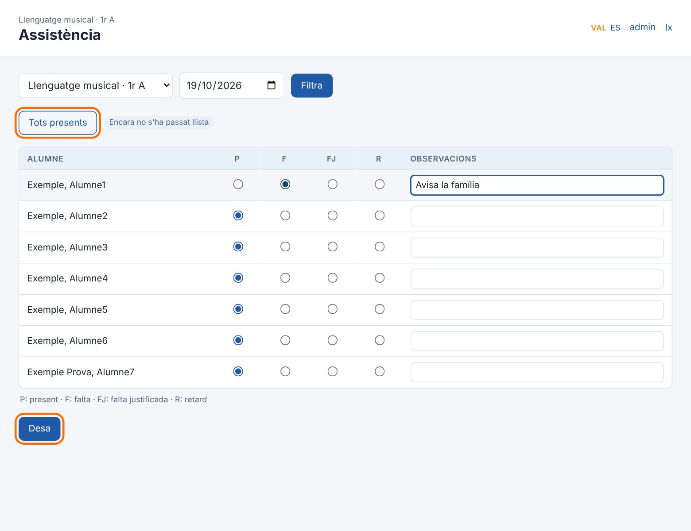

# Manual d'usuari de Compàs

## 1. Abans de començar

Compàs és el programa de gestió de la societat musical: persones, socis, escola de música, agrupacions, instruments i còpies de seguretat. Funciona en **un sol ordinador amb Windows**, sense Internet, i té dos comptes:

| Compte | Què pot fer |
|---|---|
| **Administrador/a** | Tot. També gestionar usuaris, la configuració, el registre d'activitat i restaurar còpies. |
| **Administratiu/va** | La gestió diària: persones, socis, escola, faltes, notes, butlletins, agrupacions, instruments i fer còpies. |

> En aquest manual, el botó o el camp que cal utilitzar en cada pas apareix **marcat en taronja** a les captures.

### Obrir i tancar Compàs

1. Fes doble clic a la icona **Compàs** de l'escriptori o del menú Inici.
2. S'obri una finestra menuda de Compàs i, al cap d'uns segons, el navegador amb el programa.
3. **No tanques la finestra menuda** mentre treballes: és la que fa funcionar Compàs.
4. Per a acabar, tanca la finestra menuda. Compàs farà una còpia de seguretat si hi ha hagut canvis i s'aturarà.

Si el navegador no s'obri sol, prem **Obri Compàs** a la finestra menuda.

### Entrar

Escriu el teu usuari i la contrasenya i prem **Entra**. A baix pots triar l'idioma.

Si oblides la contrasenya, l'administrador te'n pot posar una de nova (vegeu l'apartat 15).

### La primera vegada: configuració inicial

La primera vegada que s'obri Compàs apareix la **Configuració inicial**:

1. Escriu el **nom de la societat musical**.
2. Tria l'**idioma** per defecte.
3. Crea l'**usuari administrador** i la seua contrasenya (almenys 8 caràcters). Apunta-la en un lloc segur.
4. Si vols, crea també el compte d'**administratiu/va** (es pot fer després).
5. Marca **Carrega dades d'exemple** només si vols provar el programa amb dades inventades.
6. Prem **Comença**.

> Per a començar a treballar de veres sense les dades d'exemple, tanca Compàs, esborra la carpeta `data` del programa i torna a obrir-lo.

## 2. La pantalla principal

- **Menú lateral** (esquerra): totes les seccions, agrupades per Escola de música, Agrupacions, Instruments i Administració.
- **Dalt a la dreta**: canvi d'idioma (`VAL` / `ES`), el teu nom d'usuari (per a canviar la contrasenya) i **Ix** per a eixir.
- **Inici**: un resum amb el nombre de persones, socis, matriculats, grups, músics i instruments cedits. Fes clic en qualsevol xifra per a anar a la llista.
- **Avisos**: les cessions d'instruments amb la devolució vençuda, les classes de hui i els avisos de còpies de seguretat.

## 3. Com es treballa amb Compàs

Totes les seccions funcionen igual. Si n'aprens una, les saps totes.

### Llistats

- **Cerca**: escriu un nom, cognom, telèfon… i prem **Filtra**.
- **Mostra també les baixes**: per defecte s'amaguen les persones inactives i les baixes.
- **Exporta CSV**: descarrega la llista per a obrir-la amb Excel o LibreOffice Calc.
- **+ Nou**: crea un element nou.
- Fes clic en qualsevol fila per a obrir-ne la **fitxa**.

### Fitxes

La fitxa mostra totes les dades d'un element i tot el que hi està relacionat. Per exemple, la fitxa d'una persona mostra si és sòcia, alumna, professora, música…

- **Edita**: canvia les dades.
- **Elimina**: només es pot si no té res relacionat (vegeu «Baixes» més avall).
- **+ Afig** de cada apartat: crea un element **ja vinculat** a aquesta fitxa. És la manera més ràpida de treballar.

### Formularis

- Els camps amb asterisc (*) són obligatoris.
- En els desplegables llargs (persones, grups…) hi ha una **lupa** damunt: escriu-hi per a filtrar les opcions.
- Prem **Desa** per a guardar o **Cancel·la** per a tornar sense guardar.

### Baixes: per què no s'elimina res

Compàs no deixa eliminar res que tinga historial (matrícules, notes, cessions…), perquè no es perda informació. En lloc d'eliminar:

- una **persona** que ja no té relació amb la societat: edita-la i desmarca **Actiu**;
- un **soci, alumne, professor o músic**: edita'l, posa l'**estat «Baixa»** i la **data de baixa**.

Les baixes desapareixen dels llistats, però es poden tornar a veure marcant **Mostra també les baixes**.

## 4. Configuració de la societat i logotip

Menú **Administració → Configuració** (només l'administrador/a).

1. Omple les dades de la societat: nom, CIF, adreça, telèfon, correu i web. Ixen als butlletins.
2. A **Logotip de la societat**, prem el botó de triar fitxer i selecciona la imatge del logotip (PNG, JPG o WEBP, fins a 3 MB).
3. Prem **Desa**. El logotip apareix al menú i als butlletins.

## 5. Preparar el curs acadèmic

Abans de matricular cal tindre el curs preparat. Ordre recomanat: **curs → períodes → assignatures i aules → professorat → grups → horaris**.

### 5.1 Curs i períodes d'avaluació

1. Menú **Cursos acadèmics → + Nou**.
2. Nom (per exemple `2026/2027`), data d'inici i de finalització.
3. Marca **Curs actual**. Només n'hi pot haver un; és el que s'utilitza en l'assistència, les notes i els butlletins.
4. Prem **Desa**. S'obri la fitxa del curs.
5. A l'apartat **Períodes d'avaluació**, prem **+ Afig** i crea'n un per a cada avaluació (`1r trimestre`, `2n trimestre`, `3r trimestre`), amb l'ordre 1, 2, 3.

### 5.2 Assignatures i aules

- Menú **Assignatures → + Nou**: nom (Llenguatge musical, Trompeta, Clarinet…) i tipus.
- Menú **Aules → + Nou**: nom i capacitat.

Només cal crear-les una vegada: es reutilitzen cada curs.

### 5.3 Professorat

Un professor és una **persona** amb fitxa de professor:

1. Dona d'alta la persona (apartat 6) o busca-la si ja existeix.
2. A la seua fitxa, en l'apartat **Professorat**, prem **+ Afig**.
3. Comprova la data d'alta i prem **Desa**.

### 5.4 Grups i horaris

Un **grup** és una assignatura impartida en un curs per un professor: per exemple *Llenguatge musical · 1r A* o *Trompeta · Individual*.

1. Menú **Grups → + Nou**.
2. Tria el **curs**, l'**assignatura**, escriu el **nom** del grup i tria el **professor** i l'**aula**.
3. Prem **Desa**. S'obri la fitxa del grup.

4. A l'apartat **Horari**, prem **+ Afig**, tria el **dia** i les hores d'inici i de fi, i prem **Desa**. Repeteix-ho si el grup té classe més d'un dia.

Des de la fitxa del grup també pots anar directament a l'**Assistència** i a les **Qualificacions** del grup.

### 5.5 Horari general

El menú **Horari** mostra totes les classes de la setmana. Pots filtrar per professor o per aula per a imprimir l'horari de cadascú.

## 6. Donar d'alta una persona

> **Una persona s'introdueix una sola vegada.** Ser alumne, soci, músic, professor o tutor legal són *funcions* que s'afigen a la seua fitxa. Abans de crear-ne una, **busca-la** al llistat per si ja existeix.

1. Menú **Persones → + Nou**.
2. Omple el **nom** (obligatori) i la resta de dades que tingues: cognoms, data de naixement, DNI, telèfon, correu, adreça…
3. Deixa marcat **Actiu**.
4. Prem **Desa**.

S'obri la **fitxa de la persona**, amb un apartat per a cada funció: Socis, Alumnat, Professorat, Músics i membres, Tutors legals (quan és tutor d'algú) i Cessions.

## 7. Alta d'un alumne (pas a pas)

Exemple complet: un xiquet nou que s'apunta a Llenguatge musical i Clarinet. El tutor legal (la mare o el pare) també ha d'estar donat d'alta com a persona.

### Pas 1. La persona

Dona d'alta l'alumne com a **persona** (apartat 6). Si el tutor legal encara no està donat d'alta, dona'l d'alta també.

### Pas 2. La fitxa d'alumne

1. A la fitxa de la persona, en l'apartat **Alumnat**, prem **+ Afig**.

2. La persona ja ve triada. Comprova la **data d'alta** i prem **Desa**.

S'obri la **fitxa de l'alumne**, on es completen els passos següents.

### Pas 3. El tutor legal

1. A l'apartat **Tutors legals**, prem **+ Afig**.

2. Al desplegable **Tutor legal**, escriu a la lupa el nom del pare, la mare o el tutor i tria'l.
3. Tria la **relació** (mare, pare, tutor/a legal…) i marca **Principal** si és el contacte principal.
4. Prem **Desa**. Repeteix-ho si hi ha més d'un tutor.

> Germans: tots dos alumnes poden tindre el mateix tutor. No cal donar-lo d'alta dues vegades.

### Pas 4. La matrícula del curs

1. A la fitxa de l'alumne, en l'apartat **Matrícules**, prem **+ Afig**.
2. Comprova que el **curs** és l'actual i prem **Desa**.

### Pas 5. Inscriure'l als grups

S'obri la fitxa de la matrícula.

1. A l'apartat **Inscripcions als grups**, prem **+ Afig**.

2. Tria el **grup** (per exemple *Llenguatge musical · 1r A*) i prem **Desa**.
3. Repeteix-ho per a cada assignatura (per exemple *Clarinet · Individual*).

### Resultat

La fitxa de l'alumne mostra el resum del curs: grups, professors, horari, faltes i notes de cada avaluació, el botó per a **imprimir-ne el butlletí**, els tutors legals i les matrícules de tots els cursos.

### En començar un curs nou

1. Crea el curs nou i marca'l com a **curs actual** (apartat 5.1). Crea'n també els grups.
2. Per a cada alumne que continua, fes-li una **matrícula nova** per al curs nou i inscriu-lo als grups.

Les matrícules i les notes dels cursos anteriors es conserven a la fitxa de l'alumne.

### Quan un alumne deixa l'escola

Edita la seua fitxa d'alumne i posa l'estat **Baixa** i la **data de baixa**. Si a més ja no és res de la societat, desmarca **Actiu** a la seua fitxa de persona.

## 8. Socis

### Alta d'un soci

1. Busca o dona d'alta la **persona** (apartat 6).
2. A la seua fitxa, en l'apartat **Socis**, prem **+ Afig**.
3. Escriu el **número de soci**, tria el **tipus** (ordinari, protector, d'honor, juvenil) i comprova la **data d'alta**.
4. Prem **Desa**.

### Llistat de socis

El menú **Socis** mostra tots els socis actius. Pots buscar pel nom o pel número i exportar la llista a CSV (per exemple, per a fer etiquetes o enviar una circular).

### Baixa d'un soci

1. Obri el soci i prem **Edita**.
2. Canvia l'**estat** a **Baixa** i posa la **data de baixa**.
3. Prem **Desa**.

El soci desapareix del llistat, però es conserva amb el seu historial.

## 9. Músics i agrupacions

### Alta d'un músic en una agrupació

1. Busca o dona d'alta la **persona** (apartat 6).
2. A la seua fitxa, en l'apartat **Músics i membres**, prem **+ Afig**.
3. Tria l'**agrupació** (Banda, Banda juvenil, Coral…), escriu l'**instrument o veu** i tria la **funció**: membre, director/a titular, director/a assistent o responsable.
4. Prem **Desa**.

Una persona pot ser de diverses agrupacions: repeteix-ho per a cadascuna.

### Fitxa de l'agrupació

Menú **Agrupacions** → obri l'agrupació. Mostra tots els seus membres amb l'instrument i la funció. Des d'ací també pots afegir membres amb **+ Afig**.

Per a crear una agrupació nova: menú **Agrupacions → + Nou**.

## 10. Assistència

1. Menú **Assistència**.
2. Tria el **grup** i la **data** (per defecte, hui).
3. Tots apareixen com a presents (**P**). Marca només els que falten: **F** falta, **FJ** falta justificada, **R** retard. Pots afegir una observació.
4. Prem **Desa**.

Si tornes a obrir el mateix grup i dia, veuràs el que es va desar i ho podràs corregir. Davall hi ha la llista de dies registrats. El botó **Tots presents** torna a marcar tothom com a present.

## 11. Qualificacions

El professorat passa les notes a administració i administració les introdueix.

1. Menú **Qualificacions**.
2. Tria el **grup** i l'**avaluació** (1r trimestre, 2n trimestre…).
3. Escriu la nota de cada alumne. És text lliure: `7`, `8,5`, `Notable`, `Apte`…
4. Si el professor ha passat observacions, escriu-les a **Observacions acadèmiques**. Ixen al butlletí.
5. Prem **Desa**.

Per a esborrar una nota, deixa en blanc la nota i les observacions i desa.

## 12. Butlletins de notes

1. Menú **Butlletins** (o el botó **Butlletins** de la pàgina de qualificacions, o **Imprimeix el butlletí** de la fitxa d'un alumne).
2. Tria l'**avaluació**. El butlletí mostra les notes d'aquesta avaluació i de les anteriors.
3. Tria **de qui**: tot l'alumnat matriculat, l'alumnat d'un grup o un sol alumne.
4. Si vols, escriu un **text al peu** (per exemple, la data de les audicions). Es recorda per a la pròxima vegada.
5. Prem **Prepara els butlletins**.

S'obri una pestanya nova amb un full A4 per alumne. Prem **Imprimeix el butlletí** (dalt de tot).

> Per a guardar-los en PDF (per a enviar-los per correu), tria **Microsoft Print to PDF** com a impressora.

## 13. Instruments i cessions

### Alta d'un instrument

1. Menú **Inventari → + Nou**.
2. Omple el **número d'inventari** i el **tipus** (obligatoris) i la resta de dades: marca, model, número de sèrie, estat, ubicació i data d'adquisició.
3. Prem **Desa**.

A la fitxa de l'instrument hi ha l'historial de **cessions** i de **manteniments** (reparacions, revisions…).

### Deixar un instrument (cessió)

1. A la fitxa de l'instrument, en l'apartat **Cessions**, prem **+ Afig**.
2. Tria la **persona**, comprova la **data d'entrega** i posa la **devolució prevista**, l'estat en què s'entrega i la fiança si n'hi ha.
3. Prem **Desa**.

Un instrument no es pot deixar a dues persones alhora.

### Quan el tornen

1. Obri la cessió i prem **Edita**.
2. Posa la **data de devolució** i l'**estat en la devolució**.
3. Prem **Desa**. L'instrument torna a estar disponible.

### Llistat de cessions

Menú **Cessions**. Amb el filtre pots veure les **cessions actives** o només les que tenen la **devolució vençuda**. Les vençudes també apareixen a l'inici.

## 14. Còpies de seguretat

Totes les dades estan en un sol fitxer. Compàs en fa còpies automàticament:

| Quan | Tipus |
|---|---|
| La primera vegada que s'utilitza cada dia | Automàtica (diària) |
| En tancar Compàs, si hi ha hagut canvis | Automàtica (en tancar) |
| Quan prems **Fes una còpia ara** | Manual |
| Just abans de restaurar | Abans de restaurar |

Menú **Administració → Còpies de seguretat**:

### Configurar la carpeta externa (molt important)

Si l'ordinador s'espatlla o el roben, les còpies que hi ha dins es perden amb ell. Cal guardar-les també fora:

1. Connecta un **disc o llapis USB**, o tria una carpeta **sincronitzada amb el núvol** (OneDrive, Google Drive…).
2. Crea-hi una carpeta, per exemple `Copies Compàs`, i copia'n la ruta des de l'Explorador de Windows (per exemple `E:\Copies Compàs`).
3. A **Configuració de les còpies**, enganxa la ruta a **Carpeta externa**.
4. Prem **Desa**.

A partir d'ara, cada còpia es guarda també en aquesta carpeta. Si no està disponible (per exemple, el USB no està connectat) o fa més de 7 dies que no s'hi guarda res, l'inici ho avisa.

### Llista de còpies, restaurar i eliminar

- **Baixa**: descarrega aquella còpia.
- **Restaura** (només l'administrador/a): substitueix totes les dades actuals per les de la còpia. Abans, Compàs guarda una còpia de les dades actuals («Abans de restaurar»), de manera que sempre es pot tornar arrere. Després cal tornar a entrar.
- **Elimina** (només l'administrador/a): esborra la còpia.

Per a restaurar una còpia guardada fora (per exemple, des del USB), utilitza **Restaura des d'un fitxer**, al final de la pàgina.

> Les còpies contenen dades personals, també de menors. Guarda-les en un lloc segur.

## 15. Usuaris i contrasenyes

### Canviar la teua contrasenya

Fes clic en el teu **nom d'usuari** (dalt a la dreta), escriu la contrasenya actual i la nova dues vegades, i prem **Desa**.

### Gestionar els comptes (administrador/a)

Menú **Administració → Usuaris**. Obri un compte per a:

- canviar-li el **rol** (administrador/a o administratiu/va);
- posar-li una **contrasenya nova** si l'ha oblidada (deixa-la en blanc per a no canviar-la);
- desactivar-lo (desmarca **Actiu**) o eliminar-lo.

Sempre ha de quedar almenys un administrador actiu.

### Registre d'activitat

Menú **Administració → Registre d'activitat** (només l'administrador/a): qui ha creat, modificat o eliminat cada cosa, les entrades al programa, els butlletins impresos i les còpies.

## 16. Ajuda

El menú **Ajuda** mostra aquest manual dins del programa. Els botons de dalt obrin el manual i la guia d'instal·lació en PDF.

## 17. Preguntes freqüents

**He donat d'alta una persona dues vegades. Què faig?** Si la segona no té res vinculat, obri-la i prem **Elimina**. Si ja té coses vinculades, edita-les perquè apunten a la persona bona i després elimina la repetida.

**No trobe un alumne al llistat.** Pot estar de baixa: marca **Mostra també les baixes**.

**No em deixa eliminar una cosa.** Té historial relacionat. Posa-la de baixa o com a inactiva (apartat 3).

**L'alumne no apareix en l'assistència ni en les notes del grup.** Comprova que té matrícula en el curs actual, en estat Actiu, i que està inscrit en aquell grup (apartat 7, pas 5).

**El butlletí no mostra una assignatura.** L'alumne no està inscrit en aquell grup dins de la seua matrícula.

**He d'estar connectat a Internet?** No.

**On estan les dades?** A la carpeta `data` del programa (`data\compas.db`). La ruta exacta es veu a **Configuració**.

**Com passe Compàs a un altre ordinador?** Instal·la Compàs a l'ordinador nou i, a **Còpies de seguretat → Restaura des d'un fitxer**, carrega l'última còpia.
