# Manual de usuario de Compàs

## 1. Antes de empezar

Compàs es el programa de gestión de la sociedad musical: personas, socios, escuela de música, agrupaciones, instrumentos y copias de seguridad. Funciona en **un solo ordenador con Windows**, sin Internet, y tiene dos cuentas:

| Cuenta | Qué puede hacer |
|---|---|
| **Administrador/a** | Todo. También gestionar usuarios, la configuración, el registro de actividad y restaurar copias. |
| **Administrativo/a** | La gestión diaria: personas, socios, escuela, notas, boletines, agrupaciones, instrumentos y hacer copias. |

> En este manual, el botón o el campo que hay que usar en cada paso aparece **marcado en naranja** en las capturas.

### Abrir y cerrar Compàs

1. Haz doble clic en el icono **Compàs** del escritorio o del menú Inicio.
2. Se abre una ventana pequeña de Compàs y, al cabo de unos segundos, el navegador con el programa.
3. **No cierres la ventana pequeña** mientras trabajas: es la que hace funcionar Compàs.
4. Para terminar, cierra la ventana pequeña. Compàs hará una copia de seguridad si ha habido cambios y se detendrá.

Si el navegador no se abre solo, pulsa **Abrir Compàs** en la ventana pequeña.

### Entrar

Escribe tu usuario y la contraseña y pulsa **Entrar**. Abajo puedes elegir el idioma.

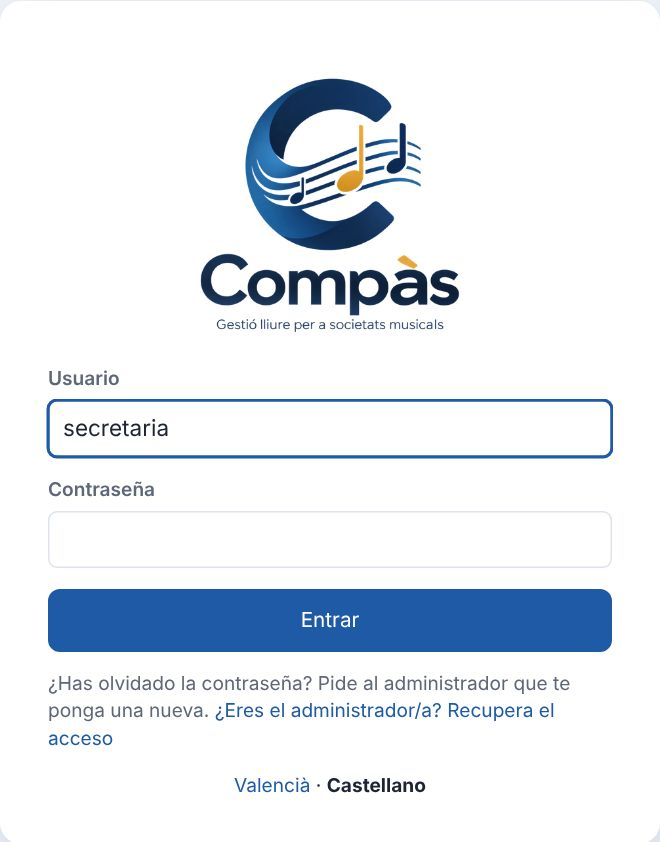

Si olvidas la contraseña, el administrador te puede poner una nueva. Si quien la ha olvidado es el administrador/a, pulsa **Recupera el acceso** (ver el apartado 16).

### La primera vez: configuración inicial

La primera vez que se abre Compàs aparece la **Configuración inicial**:

1. Escribe el **nombre de la sociedad musical**.
2. Elige el **idioma** por defecto.
3. Crea el **usuario administrador** y su contraseña (al menos 8 caracteres). Apúntala en un lugar seguro.
4. Si quieres, crea también la cuenta de **administrativo/a** (se puede hacer después).
5. Marca **Cargar datos de ejemplo** solo si quieres probar el programa con datos inventados.
6. Pulsa **Empezar**.

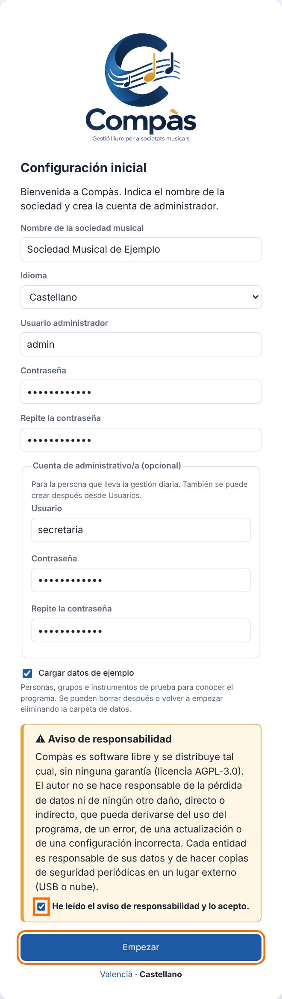

A continuación, Compàs muestra el **código de recuperación**. Sirve para poner una contraseña nueva si el administrador/a la olvida, y **solo se muestra esta vez**. Pulsa **Imprime** (o apúntalo) y guárdalo con los papeles de la sociedad, no en el ordenador. Después pulsa **Ya lo he guardado, continúa**.

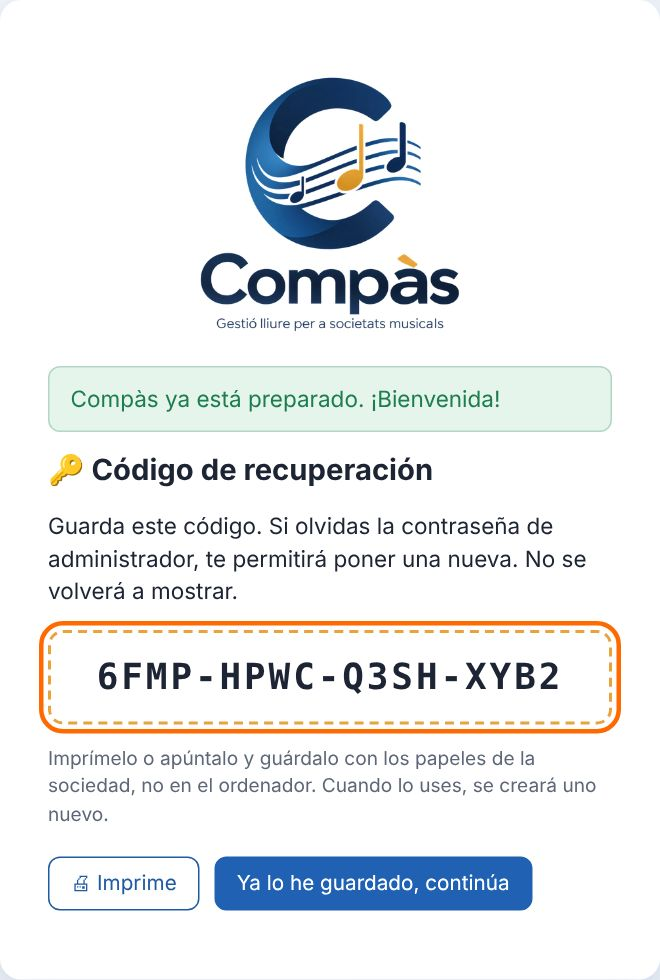

> Para empezar a trabajar de verdad sin los datos de ejemplo, cierra Compàs, borra la carpeta `data` del programa y vuelve a abrirlo.

## 2. La pantalla principal

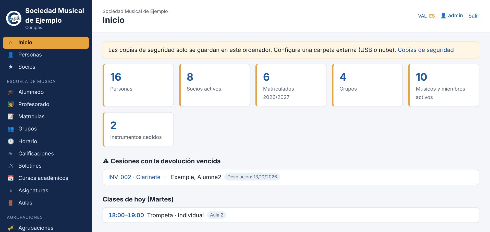

- **Menú lateral** (izquierda): todas las secciones, agrupadas en Escuela de música, Agrupaciones, Instrumentos, Documentos y datos (listados, informes e importación) y Administración.
- **Arriba a la derecha**: cambio de idioma (`VAL` / `ES`), tu nombre de usuario (para cambiar la contraseña) y **Salir**.
- **Inicio**: un resumen con el número de personas, socios, matriculados, grupos, músicos e instrumentos cedidos. Haz clic en cualquier cifra para ir a la lista.
- **Avisos**: las cesiones de instrumentos con la devolución vencida, las clases de hoy y los avisos de copias de seguridad.

## 3. Cómo se trabaja con Compàs

Todas las secciones funcionan igual. Si aprendes una, las sabes todas.

### Listados

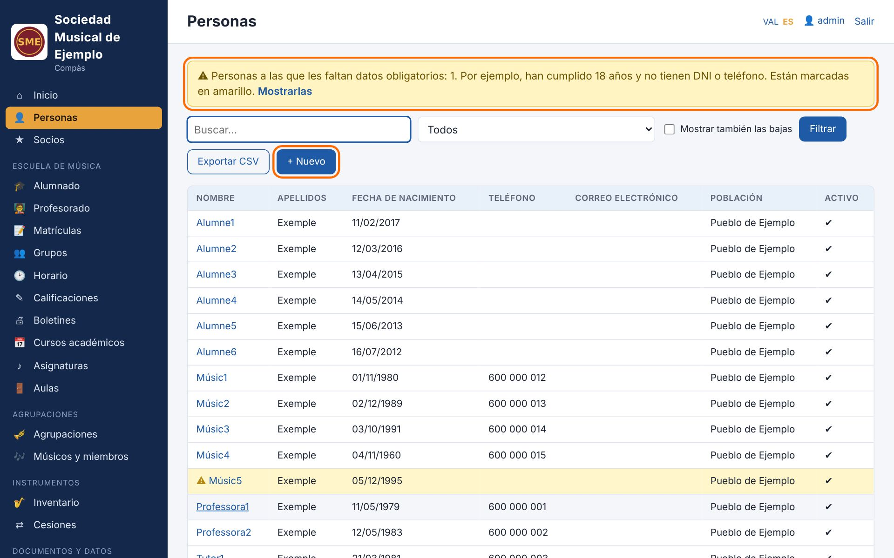

- **Buscar**: escribe un nombre, apellido, teléfono… y pulsa **Filtrar**.
- **Mostrar también las bajas**: por defecto se ocultan las personas inactivas y las bajas.
- **Exportar CSV**: descarga la lista para abrirla con Excel o LibreOffice Calc.
- **+ Nuevo**: crea un elemento nuevo.
- Haz clic en cualquier fila para abrir su **ficha**.

### Fichas

La ficha muestra todos los datos de un elemento y todo lo que está relacionado con él. Por ejemplo, la ficha de una persona muestra si es socia, alumna, profesora, música…

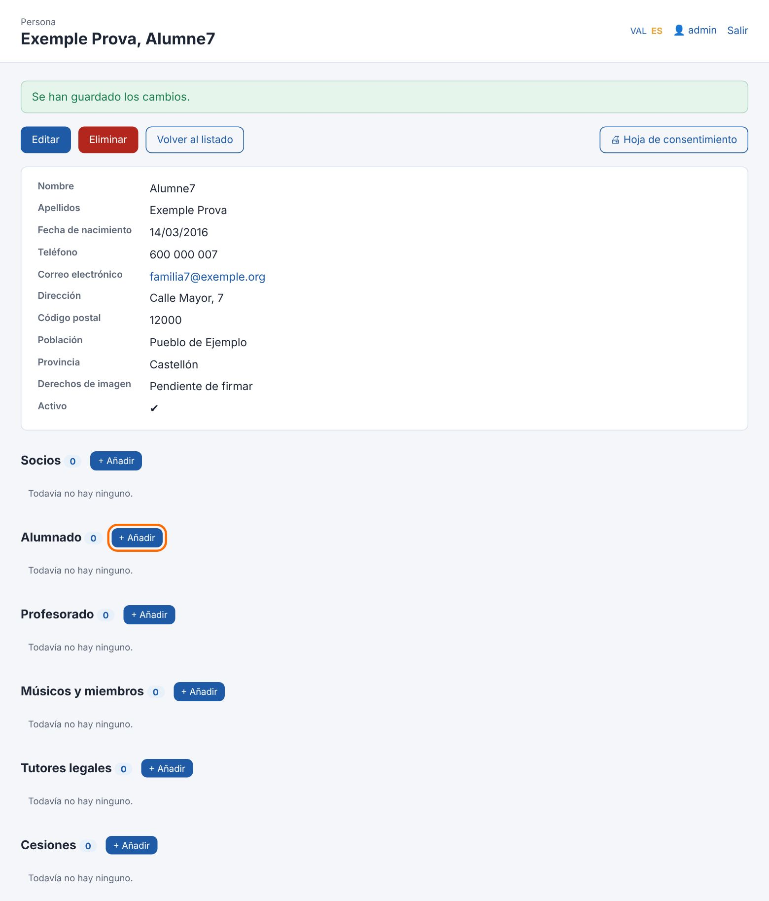

- **Editar**: cambia los datos.
- **Eliminar**: solo se puede si no tiene nada relacionado (ver «Bajas» más abajo).
- **+ Añadir** de cada apartado: crea un elemento **ya vinculado** a esta ficha. Es la forma más rápida de trabajar.

### Formularios

- Los campos con asterisco (*) son obligatorios.
- En los desplegables largos (personas, grupos…) hay una **lupa** encima: escribe en ella para filtrar las opciones.
- Pulsa **Guardar** para guardar o **Cancelar** para volver sin guardar.

### Bajas: por qué no se elimina nada

Compàs no deja eliminar nada que tenga historial (matrículas, notas, cesiones…), para que no se pierda información. En lugar de eliminar:

- una **persona** que ya no tiene relación con la sociedad: edítala y desmarca **Activo**;
- un **socio, alumno, profesor o músico**: edítalo, pon el **estado «Baja»** y la **fecha de baja**.

Las bajas desaparecen de los listados, pero se pueden volver a ver marcando **Mostrar también las bajas**.

## 4. Configuración de la sociedad y logotipo

Menú **Administración → Configuración** (solo el administrador/a).

1. Rellena los datos de la sociedad: nombre, CIF, dirección, teléfono, correo y web. Salen en los boletines.
2. En **Logotipo de la sociedad**, pulsa el botón de elegir archivo y selecciona la imagen del logotipo (PNG, JPG o WEBP, hasta 3 MB).
3. Pulsa **Guardar**. El logotipo aparece en el menú y en los boletines.

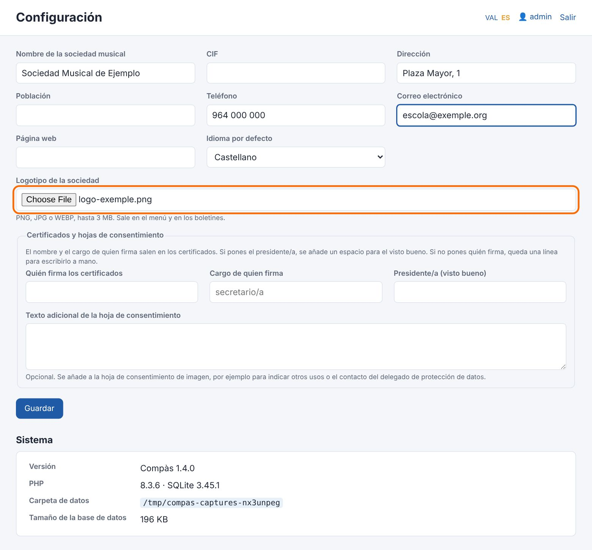

## 5. Preparar el curso académico

Antes de matricular hay que tener el curso preparado. Orden recomendado: **curso → periodos → asignaturas y aulas → profesorado → grupos → horarios**.

### 5.1 Curso y periodos de evaluación

1. Menú **Cursos académicos → + Nuevo**.
2. Nombre (por ejemplo `2026/2027`), fecha de inicio y de finalización.
3. Marca **Curso actual**. Solo puede haber uno; es el que se usa en las notas y los boletines.
4. Pulsa **Guardar**. Se abre la ficha del curso.
5. En el apartado **Periodos de evaluación**, pulsa **+ Añadir** y crea uno para cada evaluación (`1.er trimestre`, `2.º trimestre`, `3.er trimestre`), con el orden 1, 2, 3.

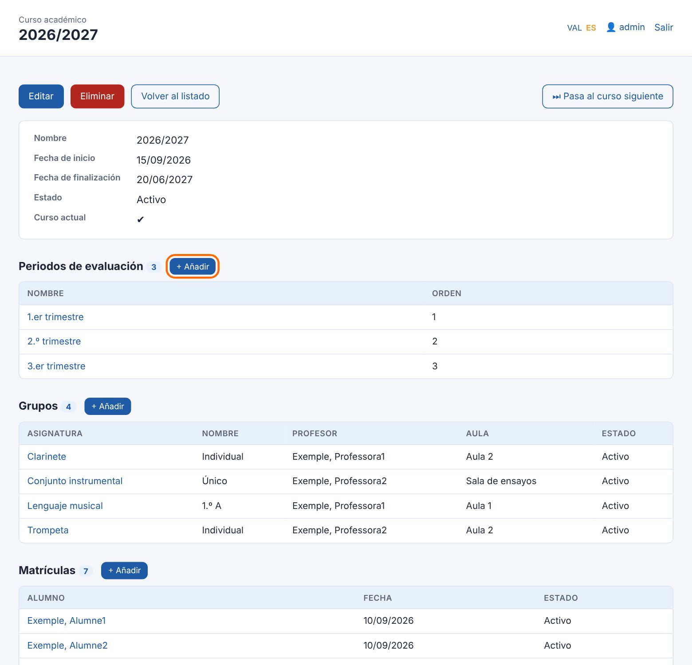

### 5.2 Asignaturas y aulas

- Menú **Asignaturas → + Nuevo**: nombre (Lenguaje musical, Trompeta, Clarinete…) y tipo.
- Menú **Aulas → + Nuevo**: nombre y capacidad.

Solo hay que crearlas una vez: se reutilizan cada curso.

### 5.3 Profesorado

Un profesor es una **persona** con ficha de profesor:

1. Da de alta a la persona (apartado 6) o búscala si ya existe.
2. En su ficha, en el apartado **Profesorado**, pulsa **+ Añadir**.
3. Comprueba la fecha de alta y pulsa **Guardar**.

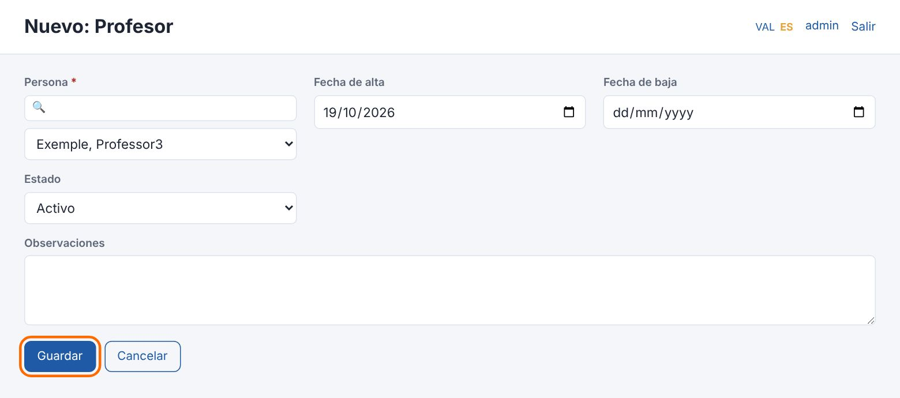

### 5.4 Grupos y horarios

Un **grupo** es una asignatura impartida en un curso por un profesor: por ejemplo *Lenguaje musical · 1.º A* o *Trompeta · Individual*.

1. Menú **Grupos → + Nuevo**.
2. Elige el **curso**, la **asignatura**, escribe el **nombre** del grupo y elige el **profesor** y el **aula**.
3. Pulsa **Guardar**. Se abre la ficha del grupo.

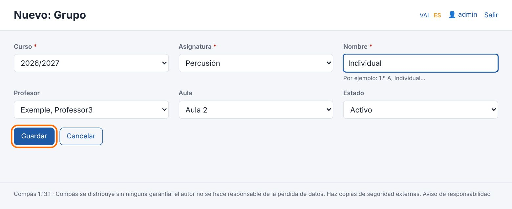

4. En el apartado **Horario**, pulsa **+ Añadir**, elige el **día** y las horas de inicio y de fin, y pulsa **Guardar**. Repítelo si el grupo tiene clase más de un día.

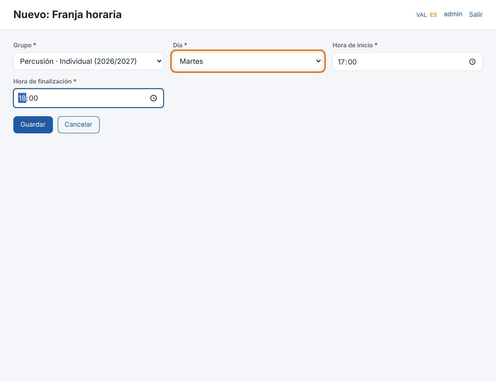

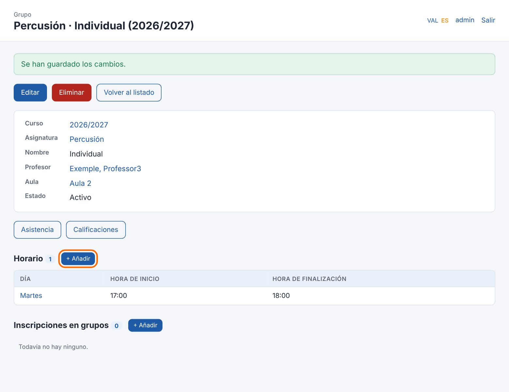

Desde la ficha del grupo también puedes ir directamente a las **Calificaciones** del grupo.

### 5.5 Horario general

El menú **Horario** muestra todas las clases de la semana. Puedes filtrar por profesor o por aula para imprimir el horario de cada uno.

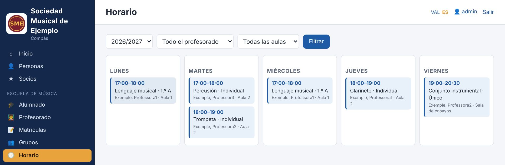

### 5.6 Pasar al curso siguiente

Cuando se acerca el curso nuevo no hace falta crearlo todo desde cero:

1. Menú **Cursos académicos**, abre el curso que termina y pulsa **⏭ Pasa al curso siguiente**.
2. Comprueba el **nombre** y las **fechas** del curso nuevo (Compàs los propone: 2027/2028, un año más).
3. Elige qué se copia: los **periodos de evaluación**, los **grupos** con el profesor/a y el aula, y el **horario**. Si quieres, también puedes **matricular ya a los alumnos que continúan** (sin grupos).
4. Deja marcado **Marca el curso nuevo como curso actual** y, si quieres, **Cierra** el curso anterior.
5. Pulsa **Crea el curso nuevo**.

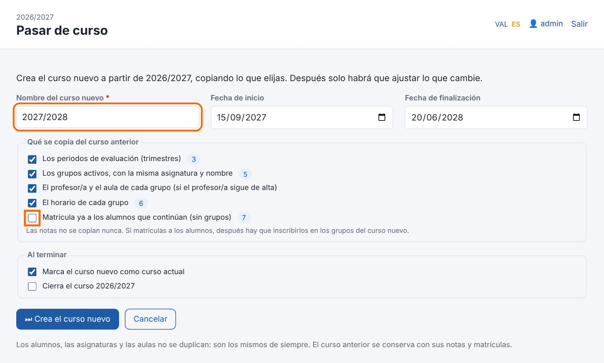

Después solo hay que ajustar lo que cambie (un grupo nuevo, otro profesor…) e inscribir a los alumnos en los grupos. Las notas no se copian nunca, y el curso anterior se conserva entero.

## 6. Dar de alta a una persona

> **Una persona se introduce una sola vez.** Ser alumno, socio, músico, profesor o tutor legal son *funciones* que se añaden a su ficha. Antes de crear una, **búscala** en el listado por si ya existe.

1. Menú **Personas → + Nuevo**.
2. Rellena los datos obligatorios y el resto que tengas (correo, dirección…):

| Dato | Obligatorio |
|---|---|
| Nombre, apellidos y fecha de nacimiento | Siempre |
| DNI/NIE y teléfono | Solo si la persona es **mayor de edad** (18 años o más) |

3. Deja marcado **Activo**.
4. Pulsa **Guardar**.

Al poner una fecha de nacimiento de mayor de edad, los campos DNI y teléfono pasan a ser obligatorios y aparece el asterisco al lado.

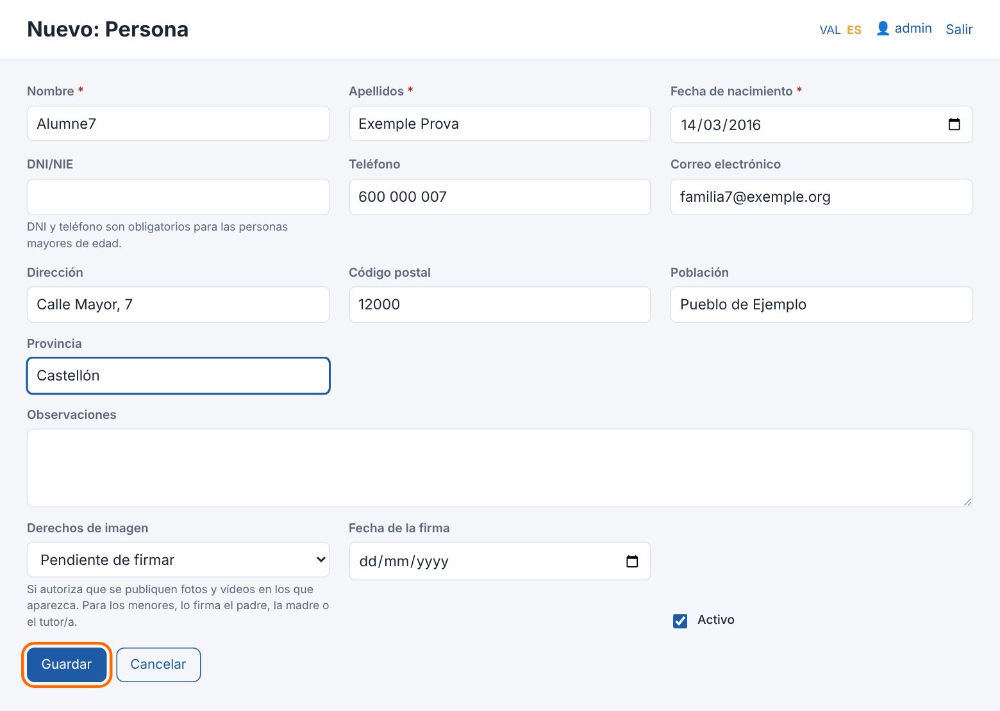

Se abre la **ficha de la persona**, con un apartado para cada función: Socios, Alumnado, Profesorado, Músicos y miembros, Tutores legales (cuando es tutor de alguien) y Cesiones.

### Cuando un alumno menor cumple 18 años

De los menores no hace falta tener el DNI ni el teléfono. Cuando una persona cumple 18 años y no tiene esos datos, Compàs lo avisa:

- Arriba del listado de **Personas** aparece un **aviso amarillo** con el número de personas a las que les faltan datos.
- Su fila se marca **en amarillo** con el símbolo ⚠. Si pasas el ratón por encima, dice qué datos faltan.
- En su ficha también aparece el aviso, con un enlace para editarla.

Pulsa **Mostrarlas** (o elige el filtro **Faltan datos obligatorios**) para ver solo esas personas. Abre cada una, pulsa **Editar**, completa el DNI y el teléfono y guarda. El aviso desaparece cuando ya no falta ninguno.

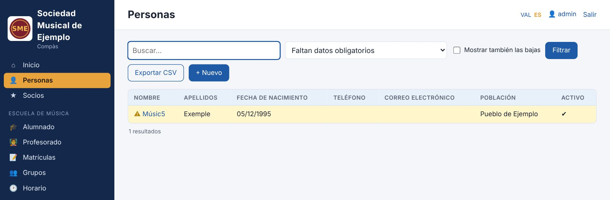

### Derechos de imagen (fotos y vídeos)

Antes de publicar fotos o vídeos en la web o las redes, la sociedad tiene que tener la autorización de cada persona; para los menores, la del padre, la madre o el tutor/a.

1. Abre la ficha de la persona (o del alumno) y pulsa **🖨 Hoja de consentimiento**. Sale una hoja A4 con los datos del alumno y del tutor/a, el texto de la autorización y el espacio para firmar.
2. Cuando la devuelvan firmada, edita la persona y, en **Derechos de imagen**, elige **Autoriza fotos y vídeos** o **No autoriza**. Si no pones la **fecha de la firma**, se pone la de hoy.

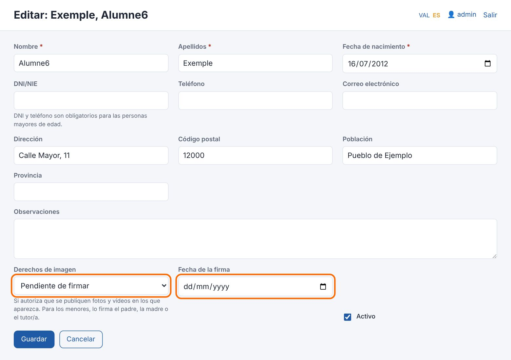

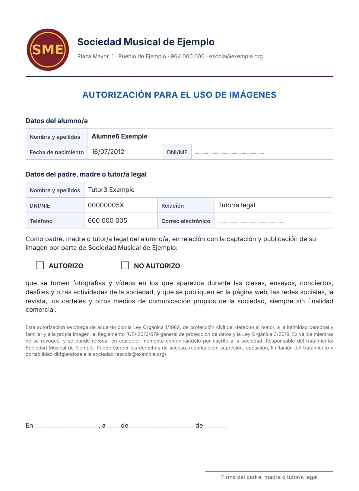

Para repartirlas a principio de curso, en **Listados e informes → Derechos de imagen** puedes imprimir de golpe las hojas de todos los pendientes o las de un grupo (apartado 13). En el listado de **Personas**, el filtro **Alumnos sin consentimiento de imagen firmado** muestra quién falta.

> El texto de la hoja es un modelo. Revísalo con la junta y, si hace falta, añade lo que quieras en **Configuración → Texto adicional de la hoja de consentimiento**.

## 7. Alta de un alumno (paso a paso)

Ejemplo completo: un niño nuevo que se apunta a Lenguaje musical y Clarinete. El tutor legal (la madre o el padre) también tiene que estar dado de alta como persona.

### Paso 1. La persona

Da de alta al alumno como **persona** (apartado 6). Si el tutor legal todavía no está dado de alta, dalo de alta también.

### Paso 2. La ficha de alumno

1. En la ficha de la persona, en el apartado **Alumnado**, pulsa **+ Añadir**.

2. La persona ya viene elegida. Comprueba la **fecha de alta** y pulsa **Guardar**.

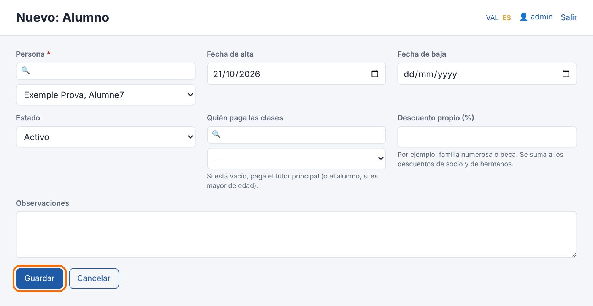

Se abre la **ficha del alumno**, donde se completan los pasos siguientes.

### Paso 3. El tutor legal

1. En el apartado **Tutores legales**, pulsa **+ Añadir**.

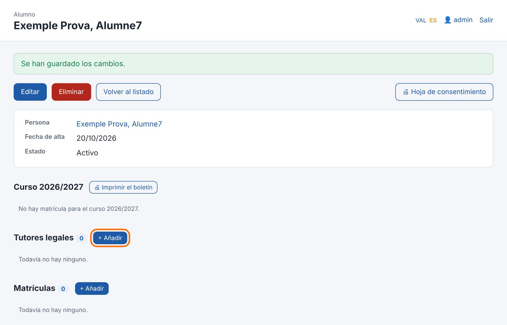

2. En el desplegable **Tutor legal**, escribe en la lupa el nombre del padre, la madre o el tutor y elígelo.
3. Elige la **relación** (madre, padre, tutor/a legal…) y marca **Principal** si es el contacto principal.
4. Pulsa **Guardar**. Repítelo si hay más de un tutor.

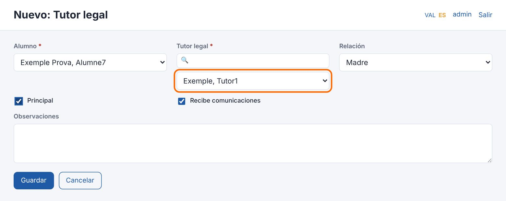

> Hermanos: los dos alumnos pueden tener el mismo tutor. No hace falta darlo de alta dos veces.

### Paso 4. La matrícula del curso

1. En la ficha del alumno, en el apartado **Matrículas**, pulsa **+ Añadir**.
2. Comprueba que el **curso** es el actual y pulsa **Guardar**.

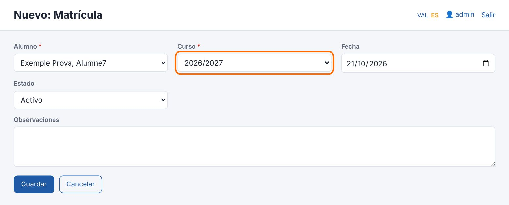

### Paso 5. Inscribirlo en los grupos

Se abre la ficha de la matrícula.

1. En el apartado **Inscripciones en grupos**, pulsa **+ Añadir**.

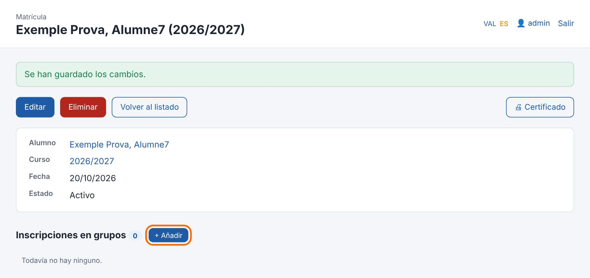

2. Elige el **grupo** (por ejemplo *Lenguaje musical · 1.º A*) y pulsa **Guardar**.
3. Repítelo para cada asignatura (por ejemplo *Clarinete · Individual*).

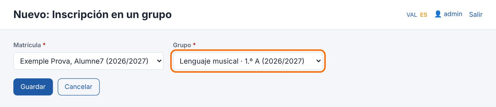

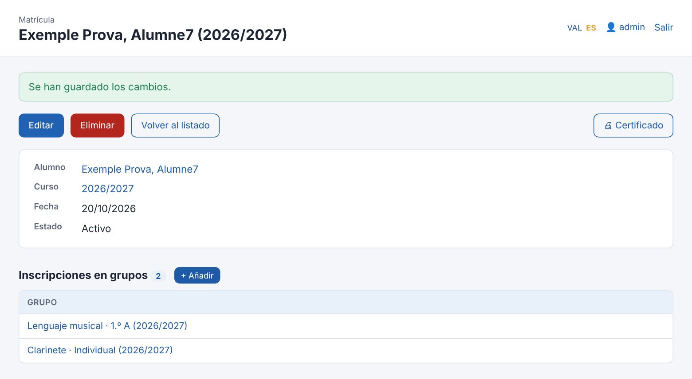

### Resultado

La ficha del alumno muestra el resumen del curso: grupos, profesores, horario y notas de cada evaluación, el botón para **imprimir su boletín**, los tutores legales y las matrículas de todos los cursos.

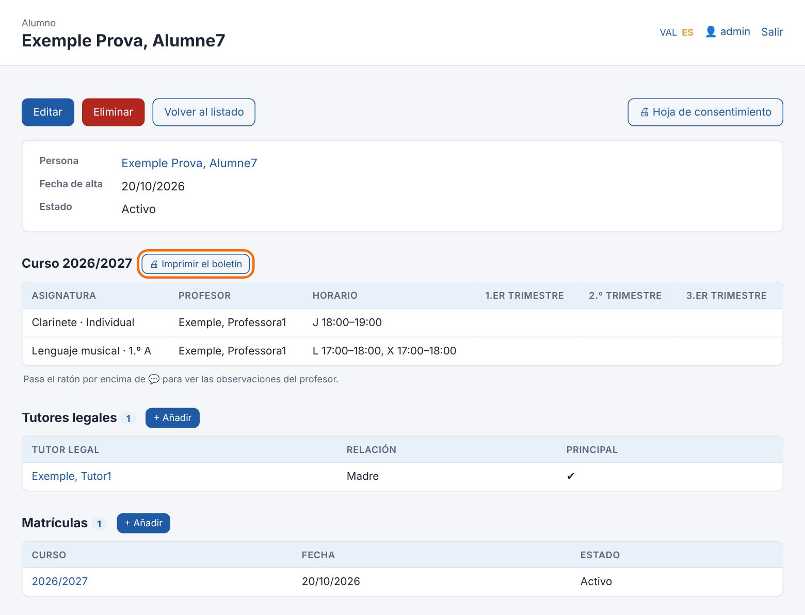

### Al empezar un curso nuevo

1. Crea el curso nuevo con **Pasa al curso siguiente** (apartado 5.6): copia los periodos, los grupos y el horario, y puede matricular ya a los alumnos que continúan.
2. Inscribe a cada alumno en los grupos del curso nuevo desde su matrícula (paso 5).

Las matrículas y las notas de los cursos anteriores se conservan en la ficha del alumno.

### Cuando un alumno deja la escuela

Edita su ficha de alumno y pon el estado **Baja** y la **fecha de baja**. Si además ya no es nada de la sociedad, desmarca **Activo** en su ficha de persona.

## 8. Socios

### Alta de un socio

1. Busca o da de alta a la **persona** (apartado 6).
2. En su ficha, en el apartado **Socios**, pulsa **+ Añadir**.
3. Escribe el **número de socio**, elige el **tipo** (ordinario, protector, de honor, juvenil) y comprueba la **fecha de alta**.
4. Pulsa **Guardar**.

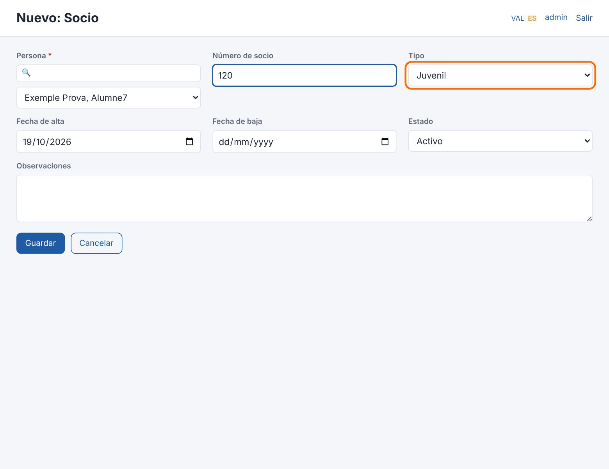

### Listado de socios

El menú **Socios** muestra todos los socios activos. Puedes buscar por el nombre o por el número y exportar la lista a CSV (por ejemplo, para hacer etiquetas o enviar una circular).

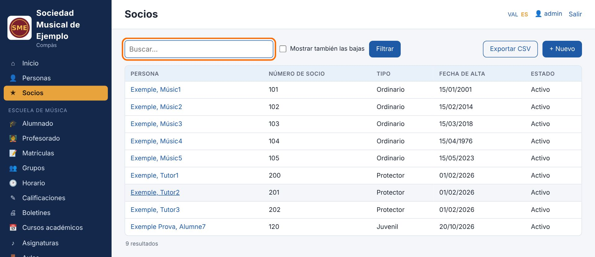

### Baja de un socio

1. Abre el socio y pulsa **Editar**.
2. Cambia el **estado** a **Baja** y pon la **fecha de baja**.
3. Pulsa **Guardar**.

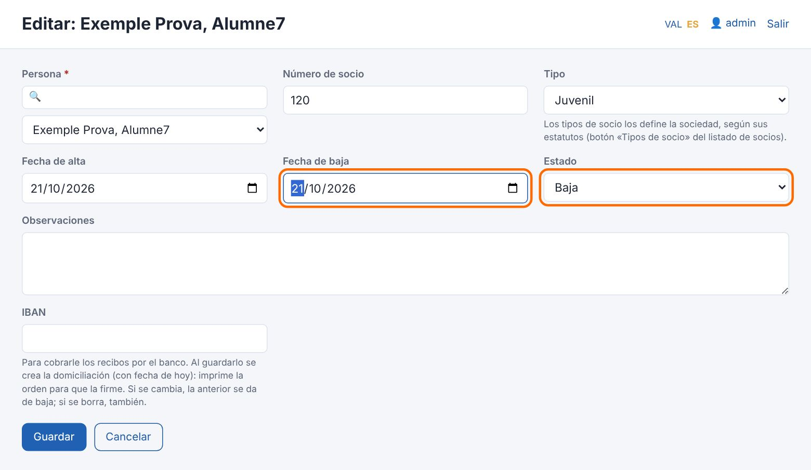

El socio desaparece del listado, pero se conserva con su historial.

## 9. Músicos y agrupaciones

### Alta de un músico en una agrupación

1. Busca o da de alta a la **persona** (apartado 6).
2. En su ficha, en el apartado **Músicos y miembros**, pulsa **+ Añadir**.
3. Elige la **agrupación** (Banda, Banda juvenil, Coral…), escribe el **instrumento o voz** y elige la **función**: miembro, director/a titular, director/a asistente o responsable.
4. Pulsa **Guardar**.

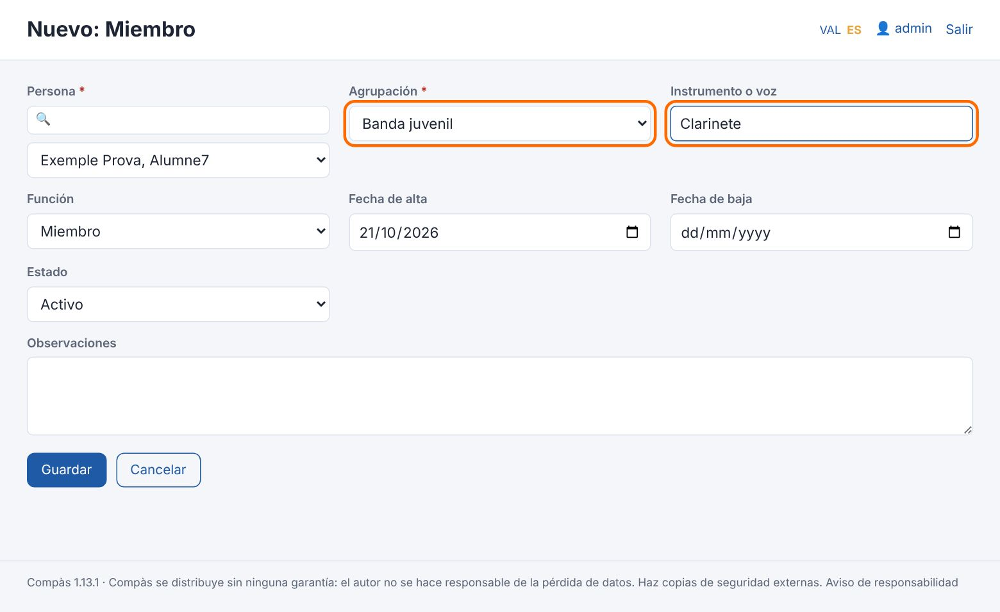

Una persona puede estar en varias agrupaciones: repítelo para cada una.

### Ficha de la agrupación

Menú **Agrupaciones** → abre la agrupación. Muestra todos sus miembros con el instrumento y la función. Desde aquí también puedes añadir miembros con **+ Añadir**.

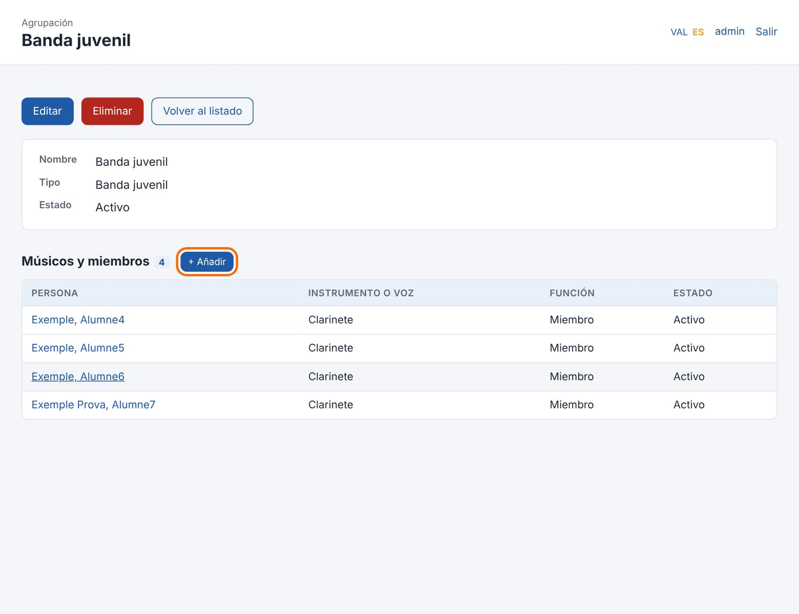

Para crear una agrupación nueva: menú **Agrupaciones → + Nuevo**.

## 10. Calificaciones

El profesorado pasa las notas a administración y administración las introduce.

1. Menú **Calificaciones**.
2. Elige el **grupo** y la **evaluación** (1.er trimestre, 2.º trimestre…).
3. Escribe la nota de cada alumno. Es texto libre: `7`, `8,5`, `Notable`, `Apto`…
4. Si el profesor ha pasado observaciones, escríbelas en **Observaciones académicas**. Salen en el boletín.
5. Pulsa **Guardar**.

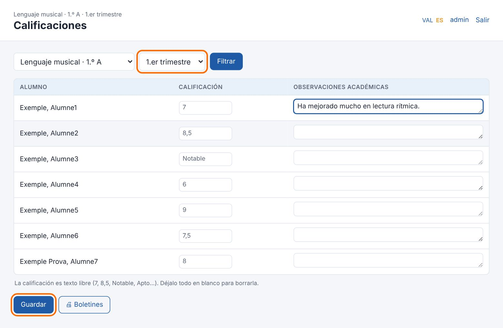

Para borrar una nota, deja en blanco la nota y las observaciones y guarda.

## 11. Boletines de notas

1. Menú **Boletines** (o el botón **Boletines** de la página de calificaciones, o **Imprimir el boletín** de la ficha de un alumno).
2. Elige la **evaluación**. El boletín muestra las notas de esta evaluación y de las anteriores.
3. Elige **de quién**: todo el alumnado matriculado, el alumnado de un grupo o un solo alumno.
4. Si quieres, escribe un **texto al pie** (por ejemplo, la fecha de las audiciones). Se recuerda para la próxima vez.
5. Pulsa **Preparar los boletines**.

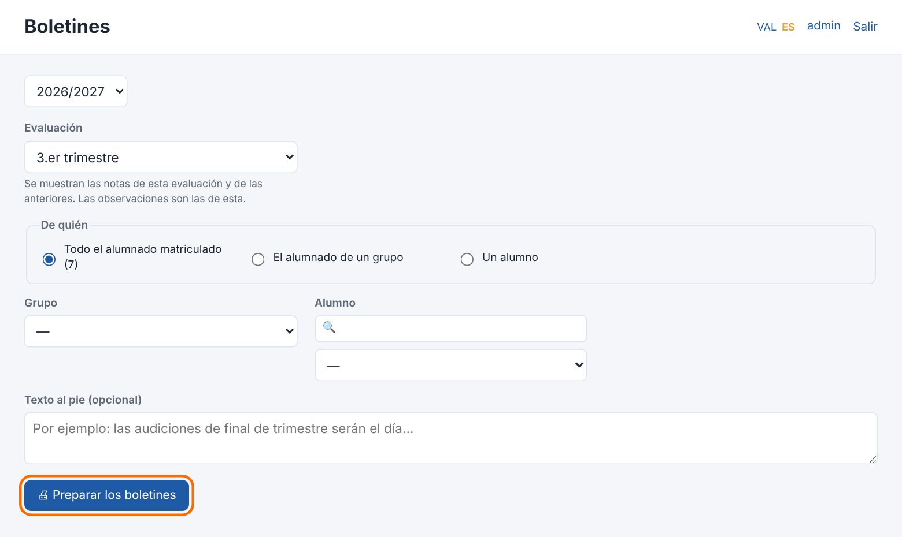

Se abre una pestaña nueva con una hoja A4 por alumno. Pulsa **Imprimir el boletín** (arriba del todo).

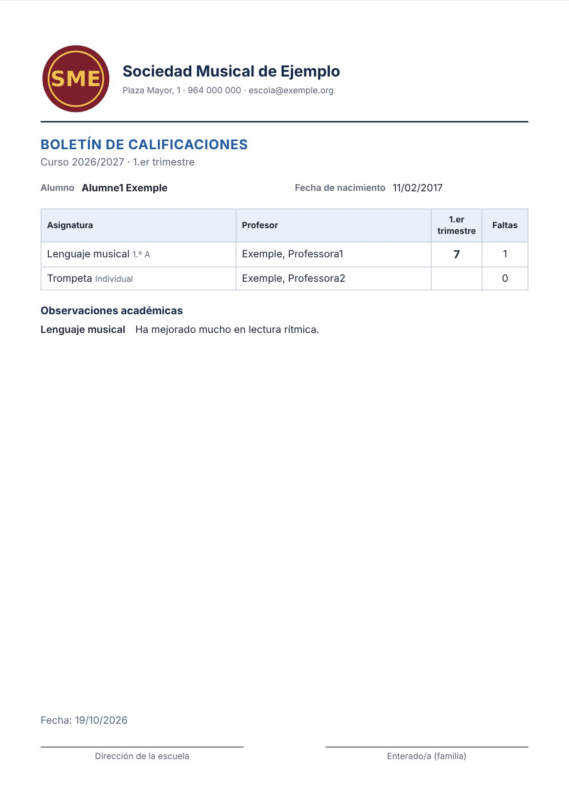

> Para guardarlos en PDF (para enviarlos por correo), elige **Microsoft Print to PDF** como impresora.

## 12. Instrumentos y cesiones

### Alta de un instrumento

1. Menú **Inventario → + Nuevo**.
2. Rellena el **número de inventario** y el **tipo** (obligatorios) y el resto de datos: marca, modelo, número de serie, estado, ubicación y fecha de adquisición.
3. Pulsa **Guardar**.

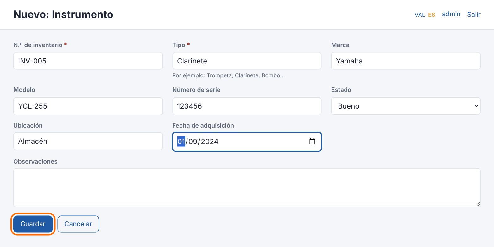

En la ficha del instrumento está el historial de **cesiones** y de **mantenimientos** (reparaciones, revisiones…).

### Prestar un instrumento (cesión)

1. En la ficha del instrumento, en el apartado **Cesiones**, pulsa **+ Añadir**.
2. Elige la **persona**, comprueba la **fecha de entrega** y pon la **devolución prevista**, el estado en que se entrega y la fianza si la hay.
3. Pulsa **Guardar**.

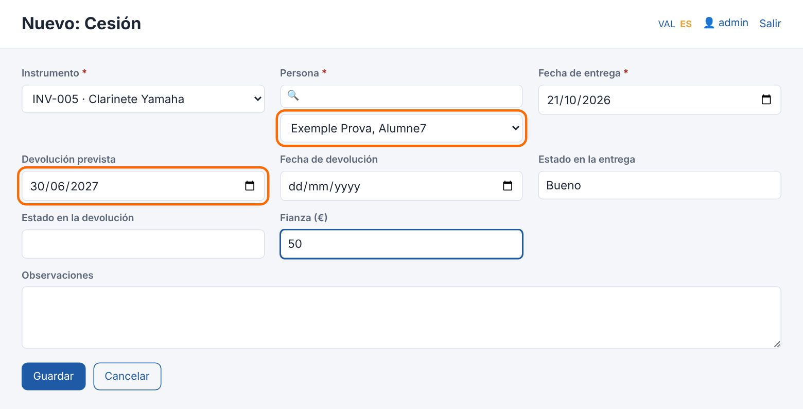

Un instrumento no se puede prestar a dos personas a la vez.

### Cuando lo devuelven

1. Abre la cesión y pulsa **Editar**.
2. Pon la **fecha de devolución** y el **estado en la devolución**.
3. Pulsa **Guardar**. El instrumento vuelve a estar disponible.

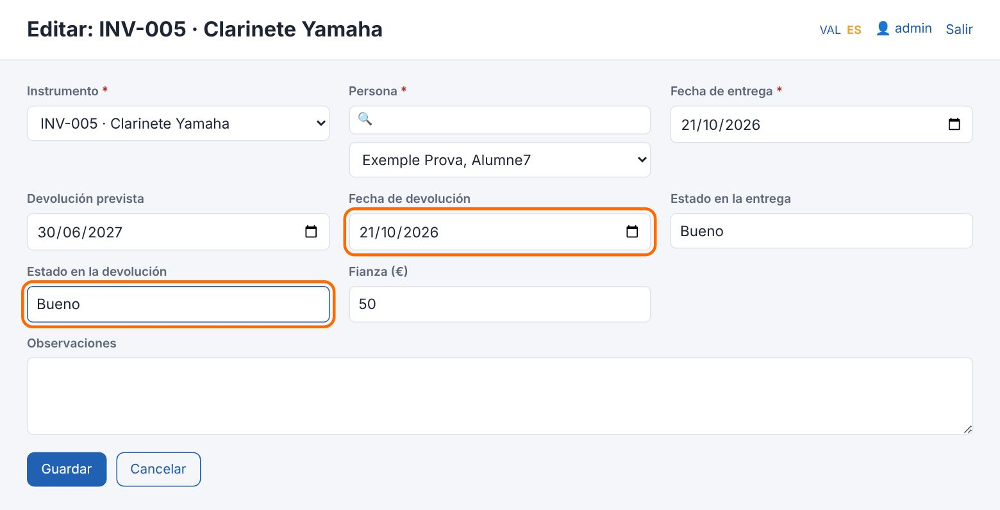

### Listado de cesiones

Menú **Cesiones**. Con el filtro puedes ver las **cesiones activas** o solo las que tienen la **devolución vencida**. Las vencidas también aparecen en el inicio.

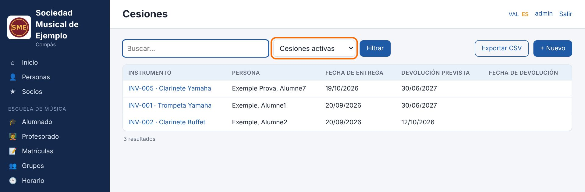

## 13. Listados, certificados y memoria

Menú **Documentos y datos → Listados e informes**. Cada listado se puede ver en pantalla, **imprimir** (o guardar en PDF) y **exportar a CSV** para abrirlo con Excel.

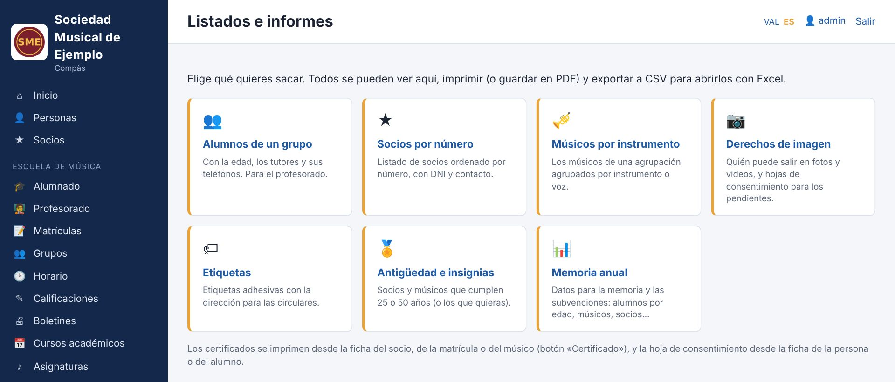

### Alumnos de un grupo

Elige el curso y el grupo. Sale cada alumno con la edad, el padre, la madre o el tutor/a y sus teléfonos y correos. Es el listado que necesita el profesorado. En amarillo, los que no autorizan fotos.

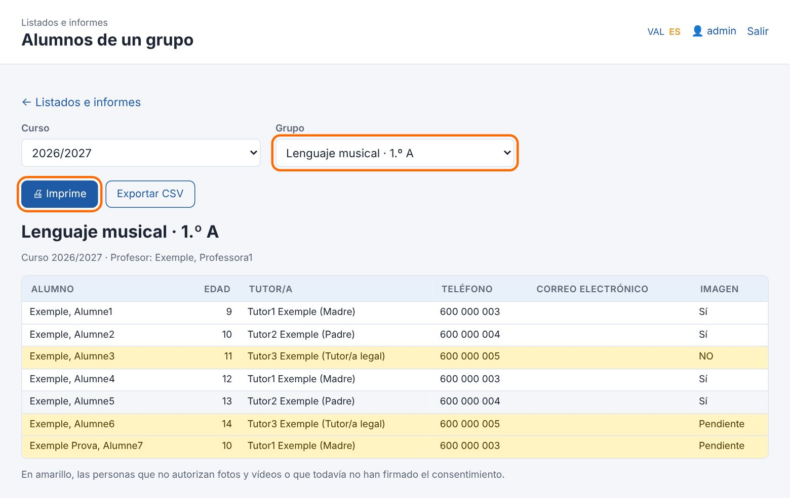

### Socios por número y músicos por instrumento

- **Socios por número**: todos los socios de alta, ordenados por número, con DNI y contacto. Puedes elegir un tipo de socio.
- **Músicos por instrumento**: elige una agrupación y sale la plantilla agrupada por instrumento o voz, con el número de músicos de cada uno.

### Derechos de imagen

Quién puede salir en fotos y vídeos: el resumen (cuántos autorizan, cuántos no y cuántos faltan) y la lista, con los que no autorizan en amarillo. Antes de un concierto, imprímela para quien hace las fotos. El botón **Hojas de consentimiento de los pendientes** imprime las hojas que faltan.

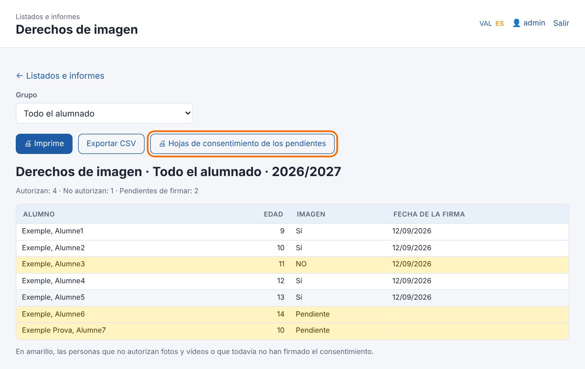

### Etiquetas para las circulares

1. Elige **para quién**: socios, familias del alumnado (los tutores que reciben comunicaciones), músicos o todas las personas.
2. Elige el **formato** de la hoja de etiquetas (lo dice la caja: 24, 21 o 14 por hoja).
3. Si la hoja ya está empezada, indica cuántas etiquetas **ya se han gastado**.
4. Pulsa **Prepara las etiquetas** e imprime con el **tamaño real (100 %)** y **sin márgenes**.

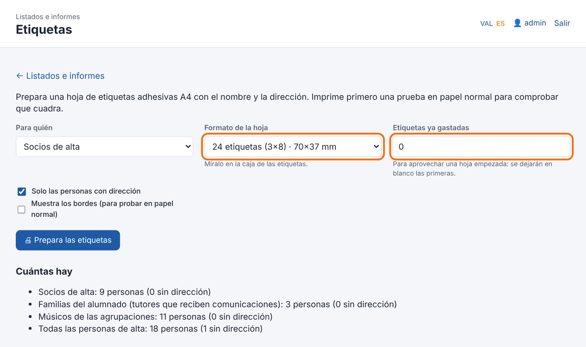

> Haz primero una prueba en papel normal con **Muestra los bordes** y ponla encima de la hoja de etiquetas a contraluz.

### Antigüedad e insignias

Elige el **año** y los **años que se premian** (por defecto 25 y 50). Sale quién los cumple ese año, como socio y como músico. Marca **Muestra también la lista completa** para ver a todos ordenados por antigüedad.

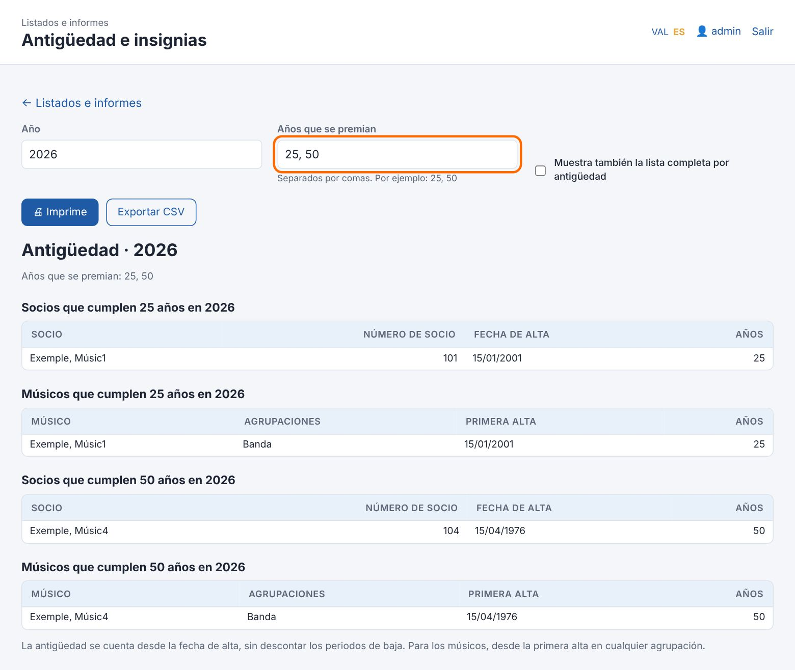

La antigüedad se cuenta desde la fecha de alta. Para los músicos, desde la primera alta en cualquier agrupación.

### Memoria anual y subvenciones

Elige el curso. Sale lo que suelen pedir la Diputación, el IVC o el ayuntamiento: alumnos por edad (con menores y mayores), por asignatura y por población, profesorado y grupos, músicos de cada agrupación (con los menores), socios por tipo y las altas y bajas del año.

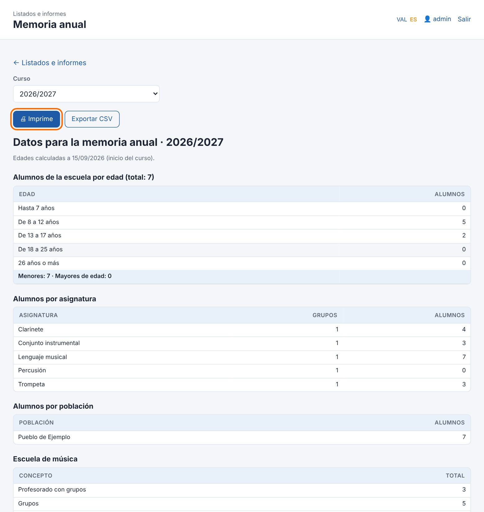

### Certificados

En la ficha de un **socio**, de una **matrícula** o de un **músico** (en **Músicos y miembros**) está el botón **🖨 Certificado**. Sale un certificado en A4 con el logotipo, los datos de la persona y la fecha de hoy, preparado para firmar. Sirve para becas, el conservatorio, el trabajo…

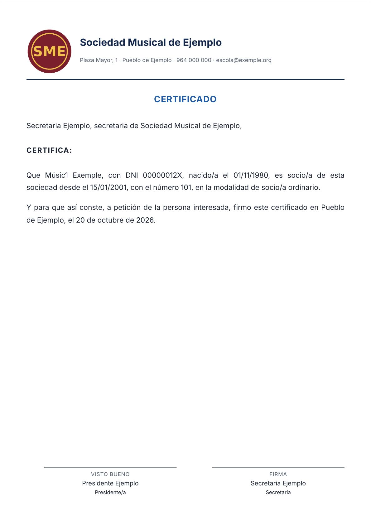

La primera vez, en **Configuración → Certificados y hojas de consentimiento**, pon quién firma (normalmente el secretario/a), el cargo y, si queréis el visto bueno, el presidente/a. Pon también la **población** de la sociedad, que sale al final del certificado.

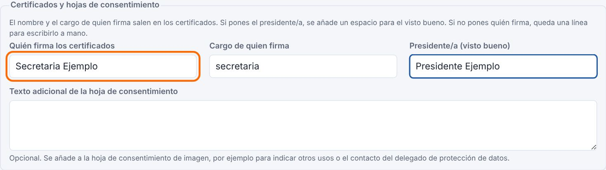

## 14. Importar datos desde Excel

Si la sociedad ya tiene los socios o el alumnado en un Excel, no hace falta volver a escribirlos. Menú **Documentos y datos → Importar datos**.

### Paso 1. El archivo

1. Elige qué quieres importar: **Personas**, **Socios** (con el número, el tipo y la fecha de alta) o **Alumnado** (con el padre, la madre o el tutor/a, si la hoja los lleva).
2. Elige el archivo: Excel (**.xlsx**) o **CSV**. Si es un .xls antiguo, ábrelo con Excel y guárdalo como .xlsx.
3. Deja marcado **La primera fila tiene los títulos de las columnas** si es el caso, y pulsa **Siguiente**.

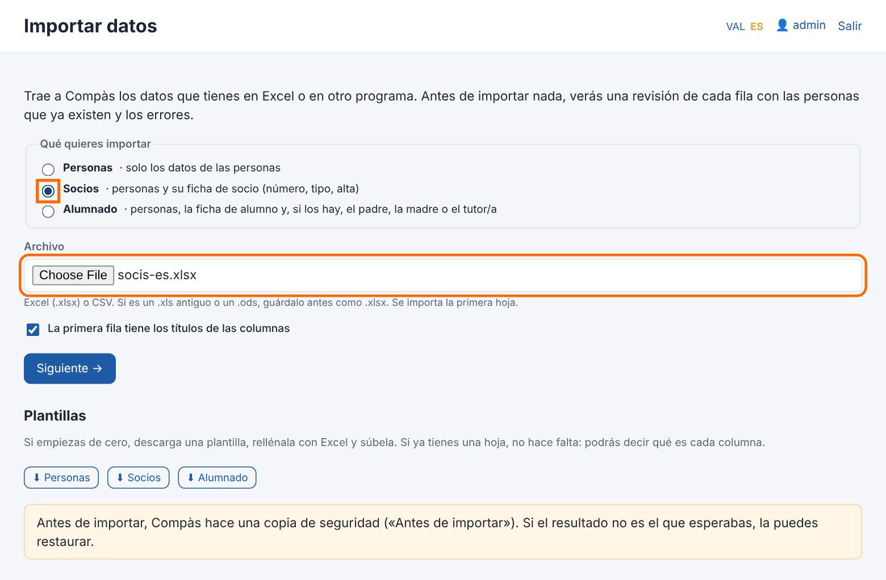

Si empiezas de cero, descarga una **plantilla**, rellénala y súbela.

### Paso 2. Qué es cada columna

Compàs reconoce las columnas habituales (Nombre, Apellidos, DNI, Teléfono, Fecha de nacimiento…) y ya las deja elegidas. Compruébalas y corrige las que falten. Si el nombre y los apellidos están juntos, elige **Nombre y apellidos juntos**. Las columnas que no elijas no se importan.

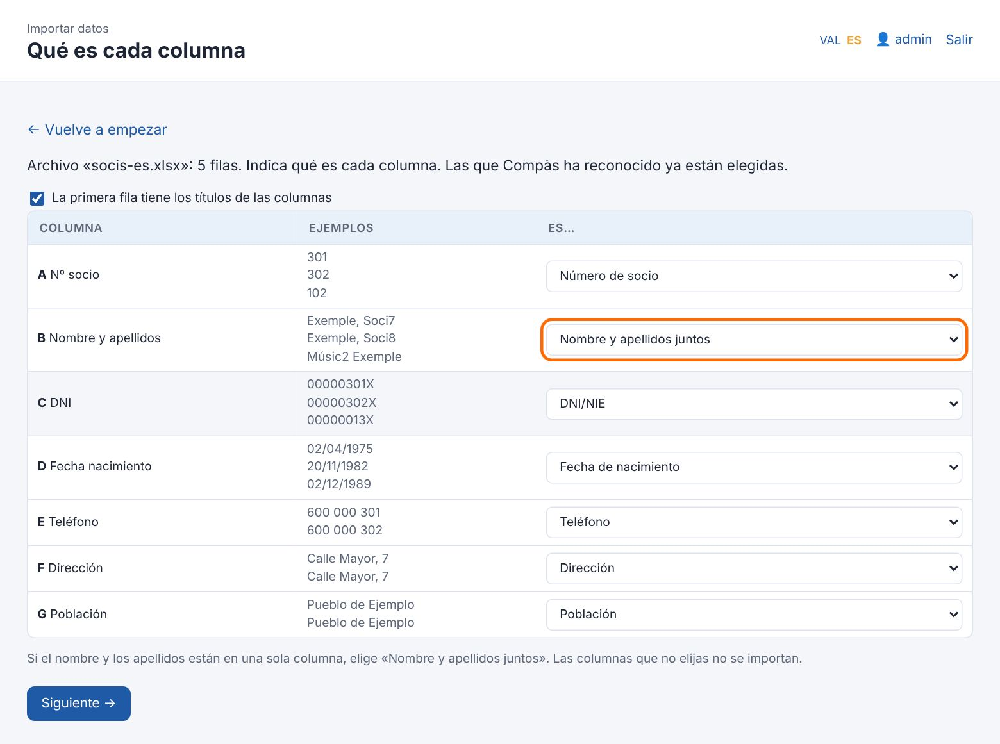

### Paso 3. Revisar e importar

Antes de importar nada, Compàs muestra cada fila:

| Estado | Qué quiere decir | Qué se hace |
|---|---|---|
| **Nueva** | No está en Compàs | Se crea |
| **Ya existe** | Mismo DNI, o mismo nombre y fecha de nacimiento | No se duplica: solo se completan los datos que le faltan |
| **Posible duplicado** | Mismo nombre, pero no se puede asegurar | Marca **Es la misma persona** si lo es; si no, se crea nueva |
| **Repetida en el archivo** / **Error** | Está dos veces o no tiene nombre | No se importa |

En la columna **Avisos** verás, por ejemplo, fechas que no se entienden o personas a las que faltan datos obligatorios (quedarán en amarillo, como siempre).

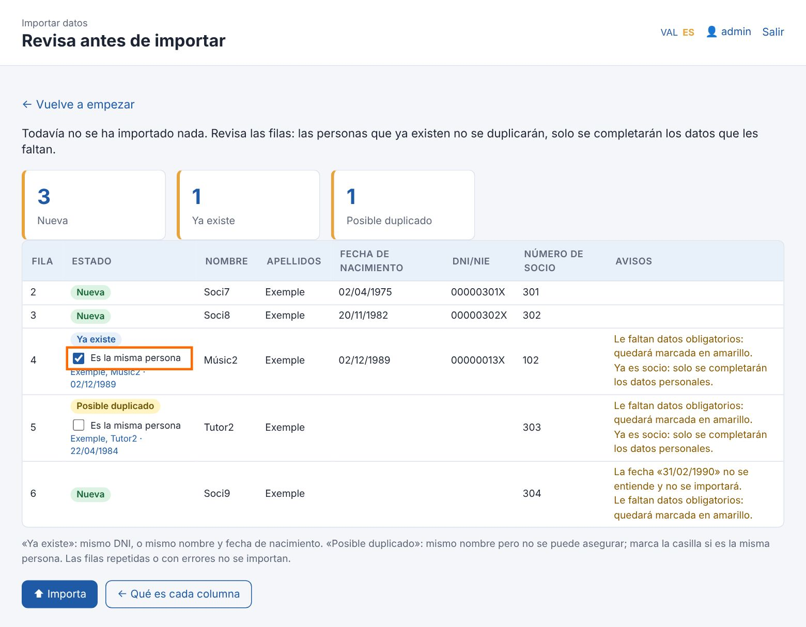

Pulsa **Importa**. Antes de importar, Compàs hace una copia de seguridad («Antes de importar»): si el resultado no es el que esperabas, la puedes restaurar (apartado 15).

## 15. Copias de seguridad

Todos los datos están en un solo archivo. Compàs hace copias automáticamente:

| Cuándo | Tipo |
|---|---|
| La primera vez que se usa cada día | Automática (diaria) |
| Al cerrar Compàs, si ha habido cambios | Automática (al cerrar) |
| Cuando pulsas **Hacer una copia ahora** | Manual |
| Justo antes de restaurar | Antes de restaurar |
| Justo antes de importar datos | Antes de importar |

Menú **Administración → Copias de seguridad**:

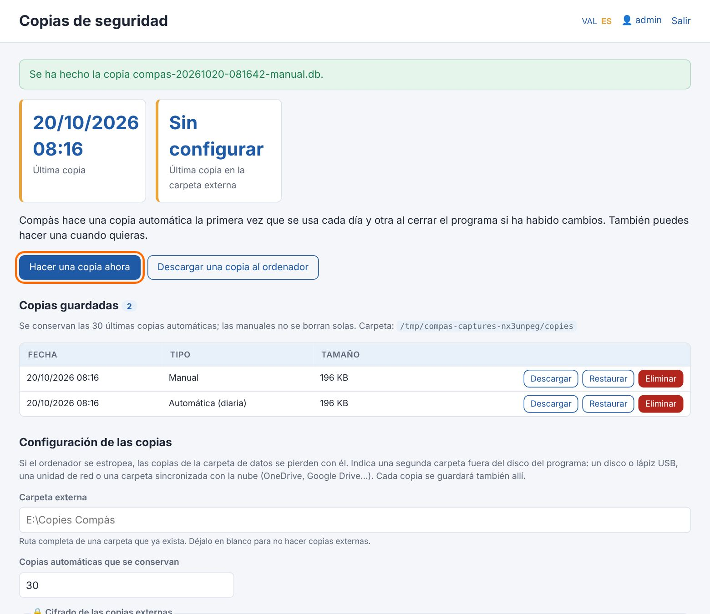

### Configurar la carpeta externa (muy importante)

Si el ordenador se estropea o lo roban, las copias que hay dentro se pierden con él. Hay que guardarlas también fuera:

1. Conecta un **disco o lápiz USB**, o elige una carpeta **sincronizada con la nube** (OneDrive, Google Drive…).
2. Crea en ella una carpeta, por ejemplo `Copias Compàs`, y copia su ruta desde el Explorador de Windows (por ejemplo `E:\Copias Compàs`).
3. En **Configuración de las copias**, pega la ruta en **Carpeta externa**.
4. Pulsa **Guardar**.

A partir de ahora, cada copia se guarda también en esta carpeta. Si no está disponible (por ejemplo, el USB no está conectado) o hace más de 7 días que no se guarda nada en ella, el inicio lo avisa.

### Lista de copias, restaurar y eliminar

- **Descargar**: descarga esa copia.
- **Restaurar** (solo el administrador/a): sustituye todos los datos actuales por los de la copia. Antes, Compàs guarda una copia de los datos actuales («Antes de restaurar»), de manera que siempre se puede volver atrás. Después hay que volver a entrar.
- **Eliminar** (solo el administrador/a): borra la copia.

Para restaurar una copia guardada fuera (por ejemplo, desde el USB), usa **Restaurar desde un archivo**, al final de la página.

> Las copias contienen datos personales, también de menores. Guárdalas en un lugar seguro.

### Copias externas cifradas

Si la carpeta externa es un pendrive o la nube, conviene cifrarlas: si se pierde el USB, nadie podrá abrir los datos sin la contraseña.

1. En **Configuración de las copias**, marca **Cifra con contraseña las copias de la carpeta externa**.
2. Escribe una contraseña (al menos 8 caracteres) dos veces y pulsa **Guardar**.

A partir de ahora, las copias de la carpeta externa terminan en `.xifrat`. Las del ordenador no se cifran. Para restaurar una, en **Restaurar desde un archivo** elige el archivo `.xifrat` y escribe la contraseña.

> **Apunta la contraseña en papel** junto con el código de recuperación. Si se olvida, las copias cifradas no se pueden recuperar.

## 16. Usuarios y contraseñas

### Cambiar tu contraseña

Cada usuario puede cambiar la suya cuando quiera:

1. En el menú, abajo del todo, pulsa **Cuenta y contraseña** (o haz clic en tu nombre de usuario, arriba a la derecha).
2. Escribe la **contraseña actual**.
3. Escribe la **contraseña nueva** dos veces (al menos 8 caracteres).
4. Pulsa **Guardar**.

Si no recuerdas la actual, no la puedes cambiar aquí: el administrativo/a debe pedir una nueva al administrador/a, y el administrador/a puede recuperar el acceso desde la entrada (ver más abajo).

### Gestionar las cuentas (administrador/a)

Menú **Administración → Usuarios**. Abre una cuenta para:

- cambiarle el **rol** (administrador/a o administrativo/a);
- ponerle una **contraseña nueva** si la ha olvidado (déjala en blanco para no cambiarla);
- desactivarla (desmarca **Activo**) o eliminarla.

Siempre debe quedar al menos un administrador activo.

### Si el administrador/a olvida la contraseña

1. En la pantalla de entrada, pulsa **¿Eres el administrador/a? Recupera el acceso**.
2. Escribe tu **usuario**, el **código de recuperación** que guardaste y la **contraseña nueva** dos veces.
3. Pulsa **Cambia la contraseña**. Entrarás directamente en el programa.
4. Compàs muestra un **código de recuperación nuevo**, porque el anterior ya no vale. Imprímelo y guárdalo en lugar del antiguo.

**Si no encuentras el código**, pulsa **No tengo el código de recuperación** en la misma página y sigue los pasos:

1. Abre el Explorador de archivos y ve a la carpeta de datos de Compàs. La página muestra la ruta exacta: cópiala en la barra de direcciones del Explorador.
2. Crea un archivo nuevo (botón derecho → **Nuevo → Documento de texto**) y ponle de nombre `recupera-acces`.
3. Vuelve a la página de Compàs y recárgala (tecla **F5**). Ya no pedirá el código: escribe el usuario y la contraseña nueva.

El archivo solo vale durante una hora y se borra solo al usarlo. Este sistema es seguro porque solo puede crear el archivo quien ya tiene acceso al ordenador y a los datos.

### Código de recuperación

Si has perdido el código o crees que alguien lo ha visto, ve a **Administración → Usuarios** y, abajo, pulsa **Genera un código nuevo**. El anterior deja de valer. Si Compàs se instaló antes de la versión 1.3, la pantalla de inicio avisa de que no hay código hasta que lo generes.

Todas las recuperaciones, también las que fallan, quedan en el **Registro de actividad**.

### Registro de actividad

Menú **Administración → Registro de actividad** (solo el administrador/a): quién ha creado, modificado o eliminado cada cosa, las entradas al programa, los boletines impresos y las copias.

## 17. Ayuda

El menú **Ayuda** muestra este manual dentro del programa. Los botones de arriba abren el manual y la guía de instalación en PDF.

## 18. Preguntas frecuentes

**He dado de alta a una persona dos veces. ¿Qué hago?** Si la segunda no tiene nada vinculado, ábrela y pulsa **Eliminar**. Si ya tiene cosas vinculadas, edítalas para que apunten a la persona buena y después elimina la repetida.

**¿Por qué una persona aparece en amarillo?** Le faltan datos obligatorios: normalmente, ha cumplido 18 años y no tiene DNI o teléfono. Complétalos (apartado 6).

**No encuentro a un alumno en el listado.** Puede estar de baja: marca **Mostrar también las bajas**.

**No me deja eliminar algo.** Tiene historial relacionado. Ponlo de baja o como inactivo (apartado 3).

**El alumno no aparece en las notas del grupo.** Comprueba que tiene matrícula en el curso actual, en estado Activo, y que está inscrito en ese grupo (apartado 7, paso 5).

**El boletín no muestra una asignatura.** El alumno no está inscrito en ese grupo dentro de su matrícula.

**El administrador/a ha olvidado la contraseña.** Pulsa **Recupera el acceso** en la pantalla de entrada y usa el código de recuperación. Si no lo encuentras, también hay una manera sin código (apartado 16).

**Tenemos que pasar a Compàs los socios que tenemos en Excel.** Usa **Importar datos** (apartado 14): no hace falta escribirlos a mano, y las personas que ya están no se duplican.

**¿Quién puede salir en las fotos del concierto?** **Listados e informes → Derechos de imagen** (apartado 13).

**¿Tengo que estar conectado a Internet?** No.

**¿Dónde están los datos?** En la carpeta `data` del programa (`data\compas.db`). La ruta exacta se ve en **Configuración**.

**¿Cómo paso Compàs a otro ordenador?** Instala Compàs en el ordenador nuevo y, en **Copias de seguridad → Restaurar desde un archivo**, carga la última copia.
