# Manual de usuario de Compàs

## 1. Antes de empezar

Compàs es el programa de gestión de la sociedad musical: personas, socios, escuela de música, agrupaciones, repertorio, instrumentos, uniformes, cuotas y recibos, lotería, libro de caja, junta directiva y actas, documentos, comunicados y copias de seguridad. Funciona en **un solo ordenador con Windows o Linux**, sin Internet, y tiene dos cuentas:

| Cuenta | Qué puede hacer |
|---|---|
| **Administrador/a** | Todo. También gestionar usuarios, la configuración (también los datos bancarios), el registro de actividad y restaurar copias. |
| **Administrativo/a** | La gestión diaria: personas, socios, escuela, notas, boletines, agrupaciones, instrumentos, uniformes, recibos, remesas, lotería, caja, junta, actas, documentos, comunicados y hacer copias. |

> En este manual, el botón o el campo que hay que usar en cada paso aparece **marcado en naranja** en las capturas.

> ⚠ **Aviso de responsabilidad.** Compàs es software libre y se distribuye tal cual, sin ninguna garantía (licencia AGPL-3.0). El autor no se hace responsable de la pérdida de datos ni de ningún otro daño, directo o indirecto, que pueda derivarse del uso del programa, de un error, de una actualización o de una configuración incorrecta. Cada entidad es responsable de sus datos y de hacer copias de seguridad periódicas en un lugar externo (USB o nube).

### Abrir y cerrar Compàs

1. Haz doble clic en el icono **Compàs** del escritorio o del menú Inicio.
2. Al cabo de unos segundos, se abre **la ventana de Compàs**. Es una ventana del programa, como la de cualquier otro: no hace falta ningún navegador.
3. Para terminar, **cierra la ventana** (la ✕ de arriba a la derecha). Compàs hará una copia de seguridad si ha habido cambios y se detendrá.

Si vuelves a abrir Compàs mientras ya está abierto, se muestra la ventana que ya tenías. Los documentos para imprimir (boletines, certificados, listados…) se abren en otra ventana de Compàs, y los archivos que se descargan (CSV, copias) van a la carpeta **Descargas**. Para abrir la **carpeta de datos**, haz clic en el icono de arriba a la izquierda de la ventana (o pulsa Alt+Espacio) y elige **Carpeta de datos de Compàs**.

La ventana usa el componente WebView2, que traen Windows 10 y 11. En el raro ordenador que no lo tenga, Compàs se abre con Microsoft Edge o Google Chrome o, si tampoco, en el navegador habitual con una ventana pequeña que **no debes cerrar** mientras trabajas.

> **En Linux**, la ventana usa WebKitGTK, que el paquete .deb instala si hace falta. Si no está, Compàs prueba Chromium, Google Chrome, Microsoft Edge o Brave y, si tampoco, se abre el navegador habitual con una ventana de terminal: no la cierres mientras trabajas, y para terminar pulsa **Ctrl+C** o ciérrala.

### Entrar

Escribe tu usuario y la contraseña y pulsa **Entrar**. Abajo puedes elegir el idioma.

Si olvidas la contraseña, el administrador te puede poner una nueva. Si quien la ha olvidado es el administrador/a, pulsa **Recupera el acceso** (ver el apartado 21).

### La primera vez: configuración inicial

La primera vez que se abre Compàs aparece la **Configuración inicial**:

1. Escribe el **nombre de la sociedad musical**.
2. Elige el **idioma** por defecto.
3. Crea el **usuario administrador** y su contraseña (al menos 8 caracteres). Apúntala en un lugar seguro.
4. Si quieres, crea también la cuenta de **administrativo/a** (se puede hacer después).
5. Marca **Cargar datos de ejemplo** solo si quieres probar el programa con datos inventados.
6. Lee el **aviso de responsabilidad** y marca que lo aceptas.
7. Pulsa **Empezar**.

A continuación, Compàs muestra el **código de recuperación**. Sirve para poner una contraseña nueva si el administrador/a la olvida, y **solo se muestra esta vez**. Pulsa **Imprime** (o apúntalo) y guárdalo con los papeles de la sociedad, no en el ordenador. Después pulsa **Ya lo he guardado, continúa**.

> Para empezar a trabajar de verdad sin los datos de ejemplo, cierra Compàs, borra la carpeta `data` del programa y vuelve a abrirlo.

## 2. La pantalla principal

- **Menú lateral** (izquierda): todas las secciones, agrupadas en Escuela de música, Agrupaciones, Instrumentos, Documentos y datos (listados, informes e importación) y Administración.
- **Arriba a la derecha**: cambio de idioma (`VAL` / `ES`), tu nombre de usuario (para cambiar la contraseña) y **Salir**.
- **Inicio**: un resumen con el número de personas, socios, matriculados, grupos, músicos e instrumentos cedidos. Haz clic en cualquier cifra para ir a la lista.
- **Avisos**: las cesiones de instrumentos con la devolución vencida, las clases de hoy y los avisos de copias de seguridad.

## 3. Cómo se trabaja con Compàs

Todas las secciones funcionan igual. Si aprendes una, las sabes todas.

### Listados

- **Buscar**: escribe un nombre, apellido, teléfono… y pulsa **Filtrar**.
- **Mostrar también las bajas**: por defecto se ocultan las personas inactivas y las bajas.
- **Exportar CSV**: descarga la lista para abrirla con Excel o LibreOffice Calc.
- **+ Nuevo**: crea un elemento nuevo.
- Haz clic en cualquier fila para abrir su **ficha**.

### Fichas

La ficha muestra todos los datos de un elemento y todo lo que está relacionado con él. Por ejemplo, la ficha de una persona muestra si es socia, alumna, profesora, música…

- **Editar**: cambia los datos.
- **Eliminar**: solo se puede si no tiene nada relacionado (ver «Bajas» más abajo).
- **+ Añadir** de cada apartado: crea un elemento **ya vinculado** a esta ficha. Es la forma más rápida de trabajar.

### Formularios

- Los campos con asterisco (*) son obligatorios.
- En los desplegables largos (personas, grupos…) hay una **lupa** encima: escribe en ella para filtrar las opciones.
- Pulsa **Guardar** para guardar o **Cancelar** para volver sin guardar.

### Bajas: por qué no se elimina nada

Compàs no deja eliminar nada que tenga historial (matrículas, notas, cesiones…), para que no se pierda información. En lugar de eliminar:

- una **persona** que ya no tiene relación con la sociedad: edítala y desmarca **Activo**;
- un **socio, alumno, profesor o músico**: edítalo, pon el **estado «Baja»** y la **fecha de baja**.

Las bajas desaparecen de los listados, pero se pueden volver a ver marcando **Mostrar también las bajas**.

## 4. Configuración de la sociedad y logotipo

Menú **Administración → Configuración** (solo el administrador/a).

1. Rellena los datos de la sociedad: nombre, CIF, dirección, teléfono, correo y web. Salen en los boletines.
2. En **Logotipo de la sociedad**, pulsa el botón de elegir archivo y selecciona la imagen del logotipo (PNG, JPG o WEBP, hasta 3 MB).
3. Pulsa **Guardar**. El logotipo aparece en el menú y en los boletines.

### Módulos y avisos

No todas las sociedades lo usan todo: hay algunas que no tienen escuela, que no venden lotería o que llevan la contabilidad en otro sitio. En el menú **Administración → Módulos y avisos** se puede desactivar cada apartado: escuela de música, agrupaciones, repertorio, instrumentos, uniformes, cuotas y recibos, lotería, libro de caja, junta y actas, documentos y comunicados.

Un módulo desactivado desaparece del menú, del inicio, de los listados y de las fichas de las personas, pero **no se borra ningún dato**: si se vuelve a activar, todo está como estaba. Personas, socios, listados, importación y administración siempre están activos.

En la misma pantalla se pueden ocultar los **avisos del inicio** que la sociedad no quiere ver: la carpeta externa de las copias, la renovación de la junta, los documentos que caducan, el certificado de delitos del profesorado, los instrumentos por devolver y el curso actual.

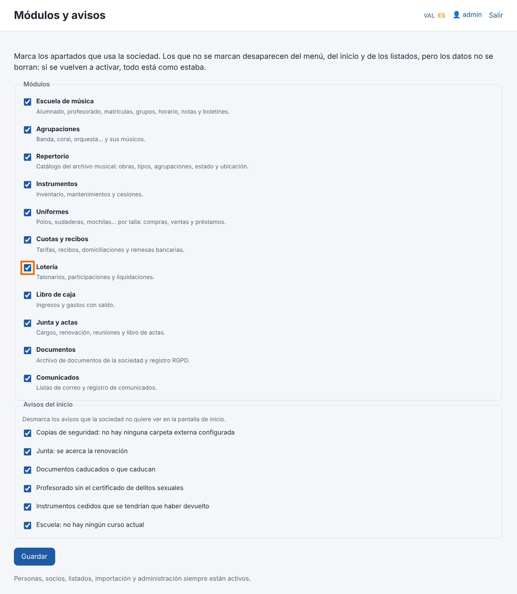

## 5. Preparar el curso académico

Antes de matricular hay que tener el curso preparado. Orden recomendado: **curso → periodos → asignaturas y aulas → profesorado → grupos → horarios**.

### 5.1 Curso y periodos de evaluación

1. Menú **Cursos académicos → + Nuevo**.
2. Nombre (por ejemplo `2026/2027`), fecha de inicio y de finalización.
3. Marca **Curso actual**. Solo puede haber uno; es el que se usa en las notas y los boletines.
4. Pulsa **Guardar**. Se abre la ficha del curso.
5. En el apartado **Periodos de evaluación**, pulsa **+ Añadir** y crea uno para cada evaluación (`1.er trimestre`, `2.º trimestre`, `3.er trimestre`), con el orden 1, 2, 3.

### 5.2 Asignaturas y aulas

- Menú **Asignaturas → + Nuevo**: nombre (Lenguaje musical, Trompeta, Clarinete…) y tipo.
- Menú **Aulas → + Nuevo**: nombre y capacidad.

Solo hay que crearlas una vez: se reutilizan cada curso.

### 5.3 Profesorado

Un profesor es una **persona** con ficha de profesor:

1. Da de alta a la persona (apartado 6) o búscala si ya existe.
2. En su ficha, en el apartado **Profesorado**, pulsa **+ Añadir**.
3. Comprueba la fecha de alta y pulsa **Guardar**.

**Certificado de delitos de naturaleza sexual.** Es obligatorio para todo el que trabaja con menores. En la ficha de profesor, pon su **fecha**. Si falta el de algún profesor en activo, Compàs lo avisa en el inicio y el listado de profesorado tiene el filtro **Sin certificado de delitos sexuales**.

### 5.4 Grupos y horarios

Un **grupo** es una asignatura impartida en un curso por un profesor: por ejemplo *Lenguaje musical · 1.º A* o *Trompeta · Individual*.

1. Menú **Grupos → + Nuevo**.
2. Elige el **curso**, la **asignatura**, escribe el **nombre** del grupo y elige el **profesor** y el **aula**.
3. Pulsa **Guardar**. Se abre la ficha del grupo.

4. En el apartado **Horario**, pulsa **+ Añadir**, elige el **día** y las horas de inicio y de fin, y pulsa **Guardar**. Repítelo si el grupo tiene clase más de un día.

Desde la ficha del grupo también puedes ir directamente a las **Calificaciones** del grupo.

### 5.5 Horario general

El menú **Horario** muestra todas las clases de la semana. Puedes filtrar por profesor o por aula para imprimir el horario de cada uno.

### 5.6 Pasar al curso siguiente

Cuando se acerca el curso nuevo no hace falta crearlo todo desde cero:

1. Menú **Cursos académicos**, abre el curso que termina y pulsa **⏭ Pasa al curso siguiente**.
2. Comprueba el **nombre** y las **fechas** del curso nuevo (Compàs los propone: 2027/2028, un año más).
3. Elige qué se copia: los **periodos de evaluación**, los **grupos** con el profesor/a y el aula, y el **horario**. Si quieres, también puedes **matricular ya a los alumnos que continúan** (sin grupos).
4. Deja marcado **Marca el curso nuevo como curso actual** y, si quieres, **Cierra** el curso anterior.
5. Pulsa **Crea el curso nuevo**.

Después solo hay que ajustar lo que cambie (un grupo nuevo, otro profesor…) e inscribir a los alumnos en los grupos. Las notas no se copian nunca, y el curso anterior se conserva entero.

## 6. Dar de alta a una persona

> **Una persona se introduce una sola vez.** Ser alumno, socio, músico, profesor o tutor legal son *funciones* que se añaden a su ficha. Antes de crear una, **búscala** en el listado por si ya existe.

1. Menú **Personas → + Nuevo**.
2. Rellena los datos obligatorios y el resto que tengas (correo, dirección…):

| Dato | Obligatorio |
|---|---|
| Nombre, apellidos y fecha de nacimiento | Siempre |
| DNI/NIE y teléfono | Solo si la persona es **mayor de edad** (18 años o más) |

3. Deja marcado **Activo**.
4. Pulsa **Guardar**.

Al poner una fecha de nacimiento de mayor de edad, los campos DNI y teléfono pasan a ser obligatorios y aparece el asterisco al lado.

Si la persona es mayor de edad y pagará recibos por el banco (un socio, o el padre o la madre de un alumno), escribe su **IBAN**. Compàs crea la domiciliación (apartado 13.4). También se puede escribir el número de cuenta antiguo de 20 cifras: Compàs lo convierte en IBAN.

Se abre la **ficha de la persona**, con un apartado para cada función: Socios, Alumnado, Profesorado, Músicos y miembros, Tutores legales (cuando es tutor de alguien) y Cesiones.

### Cuando un alumno menor cumple 18 años

De los menores no hace falta tener el DNI ni el teléfono. Cuando una persona cumple 18 años y no tiene esos datos, Compàs lo avisa:

- Arriba del listado de **Personas** aparece un **aviso amarillo** con el número de personas a las que les faltan datos.
- Su fila se marca **en amarillo** con el símbolo ⚠. Si pasas el ratón por encima, dice qué datos faltan.
- En su ficha también aparece el aviso, con un enlace para editarla.

Pulsa **Mostrarlas** (o elige el filtro **Faltan datos obligatorios**) para ver solo esas personas. Abre cada una, pulsa **Editar**, completa el DNI y el teléfono y guarda. El aviso desaparece cuando ya no falta ninguno.

### Derechos de imagen (fotos y vídeos)

Antes de publicar fotos o vídeos en la web o las redes, la sociedad tiene que tener la autorización de cada persona; para los menores, la del padre, la madre o el tutor/a.

1. Abre la ficha de la persona (o del alumno) y pulsa **🖨 Hoja de consentimiento**. Sale una hoja A4 con los datos del alumno y del tutor/a, el texto de la autorización y el espacio para firmar.
2. Cuando la devuelvan firmada, edita la persona y, en **Derechos de imagen**, elige **Autoriza fotos y vídeos** o **No autoriza**. Si no pones la **fecha de la firma**, se pone la de hoy.

Para repartirlas a principio de curso, en **Listados e informes → Derechos de imagen** puedes imprimir de golpe las hojas de todos los pendientes o las de un grupo (apartado 18). En el listado de **Personas**, el filtro **Alumnos sin consentimiento de imagen firmado** muestra quién falta.

> El texto de la hoja es un modelo. Revísalo con la junta y, si hace falta, añade lo que quieras en **Configuración → Texto adicional de la hoja de consentimiento**.

## 7. Alta de un alumno (paso a paso)

Ejemplo completo: un niño nuevo que se apunta a Lenguaje musical y Clarinete. El tutor legal (la madre o el padre) también tiene que estar dado de alta como persona.

### Paso 1. La persona

Da de alta al alumno como **persona** (apartado 6). Si el tutor legal todavía no está dado de alta, dalo de alta también.

### Paso 2. La ficha de alumno

1. En la ficha de la persona, en el apartado **Alumnado**, pulsa **+ Añadir**.

2. La persona ya viene elegida. Comprueba la **fecha de alta** y pulsa **Guardar**.

Se abre la **ficha del alumno**, donde se completan los pasos siguientes.

### Paso 3. El tutor legal

1. En el apartado **Tutores legales**, pulsa **+ Añadir**.

2. En el desplegable **Tutor legal**, escribe en la lupa el nombre del padre, la madre o el tutor y elígelo.
3. Elige la **relación** (madre, padre, tutor/a legal…) y marca **Principal** si es el contacto principal.
4. Pulsa **Guardar**. Repítelo si hay más de un tutor.

> Hermanos: los dos alumnos pueden tener el mismo tutor. No hace falta darlo de alta dos veces.

### Paso 4. La matrícula del curso

1. En la ficha del alumno, en el apartado **Matrículas**, pulsa **+ Añadir**.
2. Comprueba que el **curso** es el actual y pulsa **Guardar**.

### Paso 5. Inscribirlo en los grupos

Se abre la ficha de la matrícula.

1. En el apartado **Inscripciones en grupos**, pulsa **+ Añadir**.

2. Elige el **grupo** (por ejemplo *Lenguaje musical · 1.º A*) y pulsa **Guardar**.
3. Repítelo para cada asignatura (por ejemplo *Clarinete · Individual*).

### Resultado

La ficha del alumno muestra el resumen del curso: grupos, profesores, horario y notas de cada evaluación, el botón para **imprimir su boletín**, los tutores legales y las matrículas de todos los cursos.

### Al empezar un curso nuevo

1. Crea el curso nuevo con **Pasa al curso siguiente** (apartado 5.6): copia los periodos, los grupos y el horario, y puede matricular ya a los alumnos que continúan.
2. Inscribe a cada alumno en los grupos del curso nuevo desde su matrícula (paso 5).

Las matrículas y las notas de los cursos anteriores se conservan en la ficha del alumno.

### Cuando un alumno deja la escuela

Edita su ficha de alumno y pon el estado **Baja** y la **fecha de baja**. Si además ya no es nada de la sociedad, desmarca **Activo** en su ficha de persona.

## 8. Socios

### Tipos de socio

Cada sociedad tiene los tipos de socio que dicen sus estatutos. Compàs trae cuatro para empezar (ordinario, protector, juvenil y de honor), pero se pueden cambiar, añadir y dar de baja: en el listado de socios, pulsa **Tipos de socio**.

- **Nombre** y, si se quiere, una **descripción** (por ejemplo, «Mayores de 65 años»).
- **Orden**: en qué lugar sale en los listados y en la hoja de alta.
- **En la hoja de alta**: si quien se hace socio lo puede elegir. Los que nombra la sociedad (de honor…) normalmente no van.

Un tipo que ya tienen algunos socios o que tiene tarifa no se puede eliminar: se pone de **baja** y deja de aparecer en los socios nuevos.

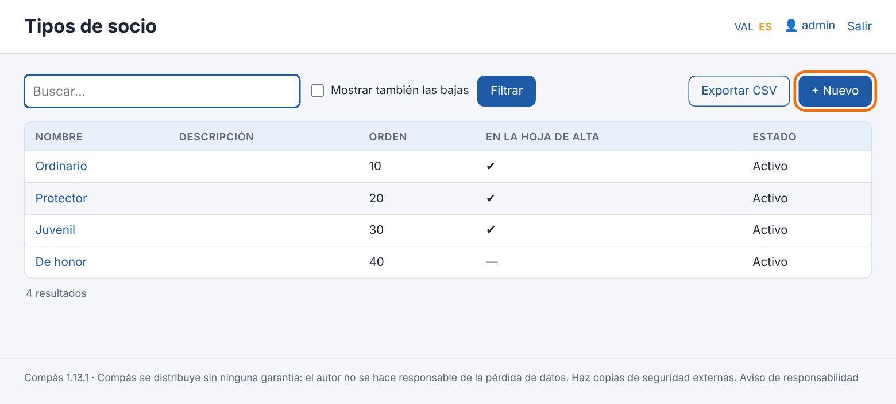

### Alta de un socio

1. Busca o da de alta a la **persona** (apartado 6).
2. En su ficha, en el apartado **Socios**, pulsa **+ Añadir**.
3. Escribe el **número de socio**, elige el **tipo** (los que tenga la sociedad) y comprueba la **fecha de alta**.
4. Si las cuotas se cobrarán por el banco, escribe el **IBAN** (si todavía no lo tiene en su ficha de persona).
5. Pulsa **Guardar**.

### Listado de socios

El menú **Socios** muestra todos los socios activos. Puedes buscar por el nombre o por el número y exportar la lista a CSV (por ejemplo, para hacer etiquetas o enviar una circular).

**Hoja de alta de socio.** En el listado de socios, **Hoja de alta de socio** hace una hoja en blanco para quien quiere hacerse socio: datos personales, tipo de socio (con la cuota, si hay tarifas), forma de pago, orden de domiciliación SEPA, autorización de imagen, firma y la información de protección de datos. Los textos de arriba y del pie se pueden cambiar en **Configuración**.

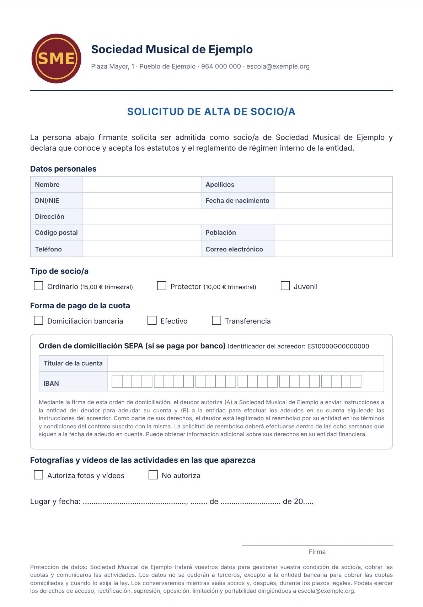

### Baja de un socio

1. Abre el socio y pulsa **Editar**.
2. Cambia el **estado** a **Baja** y pon la **fecha de baja**.
3. Pulsa **Guardar**.

El socio desaparece del listado, pero se conserva con su historial.

## 9. Músicos, agrupaciones y repertorio

### Alta de un músico en una agrupación

1. Busca o da de alta a la **persona** (apartado 6).
2. En su ficha, en el apartado **Músicos y miembros**, pulsa **+ Añadir**.
3. Elige la **agrupación** (Banda, Banda juvenil, Coral…), escribe el **instrumento o voz** y elige la **función**: miembro, director/a titular, director/a asistente o responsable.
4. Pulsa **Guardar**.

Una persona puede estar en varias agrupaciones: repítelo para cada una.

### Ficha de la agrupación

Menú **Agrupaciones** → abre la agrupación. Muestra todos sus miembros con el instrumento y la función. Desde aquí también puedes añadir miembros con **+ Añadir**.

Para crear una agrupación nueva: menú **Agrupaciones → + Nuevo**.

### Repertorio: el catálogo del archivo musical

Menú **Repertorio**. Es el catálogo de las obras que tiene la sociedad: de qué tipo son, para qué agrupaciones sirven, en qué estado están y dónde está el material. Compàs no guarda partituras ni archivos, solo el catálogo.

Para añadir una obra, pulsa **+ Obra**:

- **Título**, **tipo de obra** (pasodoble, marcha mora, marcha cristiana, marcha de procesión, obertura, poema sinfónico…), **compositor/a** y, si lo hay, **arreglista**.
- **Agrupaciones** que la pueden interpretar: se marcan las que ya hay en Compàs.
- **Número de archivo**: Compàs propone el siguiente a la última obra (si la última era ARX-0027, propone ARX-0028). No se puede repetir.
- **Ubicación** del material físico (Armario A · Estantería 3 · Carpeta 27) y **material** que hay (Partitura + particellas).
- **Estado** (completa, incompleta, en revisión o retirada), si está **digitalizada** y **observaciones**, por ejemplo qué particella falta.

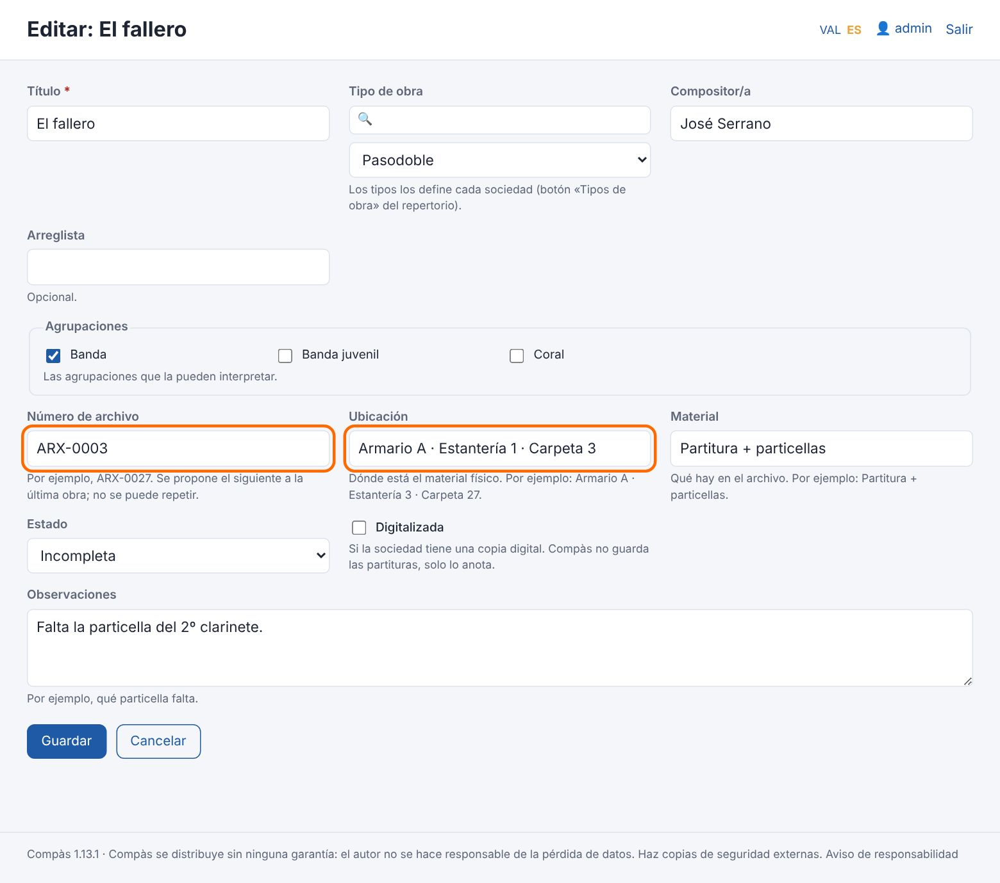

La pantalla del repertorio tiene un **buscador** (título, compositor, número de archivo, ubicación…), **filtros** por tipo, agrupación, estado y si está digitalizada, y se puede **ordenar** por título, compositor, número de archivo, tipo o ubicación. Lo que se ve se puede **imprimir** (o guardar en PDF) y **exportar a CSV**. Las obras incompletas o en revisión tienen un aviso en su ficha, y en la ficha de cada agrupación hay un enlace a sus obras.

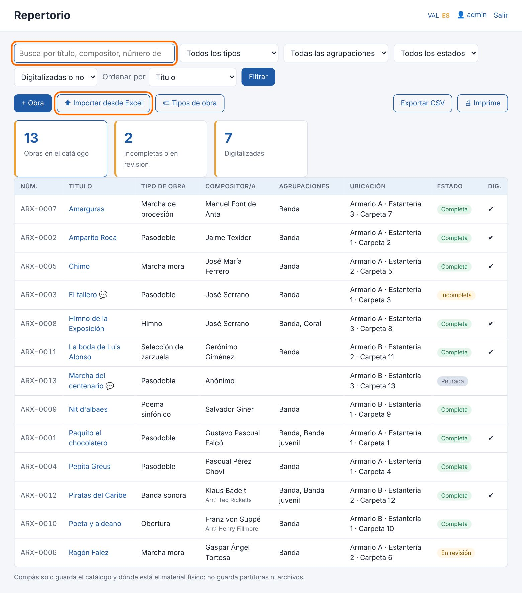

Los **tipos de obra** los elige cada sociedad: en el repertorio, pulsa **Tipos de obra** para cambiarlos, añadir o ordenarlos. Un tipo que ya tienen algunas obras no se puede eliminar, pero se puede dar de baja.

Si la sociedad ya tiene el catálogo en una hoja de cálculo, no hace falta volver a escribirlo: se puede importar (apartado 19).

## 10. Calificaciones

El profesorado pasa las notas a administración y administración las introduce.

1. Menú **Calificaciones**.
2. Elige el **grupo** y la **evaluación** (1.er trimestre, 2.º trimestre…).
3. Escribe la nota de cada alumno. Es texto libre: `7`, `8,5`, `Notable`, `Apto`…
4. Si el profesor ha pasado observaciones, escríbelas en **Observaciones académicas**. Salen en el boletín.
5. Pulsa **Guardar**.

Para borrar una nota, deja en blanco la nota y las observaciones y guarda.

## 11. Boletines de notas

1. Menú **Boletines** (o el botón **Boletines** de la página de calificaciones, o **Imprimir el boletín** de la ficha de un alumno).
2. Elige la **evaluación**. El boletín muestra las notas de esta evaluación y de las anteriores.
3. Elige **de quién**: todo el alumnado matriculado, el alumnado de un grupo o un solo alumno.
4. Si quieres, escribe un **texto al pie** (por ejemplo, la fecha de las audiciones). Se recuerda para la próxima vez.
5. Pulsa **Preparar los boletines**.

Se abre una pestaña nueva con una hoja A4 por alumno. Pulsa **Imprimir el boletín** (arriba del todo).

> Para guardarlos en PDF (para enviarlos por correo), elige **Microsoft Print to PDF** como impresora.

## 12. Instrumentos y uniformes

### Alta de un instrumento

1. Menú **Inventario → + Nuevo**.
2. Rellena el **número de inventario** y el **tipo** (obligatorios) y el resto de datos: marca, modelo, número de serie, estado, ubicación y fecha de adquisición.
3. Pulsa **Guardar**.

En la ficha del instrumento está el historial de **cesiones** y de **mantenimientos** (reparaciones, revisiones…).

### Prestar un instrumento (cesión)

1. En la ficha del instrumento, en el apartado **Cesiones**, pulsa **+ Añadir**.
2. Elige la **persona**, comprueba la **fecha de entrega** y pon la **devolución prevista**, el estado en que se entrega y la fianza si la hay.
3. Pulsa **Guardar**.

Un instrumento no se puede prestar a dos personas a la vez.

### Cuando lo devuelven

1. Abre la cesión y pulsa **Editar**.
2. Pon la **fecha de devolución** y el **estado en la devolución**.
3. Pulsa **Guardar**. El instrumento vuelve a estar disponible.

### Listado de cesiones

Menú **Cesiones**. Con el filtro puedes ver las **cesiones activas** o solo las que tienen la **devolución vencida**. Las vencidas también aparecen en el inicio.

### Uniformes

Menú **Uniformes**: polos, camisetas, sudaderas, chaquetas, mochilas, gorras… con lo que se ha comprado y lo que queda de cada talla.

1. **+ Artículo**: el nombre («Polo de la banda»), el tipo, las **tallas** separadas por comas en el orden en que se deben mostrar (8, 10, 12, S, M, L, XL; vacío si no tiene, como una mochila) y el precio de venta, si se vende.
2. **+ Compra**: cuando llegan de la tienda, el artículo, la talla, la cantidad, el precio y el proveedor.
3. **+ Entrega**: cuando se da a alguien, la persona, la talla y si es una **venta** (se la queda y la paga; el importe se propone con el precio del artículo), un **préstamo** (la tiene que devolver, como un uniforme de concierto) o **gratuito**.

Cuando se devuelve un préstamo, se edita la entrega y se pone la **fecha de devolución**: la prenda vuelve a estar disponible.

La pantalla muestra, para cada artículo y talla, el **total** de prendas que tiene la sociedad (las compradas, menos las vendidas y las gratuitas), las que están **en préstamo** y las **disponibles**. Si de una talla se han entregado más de las que constan como compradas, el número sale en rojo: falta apuntar alguna compra. Las entregas de cada persona aparecen también en su ficha.

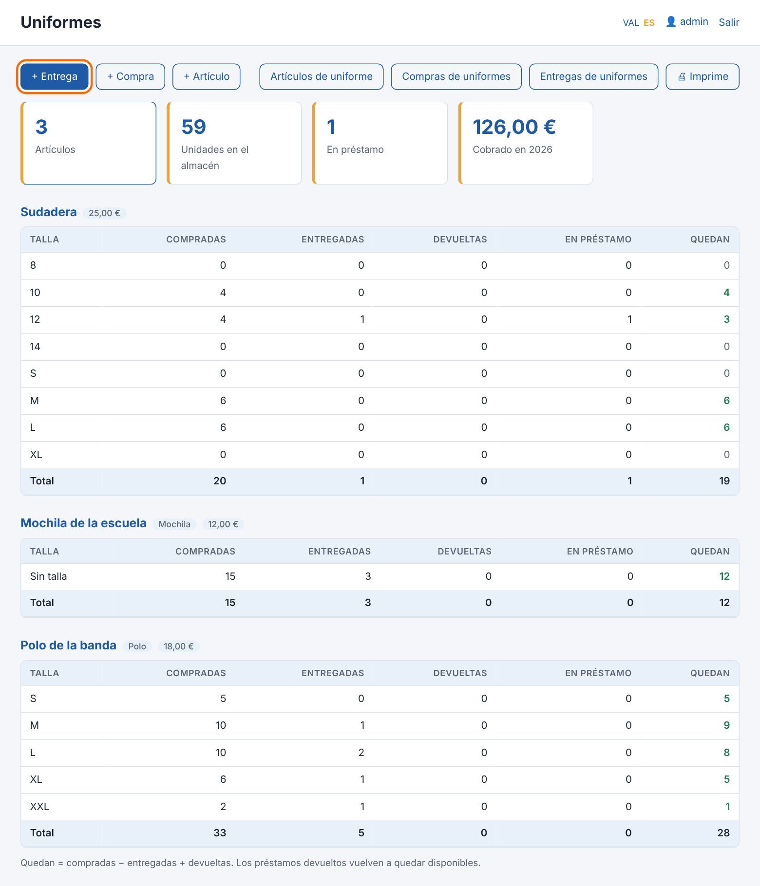

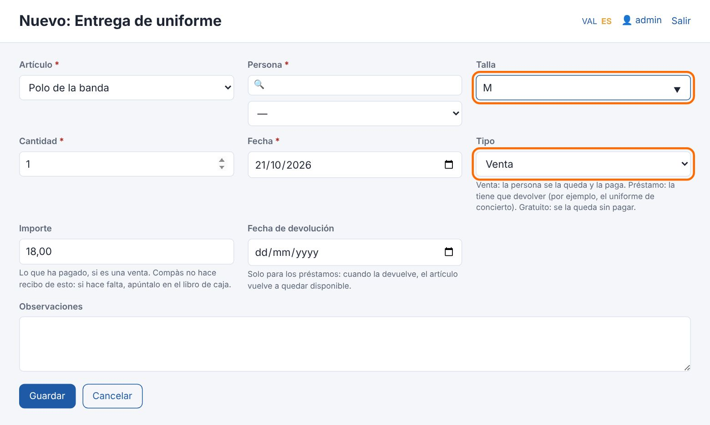

> Compàs no hace recibos de las ventas de uniformes. Si hace falta, apunta el dinero en el libro de caja (apartado 13.7).

## 13. Economía: cuotas, escuela y recibos

El apartado **Economía** del menú lleva el dinero de la sociedad: las cuotas de los socios, la matrícula y las clases de la escuela, los recibos, las remesas al banco y la lotería. **Resumen económico** muestra lo que hay por cobrar, lo cobrado este año, los recibos devueltos por el banco y quién debe dinero.

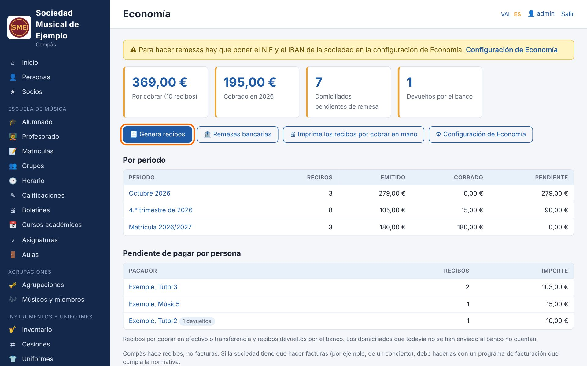

> Compàs hace **recibos**, no facturas. Si la sociedad tiene que hacer una factura (por ejemplo, de un concierto para el ayuntamiento), debe hacerla con un programa de facturación que cumpla la normativa, o la gestoría.

### 13.1 Tarifas: el precio de cada cosa

Menú **Economía → Tarifas**. Cada tarifa tiene un nombre (el que aparecerá en el recibo), un tipo, una periodicidad y un importe:

- **Cuota de socio**: anual, semestral, trimestral o mensual. Se puede hacer una para cada **tipo de socio** (los del apartado 8). Si se deja una sin tipo, vale para los tipos que no tengan una propia. Los socios de un tipo sin tarifa (por ejemplo, los honorarios) no pagan.
- **Matrícula**: una sola vez por curso y alumno.
- **Clases**: mensual, trimestral (por evaluaciones) o anual. Si se pone una **asignatura**, se cobra a cada alumno inscrito en algún grupo de esa asignatura. Si no, se cobra una vez por alumno (una cuota de escuela fija).

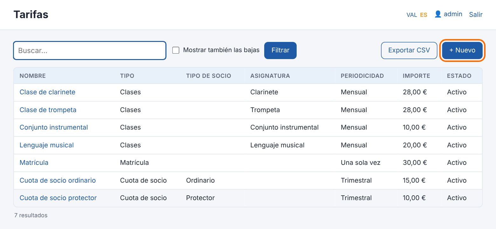

### 13.2 Datos del banco y descuentos

El administrador/a lo configura una sola vez en **Resumen económico → Configuración de Economía**:

- **Datos bancarios de la sociedad**: el NIF y el IBAN donde se cobran los recibos. Los da el banco cuando se contrata el servicio de adeudos directos SEPA («remesas» o «cuaderno 19»). Compàs calcula el **identificador de acreedor**: comprueba que es el mismo que te ha dado el banco.
- **Descuentos de la escuela**: un porcentaje para quien es socio (el alumno o quien paga) y otro para cada hermano a partir del segundo. Se aplican a las clases, no a la matrícula. En la ficha del alumno se puede poner, además, un **descuento propio** (familia numerosa, beca…) y **quién paga** las clases, si no es el tutor principal.
- **Texto al pie de los recibos**, si la sociedad quiere poner uno.

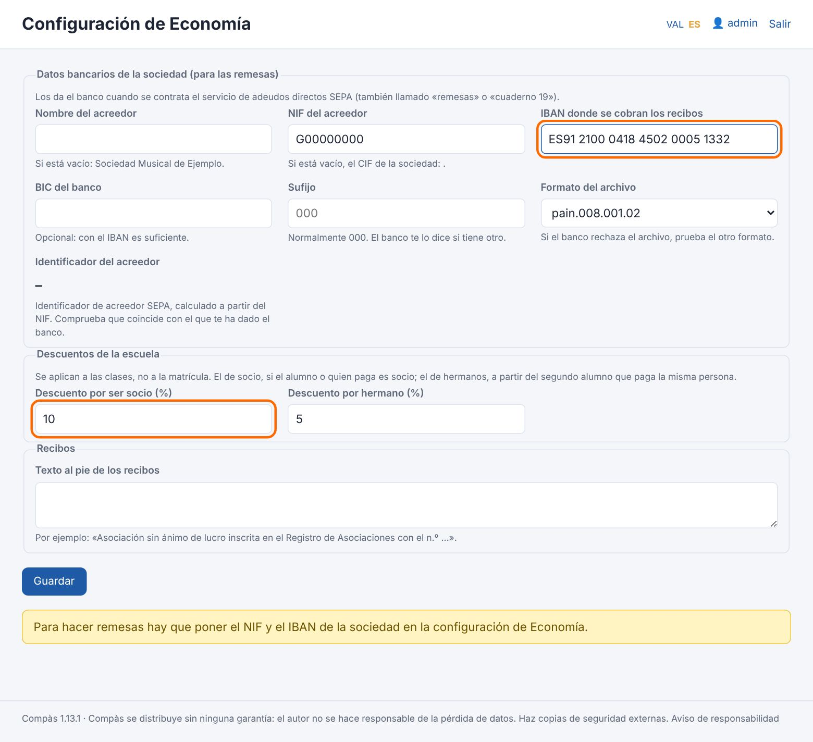

### 13.3 Generar los recibos

Menú **Economía → Genera recibos**. Hay dos opciones:

- **Cuotas de socio**: elige el año y el periodo (por ejemplo, el 1.er trimestre). Se hace un recibo para cada socio de alta en ese periodo.
- **Escuela de música**: elige el curso y el periodo: la **matrícula**, un **mes**, una **evaluación** o el **curso completo**. Se hace **un recibo por familia**: si el mismo padre o madre paga dos hermanos, va todo en un recibo, con una línea por asignatura y los descuentos.

Pulsa **Previsualiza**: Compàs muestra quién pagará, el detalle y el importe, y avisa de los alumnos que no tienen quien pague. Si está bien, pulsa **Crea**. Si vuelves a generar el mismo periodo, no se duplica nada: los que ya existen aparecen como «Ya generado».

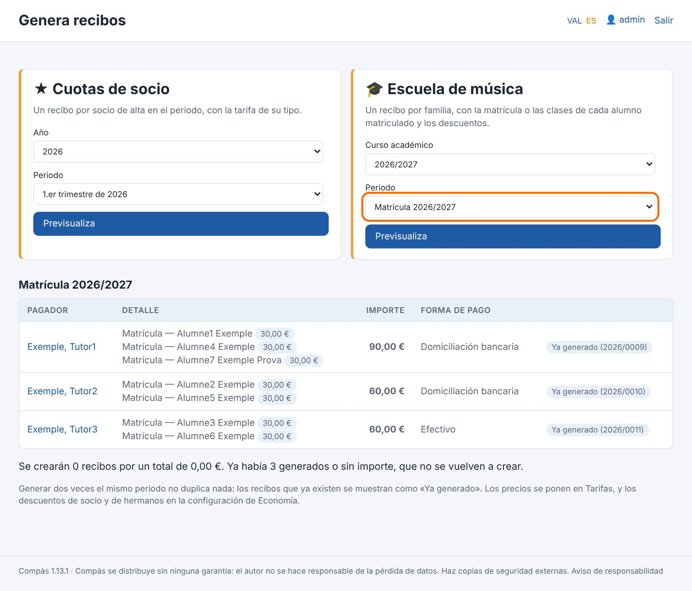

Los recibos de quien tiene una **domiciliación** activa se cobrarán por el banco; los demás, en **efectivo**. También se puede hacer un recibo a mano con **Recibos → + Nuevo** (por ejemplo, un donativo o la venta de un uniforme).

### 13.4 Domiciliaciones bancarias

Para cobrar un recibo por el banco, quien paga debe haber firmado la **orden de domiciliación** (el mandato SEPA). La manera más sencilla es escribir el **IBAN en la ficha de la persona o del socio**: al guardar, Compàs crea la domiciliación con la fecha de hoy. Si después se cambia el IBAN, la anterior se da de baja y se crea una nueva (hay que volver a firmarla); si se borra, se da de baja. También se puede hacer desde **Economía → Domiciliaciones → + Nuevo**, donde se puede poner la fecha de firma y un titular de la cuenta diferente. Compàs comprueba que el IBAN es correcto y le pone una referencia. Solo se puede domiciliar a nombre de un mayor de edad. En los listados, el IBAN solo se ve en parte.

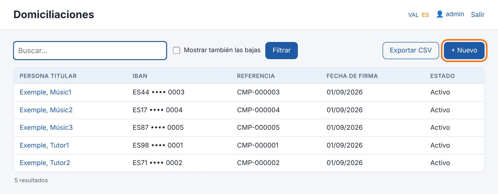

En la ficha de la domiciliación, **Imprime la orden de domiciliación** hace la hoja para firmar. La sociedad debe guardarla firmada mientras se cobre y 14 meses más.

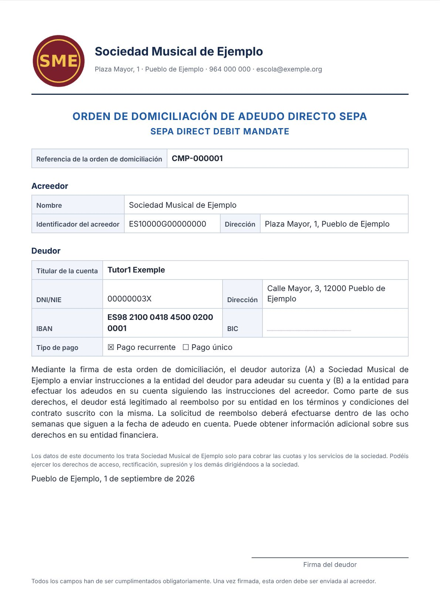

### 13.5 Remesas: cobrar por el banco

Menú **Economía → Remesas bancarias**. Aparecen los recibos domiciliados pendientes de cobrar (también los que el banco ha devuelto). Elígelos, pon la **fecha de cobro** (muchos bancos piden al menos dos días hábiles) y pulsa **Prepara la remesa**.

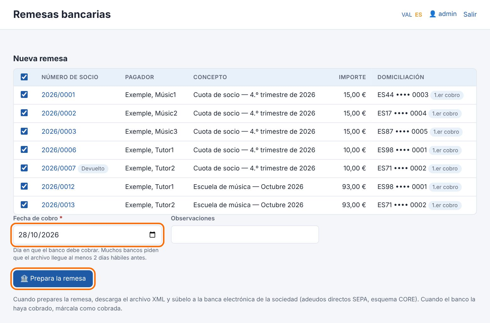

Después:

1. Pulsa **Descarga el archivo para el banco (XML)**.
2. Entra en la banca electrónica de la sociedad y súbelo al apartado de adeudos directos SEPA (esquema CORE). Si el banco rechaza el archivo, cambia el **formato** en la configuración de Economía y vuelve a descargarlo.
3. Cuando el banco la haya cobrado, pulsa **Márcala como cobrada**: todos los recibos quedan pagados.

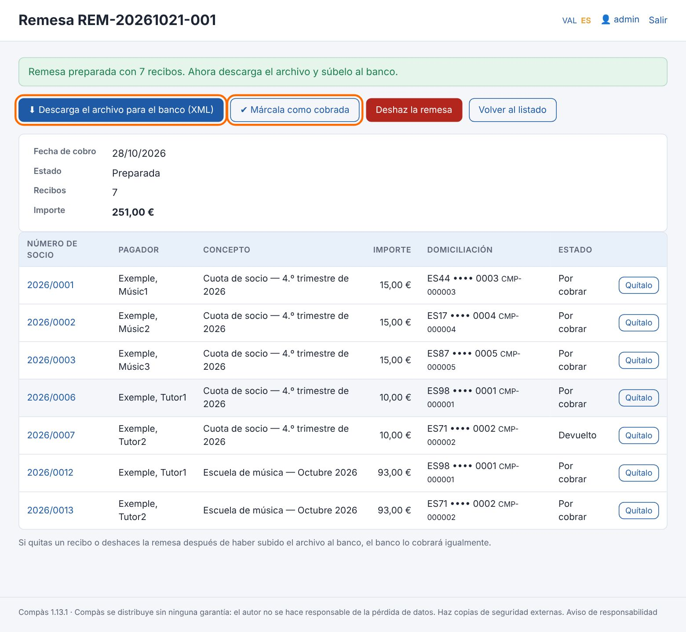

Si el banco **devuelve** un recibo, ábrelo y pulsa **Devuelto por el banco**. Volverá a estar por cobrar: lo puedes cobrar en mano o ponerlo en la remesa siguiente. Mientras una remesa no se ha subido al banco, se puede quitar un recibo o deshacerla.

### 13.6 Cobrar en mano e imprimir recibos

Abre el recibo, elige cómo se ha pagado (**efectivo** o **transferencia**) y la fecha, y pulsa **Pagado**. Con **Imprime el recibo** se hace el recibo con el logotipo; si está pagado, lleva el sello «PAGADO». Desde el **Resumen económico**, **Imprime los recibos por cobrar en mano** los hace todos de golpe, dos por hoja.

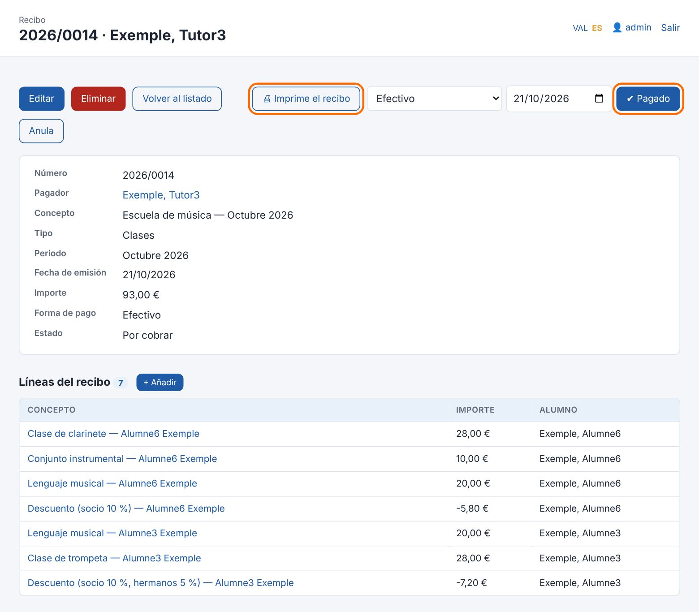

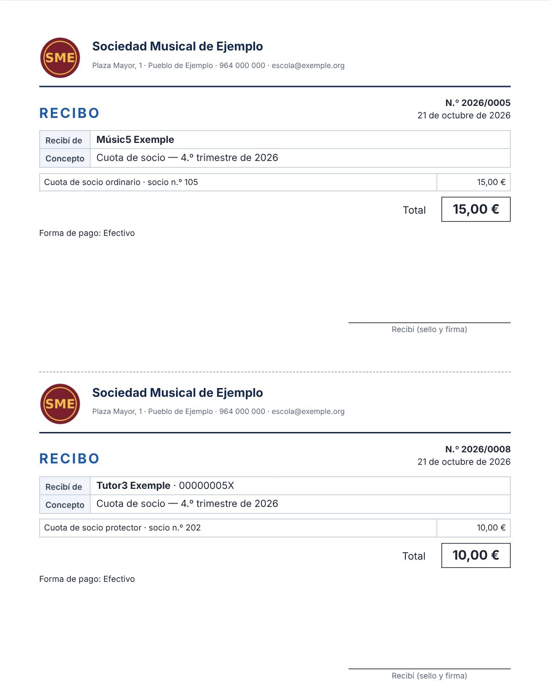

En el listado de **Recibos**, los filtros muestran los que están por cobrar, los devueltos, los que hay que cobrar en mano o los domiciliados que todavía no están en ninguna remesa. Abajo se ve el total. En la ficha de cada persona están sus recibos y su domiciliación.

### 13.7 Libro de caja

Menú **Economía → Libro de caja**. Muestra todos los ingresos y gastos del año, con el saldo después de cada movimiento. Muchas cosas entran solas:

- los recibos cobrados en efectivo (en la caja) o por transferencia (en el banco);
- las remesas cobradas, en una sola línea, como aparecen en el banco;
- el dinero de la lotería que entrega cada talonario.

El resto (facturas, subvenciones, la cuota de la Federación…) se anota con **+ Nuevo movimiento**: fecha, ingreso o gasto, banco o caja, categoría, concepto e importe. Al final de la página se pone el **saldo inicial** del 1 de enero del banco y de la caja, para que los saldos sean los reales. Se puede ver solo el banco o solo la caja, imprimirlo y exportarlo a CSV. El resumen **por categorías** sirve para presentar las cuentas a la asamblea y para la memoria.

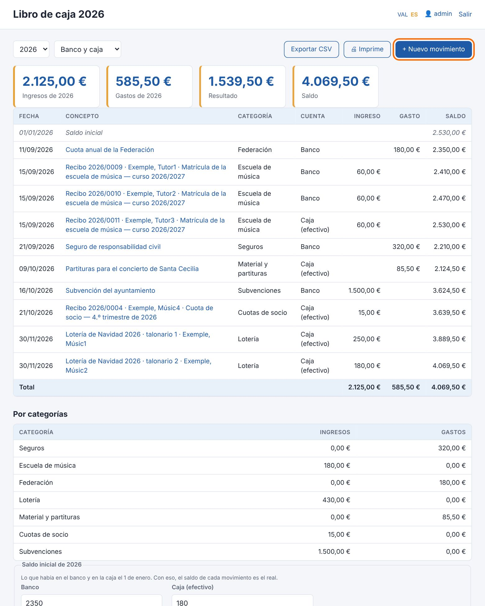

## 14. Lotería

Menú **Economía → Lotería → + Nuevo**. Escribe el nombre del sorteo (por ejemplo, «Lotería de Navidad 2026»), la fecha, los **números**, el **precio** de cada participación, el importe que **juega** (el resto es el donativo para la sociedad) y cuántas participaciones lleva cada talonario. En la ficha, **Talonarios y liquidación** abre el resumen.

### Repartir los talonarios

Elige la persona y cuántos talonarios se lleva, y pulsa **Reparte talonarios**. Compàs los numera seguidos: el talonario 1 lleva las participaciones 0001–0050, el 2 las 0051–0100, etc.

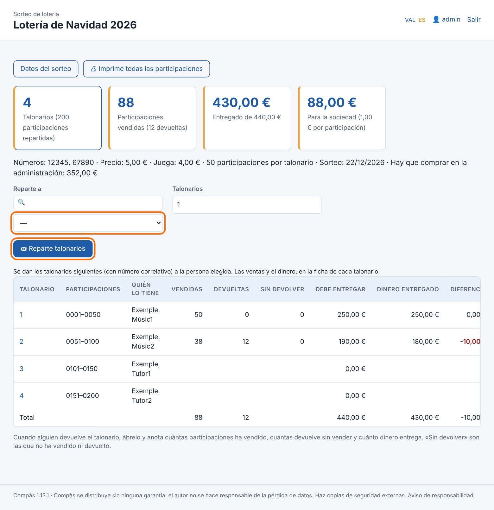

### Imprimir las participaciones

En la ficha de cada talonario, **Imprime las participaciones** hace sus 50 participaciones (8 por hoja), con el logotipo, los números, el precio y el número de participación. Desde el resumen se pueden imprimir todas de golpe. El texto legal del pie se cambia en la ficha del sorteo.

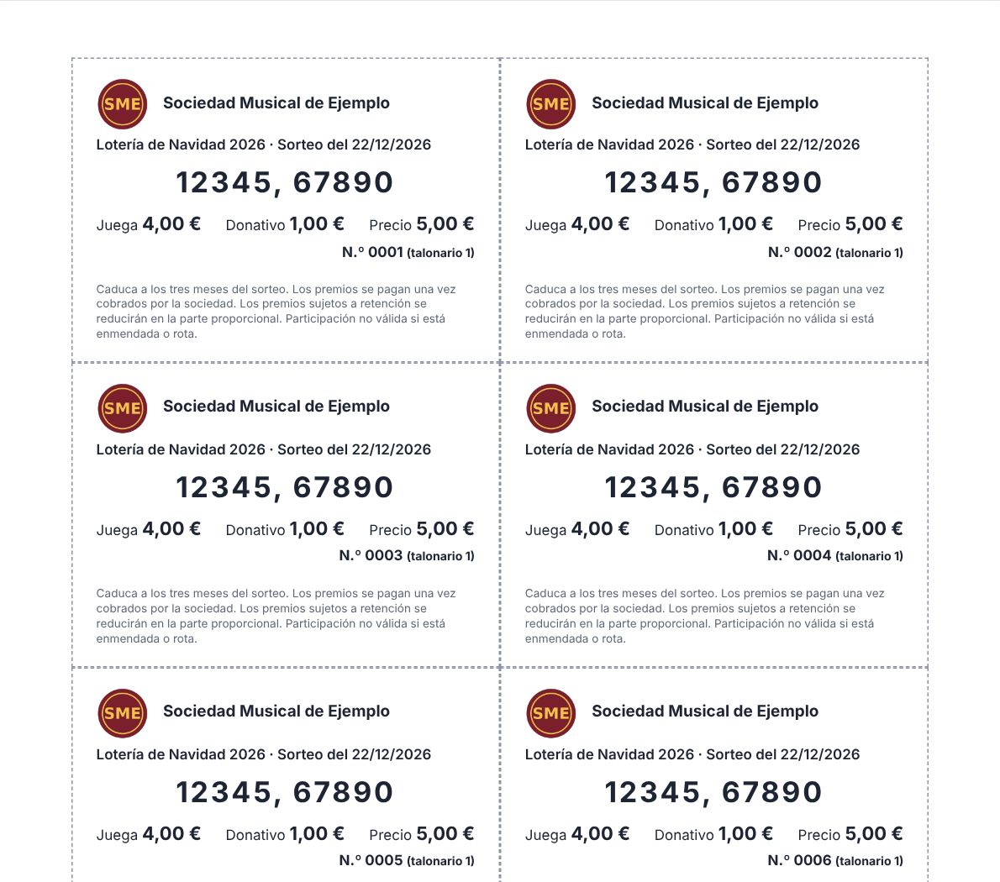

### Liquidar

Cuando alguien devuelve el talonario, ábrelo y anota cuántas participaciones ha **vendido**, cuántas **devuelve** sin vender y cuánto **dinero entrega**. El resumen muestra lo que falta por entregar (en rojo), cuánto hay que comprar en la administración de lotería y lo que queda para la sociedad.

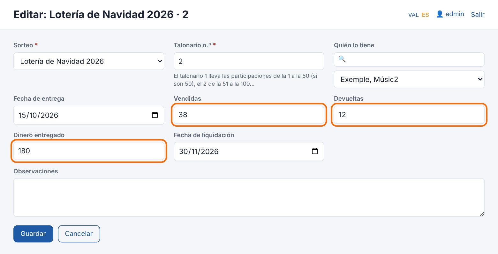

## 15. Junta directiva y actas

### 15.1 La junta

Menú **Sociedad → Junta directiva**. Muestra la junta actual y las anteriores. Para poner un cargo, pulsa **+ Añade un cargo**: elige la persona, el cargo (presidente/a, vicepresidente/a, secretario/a, tesorero/a, vocal…) y la fecha de inicio. La fecha de fin se deja vacía mientras el cargo está vigente.

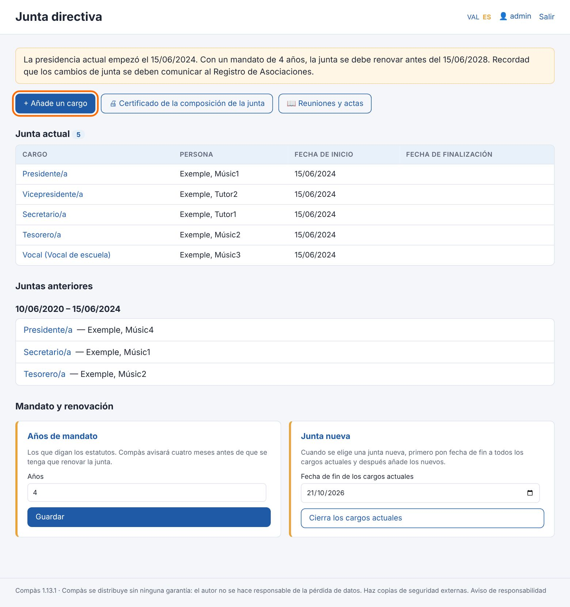

- **Años de mandato:** pon los que digan los estatutos. Compàs avisará en el inicio cuatro meses antes de que se tenga que renovar la junta.
- **Junta nueva:** cuando se elige una junta nueva, pulsa **Cierra los cargos actuales** con la fecha de la elección y después añade los cargos nuevos. Los anteriores quedan en el historial. Recordad que los cambios de junta se deben comunicar al Registro de Asociaciones.
- **Certificado de la composición de la junta:** para el banco, el registro o una subvención.

Los **certificados** (de socio, de matrícula, de agrupación y de la junta) y las **actas** los firma la secretaría con el visto bueno de la presidencia de la junta actual. Si hace falta que los firme otra persona, se pone en **Configuración**.

### 15.2 Reuniones y actas

Menú **Sociedad → Reuniones y actas → + Nuevo**. Elige si es una reunión de la **junta** o una **asamblea** (ordinaria o extraordinaria), y pon la fecha, la hora (en las asambleas, también la de segunda convocatoria), el lugar y el **orden del día**, un punto por línea.

En la ficha de la reunión hay tres documentos para imprimir:

1. **Convocatoria**, con el orden del día numerado.
2. **Acta**. Después de la reunión, edítala y completa los **asistentes**, el **desarrollo** y los **acuerdos** (uno por línea), y márcala como celebrada. En las reuniones de junta, si no pones los asistentes, el acta pone la junta actual.
3. **Certificado de un acuerdo**: elige el acuerdo y Compàs hace el certificado que piden a menudo el banco o las administraciones.

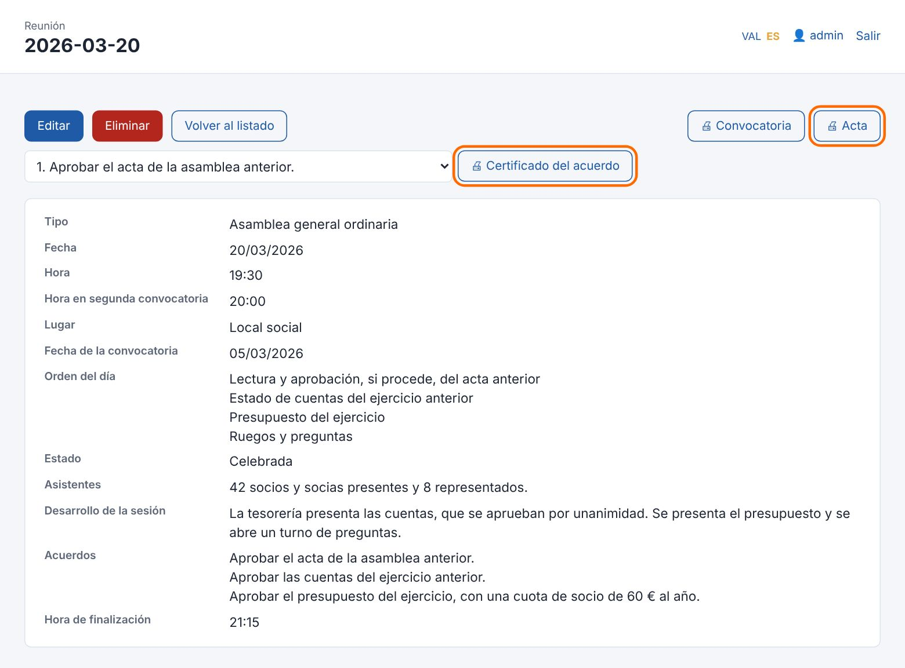

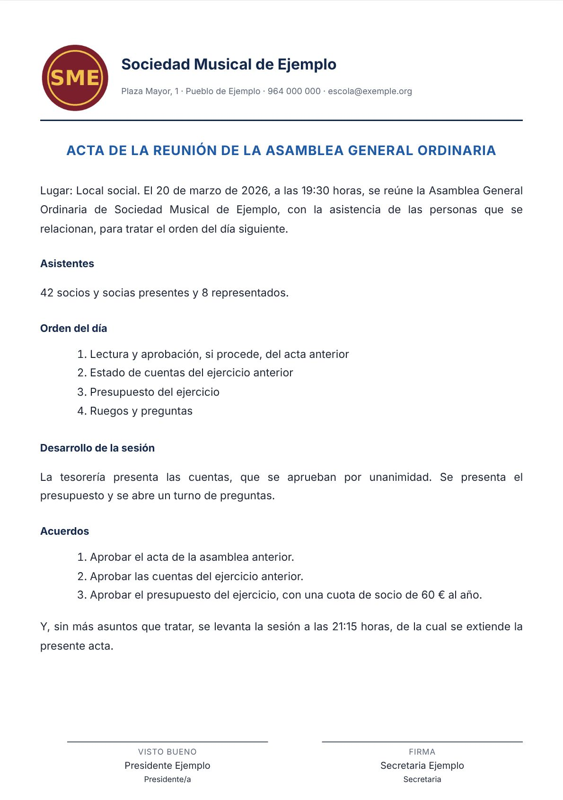

## 16. Documentos de la sociedad

Menú **Sociedad → Documentos**. Aquí se guardan los estatutos, el reglamento de régimen interno, las actas firmadas, la inscripción en el registro, el CIF, las pólizas de seguro, los contratos del profesorado y de la dirección, los convenios…

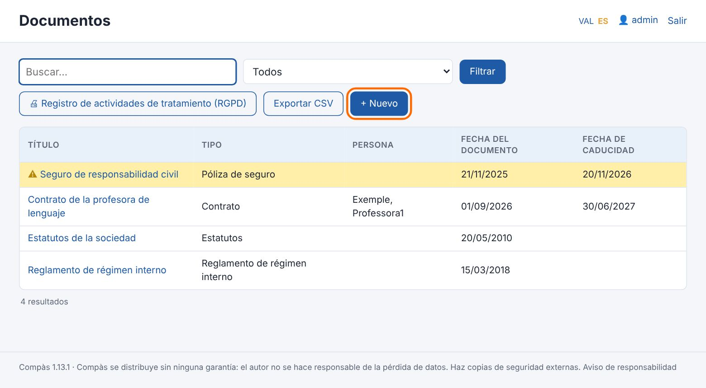

Para añadir uno, pulsa **+ Nuevo**, escribe el título, elige el tipo y el **archivo** (PDF, imagen, Word, Excel, LibreOffice o texto, hasta 20 MB). Si es de una persona (un contrato, por ejemplo), elígela: aparecerá también en su ficha. Si el documento caduca (un seguro, una licencia, un convenio), pon la **fecha de caducidad**: Compàs avisará en el inicio 60 días antes.

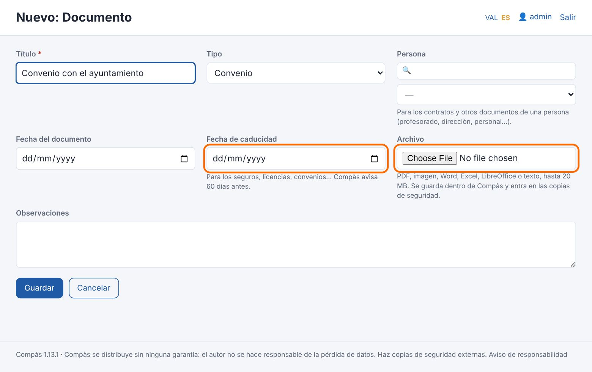

El archivo se guarda **dentro de Compàs**, no en una carpeta aparte. Así entra en las copias de seguridad (y, si las cifráis, también va cifrado). A cambio, las copias ocupan más si guardáis muchos documentos grandes.

### Registro de actividades de tratamiento (RGPD)

Desde el listado de documentos, **Registro de actividades de tratamiento (RGPD)** hace el documento que el Reglamento de protección de datos pide a las entidades. Compàs lo prepara con los datos que trata la sociedad y las medidas de seguridad que tiene configuradas. Es un modelo orientativo: revisadlo, adaptadlo y guardadlo firmado con la documentación de la sociedad.

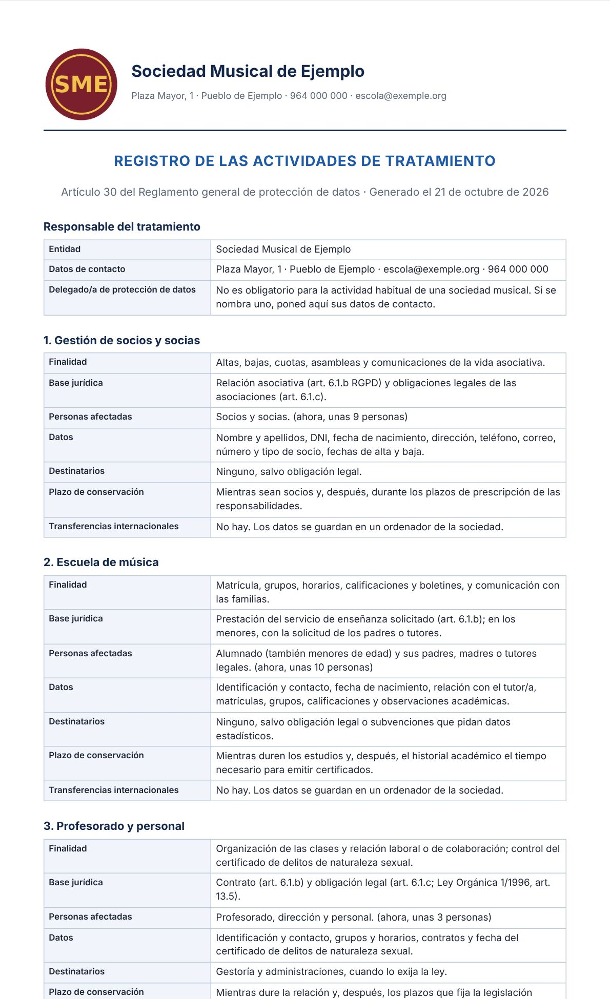

## 17. Comunicados

Menú **Sociedad → Comunicados**. Compàs no envía correos ni se conecta a Internet: prepara las direcciones para que enviéis el comunicado desde el correo de la sociedad.

1. Elige **a quién**: los socios, la junta, el profesorado, las familias de la escuela o de un grupo, los miembros de una agrupación o todo el mundo.
2. Pulsa **Copia las direcciones** y pégalas en el campo **CCO** (copia oculta) del correo, para que nadie vea las direcciones de los demás. Si son pocas, **Abre el correo con las direcciones en CCO** lo hace directamente.
3. Escribe y envía el correo desde vuestro programa de correo.
4. Vuelve a Compàs y **registra el comunicado** con el asunto: queda constancia de qué se ha enviado, cuándo y a quién.

Las personas del grupo que no tienen correo aparecen en una lista aparte, para avisarlas de otra manera.

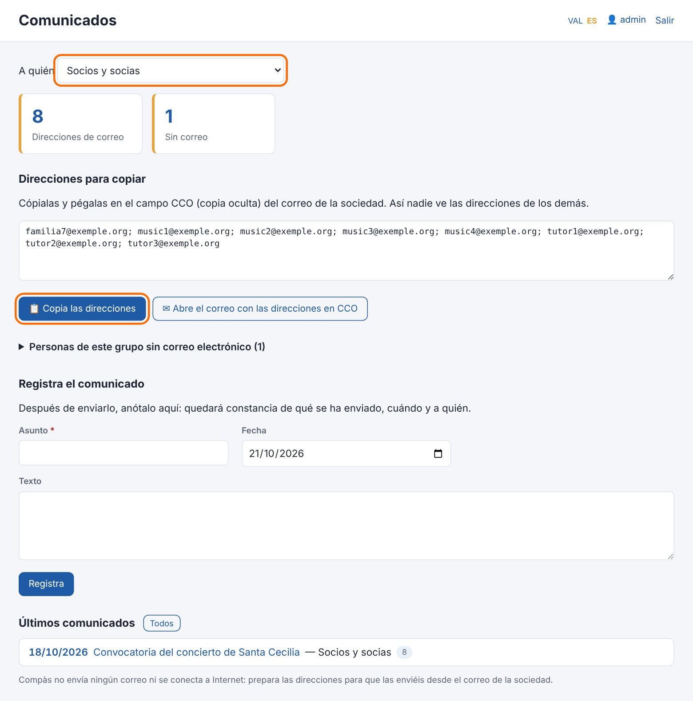

## 18. Listados, certificados y memoria

Menú **Documentos y datos → Listados e informes**. Cada listado se puede ver en pantalla, **imprimir** (o guardar en PDF) y **exportar a CSV** para abrirlo con Excel.

### Alumnos de un grupo

Elige el curso y el grupo. Sale cada alumno con la edad, el padre, la madre o el tutor/a y sus teléfonos y correos. Es el listado que necesita el profesorado. En amarillo, los que no autorizan fotos.

### Socios por número y músicos por instrumento

- **Socios por número**: todos los socios de alta, ordenados por número, con DNI y contacto. Puedes elegir un tipo de socio.
- **Músicos por instrumento**: elige una agrupación y sale la plantilla agrupada por instrumento o voz, con el número de músicos de cada uno.

### Derechos de imagen

Quién puede salir en fotos y vídeos: el resumen (cuántos autorizan, cuántos no y cuántos faltan) y la lista, con los que no autorizan en amarillo. Antes de un concierto, imprímela para quien hace las fotos. El botón **Hojas de consentimiento de los pendientes** imprime las hojas que faltan.

### Etiquetas para las circulares

1. Elige **para quién**: socios, familias del alumnado (los tutores que reciben comunicaciones), músicos o todas las personas.
2. Elige el **formato** de la hoja de etiquetas (lo dice la caja: 24, 21 o 14 por hoja).
3. Si la hoja ya está empezada, indica cuántas etiquetas **ya se han gastado**.
4. Pulsa **Prepara las etiquetas** e imprime con el **tamaño real (100 %)** y **sin márgenes**.

> Haz primero una prueba en papel normal con **Muestra los bordes** y ponla encima de la hoja de etiquetas a contraluz.

### Antigüedad e insignias

Elige el **año** y los **años que se premian** (por defecto 25 y 50). Sale quién los cumple ese año, como socio y como músico. Marca **Muestra también la lista completa** para ver a todos ordenados por antigüedad.

La antigüedad se cuenta desde la fecha de alta. Para los músicos, desde la primera alta en cualquier agrupación.

### Memoria anual y subvenciones

Elige el curso. Sale lo que suelen pedir la Diputación, el IVC o el ayuntamiento: alumnos por edad (con menores y mayores), por asignatura y por población, profesorado y grupos, músicos de cada agrupación (con los menores), socios por tipo y las altas y bajas del año.

### Certificados

En la ficha de un **socio**, de una **matrícula** o de un **músico** (en **Músicos y miembros**) está el botón **🖨 Certificado**. Sale un certificado en A4 con el logotipo, los datos de la persona y la fecha de hoy, preparado para firmar. Sirve para becas, el conservatorio, el trabajo…

La primera vez, en **Configuración → Certificados y hojas de consentimiento**, pon quién firma (normalmente el secretario/a), el cargo y, si queréis el visto bueno, el presidente/a. Pon también la **población** de la sociedad, que sale al final del certificado.

## 19. Importar datos desde Excel

Si la sociedad ya tiene los socios o el alumnado en un Excel, no hace falta volver a escribirlos. Menú **Documentos y datos → Importar datos**.

### Paso 1. El archivo

1. Elige qué quieres importar: **Personas**, **Socios** (con el número, el tipo y la fecha de alta; el tipo se busca por el nombre) **Alumnado** (con el padre, la madre o el tutor/a, si la hoja los lleva) o el **Repertorio** (ver más abajo).
2. Elige el archivo: Excel (**.xlsx**) o **CSV**. Si es un .xls antiguo, ábrelo con Excel y guárdalo como .xlsx.
3. Deja marcado **La primera fila tiene los títulos de las columnas** si es el caso, y pulsa **Siguiente**.

Si empiezas de cero, descarga una **plantilla**, rellénala y súbela.

### Paso 2. Qué es cada columna

Compàs reconoce las columnas habituales (Nombre, Apellidos, DNI, Teléfono, Fecha de nacimiento…) y ya las deja elegidas. Compruébalas y corrige las que falten. Si el nombre y los apellidos están juntos, elige **Nombre y apellidos juntos**. Las columnas que no elijas no se importan.

Si la hoja lleva la **cuenta bancaria** (IBAN o el número antiguo de 20 cifras), Compàs crea la domiciliación de cada persona mayor de edad; al importar alumnado, la del padre, la madre o el tutor/a. Si hay una columna con la **fecha de firma** de la domiciliación, también la coge. A las personas que ya tienen una domiciliación con otro IBAN no se les cambia.

### Paso 3. Revisar e importar

Antes de importar nada, Compàs muestra cada fila:

| Estado | Qué quiere decir | Qué se hace |
|---|---|---|
| **Nueva** | No está en Compàs | Se crea |
| **Ya existe** | Mismo DNI, o mismo nombre y fecha de nacimiento | No se duplica: solo se completan los datos que le faltan |
| **Posible duplicado** | Mismo nombre, pero no se puede asegurar | Marca **Es la misma persona** si lo es; si no, se crea nueva |
| **Repetida en el archivo** / **Error** | Está dos veces o no tiene nombre | No se importa |

En la columna **Avisos** verás, por ejemplo, fechas que no se entienden o personas a las que faltan datos obligatorios (quedarán en amarillo, como siempre).

Pulsa **Importa**. Antes de importar, Compàs hace una copia de seguridad («Antes de importar»): si el resultado no es el que esperabas, la puedes restaurar (apartado 20).

### Importar el repertorio

Elige **Repertorio** en el primer paso. Compàs reconoce las columnas más habituales (número de archivo, título, tipo, compositor, arreglista, agrupaciones, ubicación, material, estado, digitalizada y observaciones); la del título es la única obligatoria.

- Los **tipos de obra** que no existen se crean.
- Las **agrupaciones** se buscan por el nombre; si son varias, van separadas por comas («Banda, Coral»). Las que no hay en Compàs se avisan y no se asignan.
- El **estado** se entiende aunque esté escrito de otra manera («Completa», «Falta la flauta»…), y **Digitalizada** acepta «Sí», «X» o «1».
- Las obras que **ya están en el catálogo** (por el número de archivo o, si no tienen, por el título y el compositor) no se tocan, si no marcas **Actualizarla con la hoja**. Las repetidas dentro de la misma hoja se importan una sola vez.

El CSV que se descarga del repertorio se puede volver a importar: es una manera sencilla de corregir muchas obras a la vez con Excel.

## 20. Copias de seguridad

Todos los datos están en un solo archivo. Compàs hace copias automáticamente:

| Cuándo | Tipo |
|---|---|
| La primera vez que se usa cada día | Automática (diaria) |
| Al cerrar Compàs, si ha habido cambios | Automática (al cerrar) |
| Cuando pulsas **Hacer una copia ahora** | Manual |
| Justo antes de restaurar | Antes de restaurar |
| Justo antes de importar datos | Antes de importar |

Menú **Administración → Copias de seguridad**:

### Cuántas copias se guardan

Las copias automáticas no se acumulan sin fin. Compàs guarda:

- **todas** las de los últimos 7 días;
- **una por semana** de las últimas 5 semanas;
- **una por mes** hasta el límite que elijas en **Cuánto tiempo se guardan las copias automáticas** (1 año si no se cambia).

Con una copia cada día, eso son unas veinte copias que llegan a un año atrás. Las manuales y las de «antes de restaurar» o «antes de importar» no se borran solas. La misma rotación se hace en la carpeta externa.

La pantalla dice cuánto ocupa la base de datos (y cuánto de eso son documentos) y cuánto ocupan todas las copias. Si la base de datos pasa de 200 MB, normalmente por los documentos archivados, Compàs avisa: cada copia ocupa lo mismo, así que hay que comprobar que hay espacio suficiente en el ordenador y en la carpeta externa.

### Configurar la carpeta externa (muy importante)

Si el ordenador se estropea o lo roban, las copias que hay dentro se pierden con él. Hay que guardarlas también fuera:

1. Conecta un **disco o lápiz USB**, o elige una carpeta **sincronizada con la nube** (OneDrive, Google Drive…).
2. Crea en ella una carpeta, por ejemplo `Copias Compàs`, y copia su ruta desde el Explorador de Windows (por ejemplo `E:\Copias Compàs`).
3. En **Configuración de las copias**, pega la ruta en **Carpeta externa**.
4. Pulsa **Guardar**.

A partir de ahora, cada copia se guarda también en esta carpeta. Si no está disponible (por ejemplo, el USB no está conectado) o hace más de 7 días que no se guarda nada en ella, el inicio lo avisa.

### Lista de copias, restaurar y eliminar

- **Descargar**: descarga esa copia.
- **Restaurar** (solo el administrador/a): sustituye todos los datos actuales por los de la copia. Antes, Compàs guarda una copia de los datos actuales («Antes de restaurar»), de manera que siempre se puede volver atrás. Después hay que volver a entrar.
- **Eliminar** (solo el administrador/a): borra la copia.

Para restaurar una copia guardada fuera (por ejemplo, desde el USB), usa **Restaurar desde un archivo**, al final de la página.

> Las copias contienen datos personales, también de menores. Guárdalas en un lugar seguro.

### Copias externas cifradas

Si la carpeta externa es un pendrive o la nube, conviene cifrarlas: si se pierde el USB, nadie podrá abrir los datos sin la contraseña.

1. En **Configuración de las copias**, marca **Cifra con contraseña las copias de la carpeta externa**.
2. Escribe una contraseña (al menos 8 caracteres) dos veces y pulsa **Guardar**.

A partir de ahora, las copias de la carpeta externa terminan en `.xifrat`. Las del ordenador no se cifran. Para restaurar una, en **Restaurar desde un archivo** elige el archivo `.xifrat` y escribe la contraseña.

> **Apunta la contraseña en papel** junto con el código de recuperación. Si se olvida, las copias cifradas no se pueden recuperar.

## 21. Usuarios y contraseñas

### Cambiar tu contraseña

Cada usuario puede cambiar la suya cuando quiera:

1. En el menú, abajo del todo, pulsa **Cuenta y contraseña** (o haz clic en tu nombre de usuario, arriba a la derecha).
2. Escribe la **contraseña actual**.
3. Escribe la **contraseña nueva** dos veces (al menos 8 caracteres).
4. Pulsa **Guardar**.

Si no recuerdas la actual, no la puedes cambiar aquí: el administrativo/a debe pedir una nueva al administrador/a, y el administrador/a puede recuperar el acceso desde la entrada (ver más abajo).

### Gestionar las cuentas (administrador/a)

Menú **Administración → Usuarios**. Abre una cuenta para:

- cambiarle el **rol** (administrador/a o administrativo/a);
- ponerle una **contraseña nueva** si la ha olvidado (déjala en blanco para no cambiarla);
- desactivarla (desmarca **Activo**) o eliminarla.

Siempre debe quedar al menos un administrador activo.

### Si el administrador/a olvida la contraseña

1. En la pantalla de entrada, pulsa **¿Eres el administrador/a? Recupera el acceso**.
2. Escribe tu **usuario**, el **código de recuperación** que guardaste y la **contraseña nueva** dos veces.
3. Pulsa **Cambia la contraseña**. Entrarás directamente en el programa.
4. Compàs muestra un **código de recuperación nuevo**, porque el anterior ya no vale. Imprímelo y guárdalo en lugar del antiguo.

**Si no encuentras el código**, pulsa **No tengo el código de recuperación** en la misma página y sigue los pasos:

1. Abre el Explorador de archivos y ve a la carpeta de datos de Compàs. La página muestra la ruta exacta: cópiala en la barra de direcciones del Explorador.
2. Crea un archivo nuevo (botón derecho → **Nuevo → Documento de texto**) y ponle de nombre `recupera-acces`.
3. Vuelve a la página de Compàs y recárgala (tecla **F5**). Ya no pedirá el código: escribe el usuario y la contraseña nueva.

El archivo solo vale durante una hora y se borra solo al usarlo. Este sistema es seguro porque solo puede crear el archivo quien ya tiene acceso al ordenador y a los datos.

### Código de recuperación

Si has perdido el código o crees que alguien lo ha visto, ve a **Administración → Usuarios** y, abajo, pulsa **Genera un código nuevo**. El anterior deja de valer. Si Compàs se instaló antes de la versión 1.3, la pantalla de inicio avisa de que no hay código hasta que lo generes.

Todas las recuperaciones, también las que fallan, quedan en el **Registro de actividad**.

### Registro de actividad

Menú **Administración → Registro de actividad** (solo el administrador/a): quién ha creado, modificado o eliminado cada cosa, las entradas al programa, los boletines impresos y las copias.

## 22. Ayuda

El menú **Ayuda** muestra este manual dentro del programa. Los botones de arriba abren el manual y la guía de instalación en PDF.

## 23. Preguntas frecuentes

**He dado de alta a una persona dos veces. ¿Qué hago?** Si la segunda no tiene nada vinculado, ábrela y pulsa **Eliminar**. Si ya tiene cosas vinculadas, edítalas para que apunten a la persona buena y después elimina la repetida.

**¿Por qué una persona aparece en amarillo?** Le faltan datos obligatorios: normalmente, ha cumplido 18 años y no tiene DNI o teléfono. Complétalos (apartado 6).

**No encuentro a un alumno en el listado.** Puede estar de baja: marca **Mostrar también las bajas**.

**No me deja eliminar algo.** Tiene historial relacionado. Ponlo de baja o como inactivo (apartado 3).

**El alumno no aparece en las notas del grupo.** Comprueba que tiene matrícula en el curso actual, en estado Activo, y que está inscrito en ese grupo (apartado 7, paso 5).

**El boletín no muestra una asignatura.** El alumno no está inscrito en ese grupo dentro de su matrícula.

**El administrador/a ha olvidado la contraseña.** Pulsa **Recupera el acceso** en la pantalla de entrada y usa el código de recuperación. Si no lo encuentras, también hay una manera sin código (apartado 21).

**Tenemos que pasar a Compàs los socios que tenemos en Excel.** Usa **Importar datos** (apartado 19): no hace falta escribirlos a mano, y las personas que ya están no se duplican.

**¿Quién puede salir en las fotos del concierto?** **Listados e informes → Derechos de imagen** (apartado 18).

**¿Cómo cobramos las cuotas por el banco?** Pon los datos bancarios de la sociedad, crea la domiciliación de cada pagador, genera los recibos y prepara una remesa: Compàs hace el archivo que se sube a la banca electrónica (apartado 13).

**¿Compàs hace facturas?** No, hace recibos. Las facturas se tienen que hacer con un programa de facturación que cumpla la normativa (Verifactu).

**¿Compàs envía nuestros datos a algún sitio?** No. Todo se queda en el ordenador y, si la configuráis, en la carpeta externa de copias. Lo explica la declaración de privacidad: menú **Ayuda → Privacidad**.

**¿Tengo que estar conectado a Internet?** No.

**¿Dónde están los datos?** En la carpeta `data` del programa (`data\compas.db`). La ruta exacta se ve en **Configuración**.

**¿Cómo paso Compàs a otro ordenador?** Instala Compàs en el ordenador nuevo y, en **Copias de seguridad → Restaurar desde un archivo**, carga la última copia.
